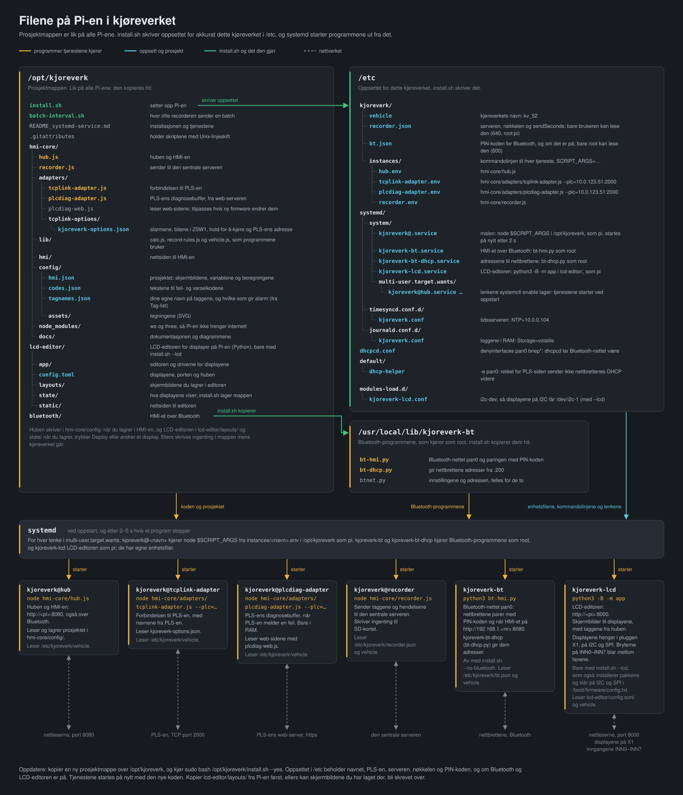

# Kjøreverk-tjenester — installasjon og oppsett med systemd

Dette beskriver hvordan programmene settes opp og holdes i gang på Raspberry Pi-en i et
kjøreverk. De kjører som **systemd-tjenester**, slik at de:

- starter av seg selv ved oppstart (også etter strømbrudd)
- starter på nytt av seg selv hvis de krasjer
- kjører uten internett (systemd er helt lokalt)

**`install.sh` setter opp alt:** kjøreverkets navn, tjenestene, recorderen, klokka, loggene og
HMI-et over Bluetooth. LCD-editoren for displayer på Pi-en setter den opp når du ber om det (`--lcd`).
Kopier prosjektmappen til Pi-en, kjør skriptet, og kjøreverket er i drift. Resten av filen
forklarer hva skriptet gjør, og hvordan det gjøres for hånd.

## Nøkkeltall

| Hva | Verdi |
|---|---|
| Prosjektmappen | `/opt/kjoreverk` (med `install.sh`, `batch-interval.sh`, denne filen, `hmi-core/`, `bluetooth/` og `lcd-editor/`) |
| Tjenestene | `kjoreverk@hub.service`, `kjoreverk@tcplink-adapter.service` (PLS-en), `kjoreverk@plcdiag-adapter.service` (PLS-ens diagnosebuffer, fra web-serveren) og `kjoreverk@recorder.service` (den sentrale serveren) |
| Malenheten | `/etc/systemd/system/kjoreverk@.service` |
| Kjøreverkets navn | `/etc/kjoreverk/vehicle` |
| Kommandolinjen per tjeneste | `/etc/kjoreverk/instances/<navn>.env` |
| Recorderens oppsett | `/etc/kjoreverk/recorder.json` (serveren, nøkkelen og `sendSeconds`) |
| Tidsserveren | `10.0.0.104`, i `/etc/systemd/timesyncd.conf.d/kjoreverk.conf` |
| Loggene | i RAM: `/etc/systemd/journald.conf.d/kjoreverk.conf` |
| Brukeren tjenestene kjører som | den som kjørte `sudo bash install.sh`, vanligvis `pi` |
| HMI-et over Bluetooth | `http://192.168.1.<kjøreverksnummer>:8080` (kv_52: `192.168.1.52`), se [HMI-et over Bluetooth](#hmi-et-over-bluetooth) |
| Bluetooth-tjenestene | `kjoreverk-bt.service` og `kjoreverk-bt-dhcp.service`, programmene i `/usr/local/lib/kjoreverk-bt` |
| PIN-koden for Bluetooth | `/etc/kjoreverk/bt.json`, lesbar bare for root |
| LCD-editoren (bare med `--lcd`) | `kjoreverk-lcd.service`, på `http://<pi-ip>:8000`, se [LCD-editoren og displayene](#lcd-editoren-og-displayene) |



## Installere med skriptet

### Hvor prosjektmappen ligger

Legg den i **`/opt/kjoreverk`** på alle Pi-ene:

- **`/opt`** er stedet for programmer som ikke kommer fra `apt`. Tjenestene hører til maskinen,
  ikke til en bruker, så mappen hører ikke hjemme i en hjemmemappe eller i `Documents`.
- **Den samme stien på alle Pi-ene** gjør at de samme kommandoene og den samme dokumentasjonen
  virker overalt, uansett hva brukeren heter.
- **Bare a–z i stien.** `ø` i en sti (`kjøreverk_telemetry`) gir lett trøbbel i enhetsfiler,
  skript og ved kopiering mellom Windows og Linux.

`install.sh` setter opp tjenestene for mappen den ligger i, så den virker også et annet sted, men
den sier fra når mappen ikke er `/opt/kjoreverk`. Den gir mappen til brukeren tjenestene kjører
som, så huben kan lagre HMI-prosjektet, og så du kan oppdatere filene uten `sudo`.

### En ny Pi

Pi-en trenger Raspberry Pi OS og Node.js 10 eller nyere (se *Installere uten internett* i
`hmi-core/README.md`). Kopier prosjektmappen, også `hmi-core/node_modules`, og kjør skriptet:

```bash
sudo mkdir -p /opt/kjoreverk
sudo cp -r /media/$USER/<minnepennen>/kjoreverk/. /opt/kjoreverk/
sudo bash /opt/kjoreverk/install.sh
```

Eller over nettet, fra en Pi som har mappen i `/opt/kjoreverk` (uten git-historikken):

```bash
tar -C /opt -czf - --exclude=.git kjoreverk | ssh pi@<ny-pi> 'tar -C /tmp -xzf -'
ssh -t pi@<ny-pi> 'sudo mkdir -p /opt/kjoreverk && sudo cp -r /tmp/kjoreverk/. /opt/kjoreverk/ && rm -rf /tmp/kjoreverk && sudo bash /opt/kjoreverk/install.sh'
```

Skriptet spør etter det som er forskjellig fra kjøreverk til kjøreverk, viser en oversikt, og
spør om det skal fortsette:

```
The vehicle's name, e.g. kv_52: kv_53
The PLC (address:port) [10.0.123.51:2000]:
The central server for the recorder, e.g. http://dbserver:8090 (empty: no recorder for now): http://dbserver:8090
This vehicle's key from the central server (empty: add it later): ...
```

- **Kjøreverkets navn** (`kv_53`) blir kilden i alarmlisten og hendelsesloggen, og kjøreverkets
  id på serveren. Se *Kjøreverkets navn* i `hmi-core/README.md`.
- **PLS-en:** Enter tar adressen i `kjoreverk-options.json`.
- **Serveren og nøkkelen:** står serveren tom, settes recorderen ikke opp nå. Nøkkelen lager du
  for kjøreverket på serveren.

Til slutt sjekker skriptet at tjenestene kjører, at huben svarer, og om klokka er synkronisert,
og skriver ut adressen til HMI-en:

```
== Done: kv_53 is running
  HMI          http://10.0.0.53:8080
  Bluetooth    pair with "kv_53 HMI", PIN 12345678, turn on Internet access, then http://192.168.1.53:8080
```

Første gang Bluetooth settes opp, startes dhcpcd på nytt 5 sekunder etter at skriptet er
ferdig, så wifi er borte noen sekunder (se [HMI-et over Bluetooth](#hmi-et-over-bluetooth)).

**Bruk `sudo bash install.sh`**, ikke `sudo ./install.sh`: en minnepenn tar bort kjørebiten.

**Uten spørsmål**, for eksempel fra et annet skript:

```bash
sudo bash /opt/kjoreverk/install.sh --vehicle kv_53 --plc 10.0.123.51:2000 \
     --server http://dbserver:8090 --token <nøkkelen> --yes
```

### Valgene

| Valg | Hva |
|---|---|
| `--vehicle kv_53` | Kjøreverkets navn: en bokstav først, så bokstaver, sifre, `_`, `.` og `-`, høyst 32 tegn |
| `--plc 10.0.123.51:2000` | PLS-ens adresse og port. Standard: den som står fra før, ellers `"connect"` i `kjoreverk-options.json`. Diagnosebufferen hentes fra web-serveren på samme adresse (`https://10.0.123.51`) |
| `--server http://dbserver:8090` | Den sentrale serveren. Med den settes recorderen opp |
| `--token <nøkkelen>` | Kjøreverkets nøkkel, laget på serveren |
| `--no-recorder` | Ingen recorder. Kjører den, stoppes den; `recorder.json` blir liggende |
| `--user pi` | Brukeren tjenestene kjører som. Standard: den som står fra før, ellers den som kjører `sudo` |
| `--ntp 10.0.0.104` | Tidsserveren |
| `--disk-logs` | La loggene ligge på SD-kortet, slik systemet er satt opp (se [Loggene](#loggene)) |
| `--no-bluetooth` | Ikke HMI-et over Bluetooth. Kjører det, stoppes det, og det er av også neste gang skriptet kjøres |
| `--bluetooth` | Bluetooth på igjen etter `--no-bluetooth`. Uten noen av dem er det på |
| `--bt-pin 12345678` | PIN-koden et nettbrett taster én gang for å pare, 4–16 sifre. Standard: den som står fra før, ellers en ny tilfeldig på 8 sifre |
| `--lcd` | LCD-editoren og displayene på Pi-en (`lcd-editor/`), med pakkene den trenger fra apt, og I2C og SPI på (etter en omstart). Den er på også neste gang skriptet kjøres. Uten valget er den av, med mindre den er slått på fra før |
| `--no-lcd` | Ingen LCD-editor. Kjører den, stoppes den |
| `--yes` | Ikke spør: bruk valgene og det som står fra før. Mangler navnet, avbryter skriptet |

### Hva skriptet gjør

| Hva | Hvor |
|---|---|
| Kjøreverkets navn | `/etc/kjoreverk/vehicle` |
| Kommandolinjen for huben, adapterne og recorderen | `/etc/kjoreverk/instances/hub.env`, `tcplink-adapter.env` og `plcdiag-adapter.env` (begge med `--plc=`), og `recorder.env` |
| Malenheten, med prosjektmappen, brukeren og stien til `node` | `/etc/systemd/system/kjoreverk@.service` |
| Serveren og nøkkelen, lesbar bare for brukeren (`640`, `root:pi`) | `/etc/kjoreverk/recorder.json` |
| Tidsserveren (eller en linje i chrony, hvis Pi-en bruker chrony) | `/etc/systemd/timesyncd.conf.d/kjoreverk.conf` |
| Loggene i RAM | `/etc/systemd/journald.conf.d/kjoreverk.conf` |
| Prosjektmappen gis til brukeren | `chown -R pi: /opt/kjoreverk` |
| Bluetooth: programmene fra `bluetooth/`, som kjører som root, og PIN-koden (`600`, `root`) | `/usr/local/lib/kjoreverk-bt/`, `/etc/kjoreverk/bt.json` |
| Bluetooth: tjenestene | `/etc/systemd/system/kjoreverk-bt.service` og `kjoreverk-bt-dhcp.service` |
| Bluetooth: dhcpcd lar `pan0` og `bnep*` være, og dhcp-helper sender ikke nettbrettenes DHCP videre | `denyinterfaces` i `/etc/dhcpcd.conf`, `-e pan0` i `/etc/default/dhcp-helper` |
| LCD-editoren (med `--lcd`): tjenesten, som kjører `lcd-editor/` med Python | `/etc/systemd/system/kjoreverk-lcd.service` |
| LCD-editoren (med `--lcd`): pakkene som mangler | `apt-get install python3-flask python3-pil python3-psutil python3-smbus2 python3-lgpio python3-spidev python3-numpy i2c-tools` |
| LCD-editoren (med `--lcd`): I2C og SPI, og `i2c-dev` | `dtparam=i2c_arm=on` og `dtoverlay=spi0-1cs,no_miso` nederst i `/boot/firmware/config.txt`, og `/etc/modules-load.d/kjoreverk-lcd.conf` |

Så slår den på og starter (eller starter på nytt) tjenestene. En tjeneste fra før med et program
som ikke lenger finnes i prosjektet, som `kjoreverk@binary-adapter.service`, stoppes og slås av.

- **Den skriver bare filer som er endret**, og sier for hver fil om den er skrevet eller
  uendret.
- **Filene den skriver, er dens egne.** Den skriver dem på nytt hver gang, så et valg du legger
  til for hånd i en `.env`-fil (`--dump`), er borte neste gang skriptet kjøres.
- **Andre tjenester** du har lagt til selv (se [Legge til et nytt program](#legge-til-et-nytt-program)),
  rører den ikke.

### Kjøre det på nytt og oppdatere

Skriptet kan kjøres så ofte du vil, og det er slik en oppdatering tas i bruk. Det som står fra
før (navnet, PLS-en, serveren, nøkkelen, brukeren, PIN-koden, og om Bluetooth og LCD-editoren er på), blir
standard, og tjenestene startes på nytt med den nye koden. At det er kjørt før, gjør ingenting:
filer som ikke er endret, lar det være.

- **Oppdatere programmet:** kopier de nye filene over de gamle, som for en ny Pi, og kjør
  `sudo bash /opt/kjoreverk/install.sh --yes`. Kopieringen sletter ikke filer som er fjernet fra
  prosjektet; de blir liggende uten å gjøre noe.
- **Når tjenestene startes på nytt,** begynner huben med tomt minne: trendene, hendelsesloggen
  og kvitteringene. Det PLS-en har logget, kommer tilbake. Recorderen sender det som venter, i
  høyst 5 sekunder før den stopper; oppdater når serveren er tilgjengelig, ellers er det som lå
  i køen, borte.
- **HMI-sidene som står åpne**, kjører den gamle koden til de lastes inn på nytt (F5).
- **En ny tjeneste i oppdateringen,** som `kjoreverk@plcdiag-adapter` (PLS-ens diagnosebuffer),
  settes opp og startes av skriptet, med samme PLS-adresse som de andre.
- **Endre én ting:** for eksempel `sudo bash /opt/kjoreverk/install.sh --token <ny nøkkel>`.
- **Endre HMI-prosjektet på alle Pi-ene:** `hmi-core/config/` kopieres med resten. Har noen
  lagret endringer i HMI-en på én Pi, kopier `hmi-core/config/` derfra først, ellers blir de
  skrevet over.

### Flytte prosjektet fra en annen mappe

En Pi som ble satt opp for hånd, for eksempel med prosjektet i `~/Documents/kjøreverk_telemetry`:

```bash
sudo systemctl stop 'kjoreverk@*'
sudo mv ~/Documents/kjøreverk_telemetry /opt/kjoreverk
sudo bash /opt/kjoreverk/install.sh
```

- **Tjenestene** skrives på nytt for `/opt/kjoreverk`.
- **PLS-ens adresse** tas fra `tcplink-adapter.env`, eller fra `binary-adapter.env` hvis bare
  den finnes.
- **`/etc/hmi-recorder.json`** flyttes til `/etc/kjoreverk/recorder.json`.
- **`kjoreverk@binary-adapter.service`** stoppes og slås av: `binary-adapter.js` er ikke lenger
  i prosjektet.
- **Git-historikken** følger med mappen, så du jobber med git i `/opt/kjoreverk` etterpå.

## Slik virker det

- `kjoreverk@.service` er en **mal**: `@` betyr at den kan startes flere ganger under
  forskjellige instansnavn (`%i`).
- Hvert instansnavn (`hub`, `tcplink-adapter`, `plcdiag-adapter`, `recorder`) hører til en fil
  `/etc/kjoreverk/instances/<navn>.env` med én linje: `SCRIPT_ARGS=...` — nøyaktig det du
  ellers ville skrevet etter `node`. Først skriptet, så argumentene til det, med mellomrom
  mellom: `SCRIPT_ARGS=hmi-core/adapters/tcplink-adapter.js --plc=10.0.123.51:2000 --dump` er
  det samme som `node hmi-core/adapters/tcplink-adapter.js --plc=10.0.123.51:2000 --dump`.
- Stiene i `SCRIPT_ARGS` er relative til arbeidsmappen (`WorkingDirectory`), så
  `hmi-core/hub.js` betyr `/opt/kjoreverk/hmi-core/hub.js`.
- Linjen `ExecStart=/usr/bin/node $SCRIPT_ARGS` i malen lar systemd dele strengen opp i
  separate argumenter, akkurat som en `$VAR` uten anførselstegn i bash.
- Hver instans følges, logges og startes på nytt **hver for seg** — å drepe eller starte én
  på nytt påvirker ikke de andre.

## Oppsettet for hånd

Dette er det `install.sh` gjør. Bruk det for å forstå oppsettet, eller hvis skriptet ikke kan
brukes.

### 1. Kjøreverkets navn og instansene

```bash
sudo mkdir -p /etc/kjoreverk/instances

echo kv_52 | sudo tee /etc/kjoreverk/vehicle

echo 'SCRIPT_ARGS=hmi-core/hub.js' | sudo tee /etc/kjoreverk/instances/hub.env

echo 'SCRIPT_ARGS=hmi-core/adapters/tcplink-adapter.js --plc=10.0.123.51:2000' | sudo tee /etc/kjoreverk/instances/tcplink-adapter.env

echo 'SCRIPT_ARGS=hmi-core/adapters/plcdiag-adapter.js --plc=10.0.123.51:2000' | sudo tee /etc/kjoreverk/instances/plcdiag-adapter.env
```

- **Kjøreverkets navn** (`kv_52`) er det eneste som er forskjellig fra kjøreverk til kjøreverk,
  sammen med recorderens nøkkel. Taggene heter `pls.*` i alle kjøreverkene.
- `tcplink-adapter.js` trenger ingen layoutfil: navnene og størrelsene kommer fra PLS-en. Resten
  (tagprefikset, alarmene og hold-for-å-kjøre) står i
  `hmi-core/adapters/tcplink-options/kjoreverk-options.json`, som den finner av seg selv.
  `--plc=` overstyrer adressen der.
- `plcdiag-adapter.js` henter PLS-ens diagnosebuffer fra web-serveren på samme adresse
  (`https://10.0.123.51`; porten for TcpLink tas bort) når PLS-en melder en feil, og bare i
  RAM. Se *PLS-diagnose* i `hmi-core/README.md`.

### 2. Malenheten

`/etc/systemd/system/kjoreverk@.service`:

```ini
[Unit]
Description=Kjoreverk service: %i
After=network.target
StartLimitIntervalSec=0

[Service]
Type=simple
EnvironmentFile=/etc/kjoreverk/instances/%i.env
ExecStart=/usr/bin/node $SCRIPT_ARGS
WorkingDirectory=/opt/kjoreverk
User=pi
Restart=always
RestartSec=2

[Install]
WantedBy=multi-user.target
```

- **`ExecStart`** må ha den fulle stien til `node` (`which node`): `/usr/local/bin/node` hvis
  Node er installert som i `hmi-core/README.md`, ellers `/usr/bin/node`.
- **`User=`** er kontoen programmene kjører som. Den må kunne lese prosjektmappen, skrive i
  `hmi-core/config/` (huben lagrer prosjektet der) og nå PLS-en på nettverket:
  `sudo chown -R pi: /opt/kjoreverk`.
- **`StartLimitIntervalSec=0`** gjør at systemd aldri gir opp å starte en tjeneste som krasjer
  mange ganger på rad, for eksempel mens nettverket ikke er oppe ennå.

### 3. Slå på og start tjenestene

```bash
sudo systemctl daemon-reload
sudo systemctl enable --now kjoreverk@hub.service kjoreverk@tcplink-adapter.service kjoreverk@plcdiag-adapter.service
```

`enable` lager lenken som starter tjenesten ved oppstart (uten den starter tjenestene **ikke**
etter en omstart, selv om `start` får dem til å kjøre akkurat nå). `--now` gjør begge deler i
én kommando.

### 4. Kontroller

```bash
systemctl status kjoreverk@hub.service kjoreverk@tcplink-adapter.service kjoreverk@plcdiag-adapter.service
```

Alle skal vise `Active: active (running)` og `Loaded: ... enabled`.

## Recorderen (til den sentrale serveren)

`recorder.js` sender taggene og hendelsene til den sentrale serveren. Hva den gjør, står i
avsnittet om recorderen i `hmi-core/README.md`. `install.sh` setter den opp når den får
serverens adresse (`--server`). For hånd:

### 1. Oppsettet

Serverens adresse og nøkkelen, som du lager på serveren. Kjøreverkets navn tar recorderen fra
`/etc/kjoreverk/vehicle`:

```bash
sudo nano /etc/kjoreverk/recorder.json
```

```json
{ "server": "http://dbserver:8090", "token": "nøkkelen fra serveren" }
```

Nøkkelen skal bare kunne leses av brukeren tjenesten kjører som:

```bash
sudo chown root:pi /etc/kjoreverk/recorder.json
sudo chmod 640 /etc/kjoreverk/recorder.json
```

`hmi-core/config/recorder.example.json` viser alle innstillingene. Hvor ofte en batch sendes
(`sendSeconds`, standard 10 s), setter du med `sudo bash /opt/kjoreverk/batch-interval.sh 60`;
recorderen tar det med en gang, uten omstart, og `install.sh` lar det stå. Andre endringer i filen
gjelder etter `sudo systemctl restart kjoreverk@recorder`. En Pi som ble satt opp før
`install.sh`, kan ha filen i `/etc/hmi-recorder.json`; recorderen leser den hvis
`/etc/kjoreverk/recorder.json` ikke finnes.

### 2. Klokka mot tidsserveren

Recorderen sender ingenting før klokka er synkronisert. Tidsserveren på nettet er `10.0.0.104`,
den samme som den sentrale serveren bruker. Med `systemd-timesyncd`, som følger med Raspberry Pi OS:

```bash
sudo mkdir -p /etc/systemd/timesyncd.conf.d
printf '[Time]\nNTP=10.0.0.104\n' | sudo tee /etc/systemd/timesyncd.conf.d/kjoreverk.conf
sudo timedatectl set-ntp true
sudo systemctl restart systemd-timesyncd
timedatectl                                # System clock synchronized: yes
```

Bruker Pi-en `chrony` i stedet, skriv `server 10.0.0.104 iburst` i `/etc/chrony/chrony.conf`
(det gjør `install.sh` også).

### 3. Slå på og start

```bash
echo 'SCRIPT_ARGS=hmi-core/recorder.js' | sudo tee /etc/kjoreverk/instances/recorder.env
sudo systemctl enable --now kjoreverk@recorder.service
journalctl -u kjoreverk@recorder.service -n 50 --no-pager
```

Loggen skal si `the central server answers` og `Recording rules version …`.

- **Stopper du tjenesten,** sender recorderen det som venter, i høyst 5 sekunder.
- **Den skriver ingenting til SD-kortet.**
- **Den kan startes før eller etter huben:** den kobler seg til når huben er oppe.

## Loggene

`install.sh` legger loggene til journald i RAM (`Storage=volatile`), så de ikke skrives til
SD-kortet mens kjøreverket går. Det følger planen om at ingenting skal skrives til kortet i drift
(`hmi-core/docs/PLAN.md` §3.1).

- **Loggene leses som før**, med `journalctl`, men de er **borte etter en omstart eller et
  strømbrudd**.
- **Trenger du loggene fra før en omstart**, for eksempel for å finne ut hvorfor noe feiler ved
  oppstart: kjør `sudo bash /opt/kjoreverk/install.sh --disk-logs --yes`, gjenta feilen, les
  loggene, og kjør skriptet uten `--disk-logs` igjen. Loggene havner da på kortet bare hvis
  `/var/log/journal` finnes (`sudo mkdir -p /var/log/journal`).
- **For hånd:** `/etc/systemd/journald.conf.d/kjoreverk.conf` med `[Journal]` og
  `Storage=volatile`, og så `sudo systemctl restart systemd-journald`.

## HMI-et over Bluetooth

I tunnelen er det mange steder uten wifi-dekning. Der når et nettbrett HMI-et over Bluetooth i
stedet: Pi-en er et lite Bluetooth-nett (PAN) i tillegg til wifi, og HMI-et er det samme som over
wifi. `install.sh` setter det opp, med mindre `--no-bluetooth` er gitt.

**Koble til fra et Android-nettbrett:**

1. *Innstillinger → Bluetooth*, søk og velg **«kv_52 HMI»** (kjøreverkets navn og `HMI`).
2. Tast **PIN-koden** når nettbrettet ber om den. Det er bare første gang.
3. Trykk på tannhjulet ved «kv_52 HMI» og slå på **Internettilgang**.
4. Slå av wifi på nettbrettet, ellers kan Android sende HMI-trafikken ut på wifi.
5. Åpne **`http://192.168.1.52:8080`** i nettleseren. Android sier at nettet ikke har internett; det
   stemmer, nettet går bare til Pi-en.

- **Adressen** er `192.168.1.<kjøreverksnummer>`: tallet på slutten av navnet (`kv_52` → `.52`),
  som må være 1–199. Nettbrettene får adresser fra `.200` og oppover. `"address"` i `bt.json`
  overstyrer adressen.
- **PIN-koden** lager `install.sh` første gang, tilfeldig og 8 sifre, og skriver den ut til slutt.
  Den ligger i `/etc/kjoreverk/bt.json` (`sudo cat /etc/kjoreverk/bt.json`) og blir stående når
  skriptet kjøres på nytt. En ny kode: `--bt-pin`. Nettbrett som er paret fra før, trenger ikke
  pare på nytt.
- **Bare med PIN-koden.** HMI-et har ingen innlogging, så den som kan pare, kan styre. Paring med
  fast kode krever den eldre PIN-paringen, så programmet slår av SSP («Just Works», der en enhet
  uten skjerm kan pare uten kode). Det sjekkes hvert 30. sekund; kan SSP ikke slås av, slås
  Bluetooth av heller enn å stå åpent.
- **Nettbrettet når bare Pi-en:** det som kommer inn på Bluetooth-nettet (`pan0`), sendes ikke
  videre til PLS-en eller tunnelnettet.
- **Rekkevidden** er omtrent 10 meter med Pi-ens egen antenne, mindre gjennom et stålskap.
- **Wifi og Bluetooth deler brikke og antenne** på 2,4 GHz. HMI-et sender lite, men følg med på
  om wifi-forbindelsen blir dårligere når et nettbrett er koblet til.
- **iPad virker ikke:** den kan bare bruke Bluetooth-nett fra en iPhone.
- **dhcpcd og dhcp-helper:** `install.sh` legger `pan0` og `bnep*` i `denyinterfaces` i
  `/etc/dhcpcd.conf`, så dhcpcd ikke tar Bluetooth-nettet som sitt, og `-e pan0` i
  `/etc/default/dhcp-helper`, så reléet for PLS-siden ikke sender nettbrettenes DHCP ut i
  tunnelnettet. Første gang startes dhcpcd på nytt 5 sekunder etter at skriptet er ferdig, og
  wifi er borte noen sekunder. Forbindelsen til PLS-en (eth0) rører det ikke.
- **DHCP til nettbrettene** gir `bt-dhcp.py`, et lite eget program som leser og sender rett på
  `pan0`: dhcp-helper har allerede UDP-port 67, så en vanlig DHCP-server får den ikke.

**Fjerne et nettbrett** (for eksempel et som er mistet): `bluetoothctl paired-devices` viser dem,
`sudo bluetoothctl remove <adressen>` fjerner det. Bytt også PIN-koden med `--bt-pin`.

**Feilsøking:** `journalctl -u kjoreverk-bt -u kjoreverk-bt-dhcp -f` viser paringen
(«pairing request from …»), tilkoblingene og adressene nettbrettene får («gave 192.168.1.200 to …»).

## LCD-editoren og displayene

For å eksperimentere med displayer på Pi-en: OLED-er (SSD1306) og tegn-LCD-er (1602/2004) på I2C, og
farge-TFT-er (ST7789) på SPI. Editoren i nettleseren lager skjermbildene, med taggene fra huben som
datakilder (de samme navnene som i HMI-et), og *Deploy* viser dem på displayet. Alt om editoren,
koblingen og pakkene den trenger, står i `lcd-editor/README.md`.

```bash
sudo bash /opt/kjoreverk/install.sh --lcd       # på, også etter omstart og neste gang skriptet kjøres
sudo bash /opt/kjoreverk/install.sh --no-lcd    # av
```

- **Editoren** er på `http://<pi-ip>:8000`, også over Bluetooth (`http://192.168.1.52:8000` for kv_52).
- **Den er Python**, ikke Node, og trenger Raspberry Pi OS Bookworm eller nyere. `--lcd` installerer
  pakkene som mangler, med apt (flask og PIL til editoren, og pakkene til displayene og inngangene),
  så Pi-en trenger internett første gang. Får apt ikke installert dem, sier skriptet hvilke det
  gjelder. Uten flask og PIL setter det ikke opp editoren, men resten av oppsettet går som før.
- **Den leser bare** fra huben, som recorderen, og når huben er borte, viser displayene `--`.
- **Tjenesten** `kjoreverk-lcd.service` kjører `python3 -B -m app` i `lcd-editor/` som samme bruker
  som de andre, med gruppene `i2c`, `spi` og `gpio` (de som finnes). Displayene og porten står i
  `lcd-editor/config.toml`; etter en endring der: `sudo systemctl restart kjoreverk-lcd`.
- **Koble displayene til pluggen X1** på RaspiPower-kortet: den har strøm, I2C og SPI. De andre
  GPIO-ene går til kortets innganger og 24 V-utganger. Koblingen står i `lcd-editor/README.md`.
- **I2C og SPI** slår `--lcd` på i `/boot/firmware/config.txt`, med `dtparam=i2c_arm=on` og
  `dtoverlay=spi0-1cs,no_miso`. Den siste gjør CE1 og MISO til vanlige GPIO-er, som TFT-en bruker.
  Linjene legges nederst, bare når de ikke står der fra før. De virker etter neste omstart, og
  skriptet sier fra til slutt når det trengs: `sudo reboot`. `--no-lcd` lar dem stå.
- **En layout kan ha flere faner,** og bryterne på kortets innganger INN0–INN7 (24 V, på SV2) blar
  mellom dem. Hva hver inngang gjør, velger du i editoren. Editoren leser inngangene med
  `python3-lgpio`, og fanen som vises, lagres ikke.
- **Layoutene** du lagrer, ligger i `lcd-editor/layouts/` og kopieres med resten av prosjektet. Kopier
  dem fra Pi-en før du oppdaterer, ellers blir de som heter det samme, skrevet over. Hva displayene
  viser (`lcd-editor/state/`), følger ikke med prosjektet og blir stående.

## Legge til et nytt program

Ingen ny enhetsfil trengs — bare to kommandoer:

```bash
# 1. Lag konfigurasjonsfilen
echo 'SCRIPT_ARGS=path/to/new-script.js --some-flag=value' | sudo tee /etc/kjoreverk/instances/<navn>.env

# 2. Slå på og start den
sudo systemctl enable --now kjoreverk@<navn>.service
```

Bytt ut `<navn>` med en kort betegnelse (bare bokstaver, sifre og bindestrek, ingen
skråstrek). Den blir både filnavnet og delen etter `@` i tjenestenavnet. `install.sh` lar den
være, så lenge programmet finnes i prosjektet.

Trenger et senere program en **annen** arbeidsmappe eller bruker enn malen gir, ikke lag en
helt ny enhet — overstyr bare den instansen:

```bash
sudo systemctl edit kjoreverk@<navn>.service
```

Dette åpner en tilleggsfil (drop-in) der du bare skriver linjene som er annerledes; alt annet
kommer fortsatt fra malen. `install.sh` rører ikke tilleggsfilene.

## Sjekke at alt virker

**Sjekk at tjenestene er slått på (overlever omstart) og kjører:**
```bash
systemctl is-enabled kjoreverk@hub.service kjoreverk@tcplink-adapter.service kjoreverk@plcdiag-adapter.service kjoreverk@recorder.service
systemctl status 'kjoreverk@*'
```

**Bekreft at riktig Node-program faktisk kjører:**
```bash
systemctl status kjoreverk@hub.service   # merk deg Main PID
ls -l /proc/<PID>/exe                    # skal peke til den node install.sh fant
```

**Se loggene:**
```bash
journalctl -u kjoreverk@hub.service -n 50 --no-pager
journalctl -u kjoreverk@tcplink-adapter.service -n 50 --no-pager
journalctl -u kjoreverk@plcdiag-adapter.service -n 50 --no-pager

# følg loggene til alle tjenestene live mens du tester:
journalctl -u 'kjoreverk@*' -f
```

**Test at den kommer seg etter et krasj** (simulerer et hardt krasj):
```bash
sudo systemctl kill -s SIGKILL kjoreverk@hub.service
systemctl status kjoreverk@hub.service   # skal kjøre igjen innen ~2 s, med ny PID
```

**Test at alt overlever en full omstart** (det virkelige tilfellet dette er laget for):
```bash
sudo reboot
# når den er oppe igjen:
systemctl status 'kjoreverk@*'
```
Alle skal være `active (running)` uten at du har kjørt noen kommandoer for hånd.

## Merknader og fallgruver

- **systemd bryr seg ikke om `PATH`, `.bashrc` eller `.profile` fra skallet ditt.** Hver sti i
  en enhetsfil (`node`, programmene, arbeidsmappen) må være absolutt og skrevet ut. Installerer
  du Node på nytt et annet sted, kjør `install.sh` igjen, så får malen den nye stien.
- **`$'\r': command not found`** når `install.sh` kjøres: filen har fått Windows-linjeskift.
  Kjør `sed -i 's/\r$//' /opt/kjoreverk/install.sh`. Git holder `*.sh` med Unix-linjeskift
  (`.gitattributes`).
- **Flytter du prosjektmappen**, peker tjenestene fortsatt på den gamle. Kjør `install.sh` fra
  den nye.
- **Trenger et program litt tid etter oppstart før maskinvaren (seriell/I2C/USB/nettverk) er
  klar**, legg til `ExecStartPre=/bin/sleep 5` med `sudo systemctl edit kjoreverk@<navn>.service`
  for den instansen som trenger ventetiden.
- **Databaseservere** (PostgreSQL, MariaDB o.l.) bør ikke startes slik: de har sin egen
  tjeneste fra pakken sin.
- **Etter en endring for hånd i malenheten eller en `.env`-fil**, kjør:
  ```bash
  sudo systemctl daemon-reload
  sudo systemctl restart kjoreverk@<navn>.service
  ```
  `daemon-reload` alene starter ikke tjenester som kjører, på nytt — den gjør bare systemd
  oppmerksom på endringen. `install.sh` gjør begge deler.

## Nyttige kommandoer

| Oppgave | Kommando |
|---|---|
| Sett opp eller oppdater Pi-en | `sudo bash /opt/kjoreverk/install.sh` |
| Hvor ofte recorderen sender en batch | `bash /opt/kjoreverk/batch-interval.sh` (vis), `sudo bash /opt/kjoreverk/batch-interval.sh 60` (sett) |
| Start alle tjenestene på nytt | `sudo systemctl restart 'kjoreverk@*'` |
| Start en tjeneste nå | `sudo systemctl start kjoreverk@<navn>.service` |
| Stopp en tjeneste | `sudo systemctl stop kjoreverk@<navn>.service` |
| Start en tjeneste på nytt | `sudo systemctl restart kjoreverk@<navn>.service` |
| Start ved oppstart | `sudo systemctl enable kjoreverk@<navn>.service` |
| Ikke start ved oppstart | `sudo systemctl disable kjoreverk@<navn>.service` |
| Se status | `systemctl status kjoreverk@<navn>.service` |
| Se de siste loggene | `journalctl -u kjoreverk@<navn>.service -n 50 --no-pager` |
| Følg loggene live | `journalctl -u 'kjoreverk@*' -f` |
| Last inn på nytt etter endringer i enheter | `sudo systemctl daemon-reload` |
| Vis PIN-koden for Bluetooth | `sudo cat /etc/kjoreverk/bt.json` |
| Nettbrettene som er paret | `bluetoothctl paired-devices` |
| Fjern et nettbrett | `sudo bluetoothctl remove <adressen>` |
| Loggene for Bluetooth | `journalctl -u kjoreverk-bt -u kjoreverk-bt-dhcp -f` |
| Slå av HMI-et over Bluetooth | `sudo bash /opt/kjoreverk/install.sh --no-bluetooth --yes` |
| Slå på LCD-editoren / slå den av | `sudo bash /opt/kjoreverk/install.sh --lcd --yes` / `--no-lcd --yes` |
| Loggen for LCD-editoren | `journalctl -u kjoreverk-lcd -f` |
