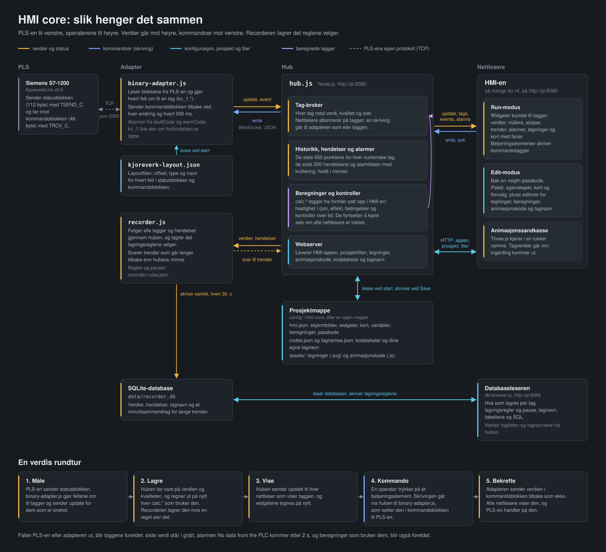
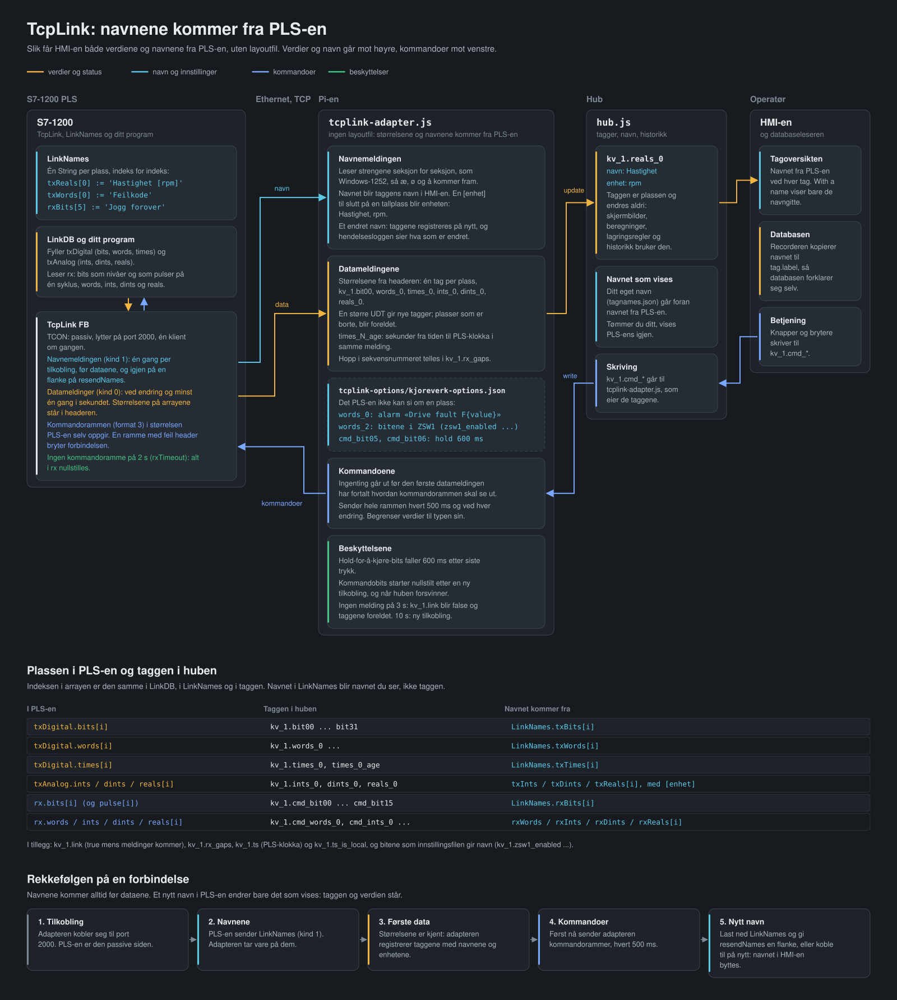
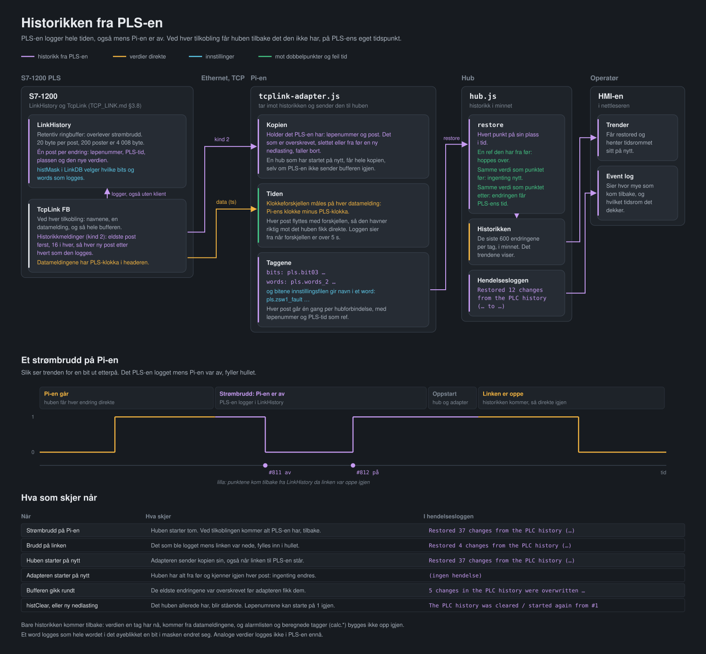

# HMI core

Et HMI i nettleseren for kjøreverket: en S7-1200-PLS som snakker med en Raspberry Pi over
Open User Communication (TCP). Du lager skjermbildene i nettleseren og knytter widgeter til
PLS-ens tagger.

```
 HMI-er i        <--WebSocket-->  hub.js  <--WebSocket-->  tcplink-adapter.js  <--TCP-->  S7-1200
 nettleseren                      tagger, historikk,       + kjoreverk-         port 2000  TcpLink
 (mappen hmi/)                    beregninger, alarmer,      options.json                  + LinkNames
                                  prosjektlagring
```

Huben har en liste over **tagger** (verdier med et fast navn, som `pls.reals_0`).
`tcplink-adapter.js` tar imot meldingene fra TcpLink-blokken i PLS-en, gjør hver plass om til
en tag med navnet og enheten PLS-en gir den (`Hastighet [rpm]`), og sender kommandoer fra
HMI-en tilbake til PLS-en. Alle nettlesere som åpner HMI-en, ser de samme taggene, live.



---

## Innhold

1. [Kom i gang](#1-kom-i-gang)
2. [Kjernefiler og prosjektfiler](#2-kjernefiler-og-prosjektfiler) — hva du skal la være, og hva som er ditt
3. [Å jobbe med flere prosjekter](#3-å-jobbe-med-flere-prosjekter)
4. [Begreper](#4-begreper): tagger, adaptere, variabler og [dine egne navn på tagger](#tagnavn-dine-egne-navn-på-tagger)
5. [Lage skjermbilder](#5-lage-skjermbilder)
6. [Widgeter](#6-widgeter)
7. [Beregnede verdier](#7-beregnede-verdier)
8. [Lagring til database](#8-lagring-til-database): hva huben holder i minnet, og [recorderen](#recorderen-til-den-sentrale-serveren) som sender til den sentrale serveren
9. [Tegninger (SVG)](#9-tegninger-svg) — hva en tegning trenger, og [å spole tilbake i tid](#spole-tilbake-i-tid)
10. [Animasjoner (Three.js)](#10-animasjoner-threejs) — hva en kodesnutt trenger
11. [Forbindelsen til PLS-en](#11-forbindelsen-til-pls-en) — [kjøreverkets navn](#kjøreverkets-navn), [tcplink-adapter.js med navnene fra PLS-en](#tcplink-navnene-kommer-fra-pls-en) og [historikken fra PLS-en](#historikken-fra-pls-en)
12. [Referanse](#12-referanse) — protokoll, HTTP-API, prosjektfil, kommandolinje
13. [Sikkerhet](#13-sikkerhet)
14. [Feilsøking](#14-feilsøking)
15. [Endre kjernen](#15-endre-kjernen)

---

## 1. Kom i gang

Du trenger [Node.js](https://nodejs.org) 10 eller nyere. For en Raspberry Pi uten internett, se
[Installere uten internett](#installere-uten-internett-raspberry-pi).

Start hver del i sin egen terminal, fra mappen `hmi-core`:

```bash
npm install                      # én gang: ws (WebSocket) og three (for Animation-widgeter)
node hub.js                      # huben og HMI-en: http://localhost:8080
node adapters/tcplink-adapter.js # forbindelsen til PLS-en (TcpLink)
```

- **PLS-en** trenger TcpLink-blokken og navne-DB-en `LinkNames`; se `TCP_LINK.md` i
  PLS-prosjektet. Navnene og størrelsene kommer fra PLS-en ved hver tilkobling, så det trengs
  ingen layoutfil. Se [TcpLink: navnene kommer fra PLS-en](#tcplink-navnene-kommer-fra-pls-en).
- **PLS-ens adresse** står i `"connect"` i `adapters/tcplink-options/kjoreverk-options.json`
  (`10.0.123.51:2000`). Er den en annen, endre den der, eller start adapteren med
  `--plc=<ip>:2000`. Startes adapteren uten argumenter, bruker den den filen.
- **At forbindelsen er oppe**, ser du på taggen `pls.link` (true) og i adapterens logg.
  Blir den ikke det, se [Feilsøking](#14-feilsøking) og diagnosen i `TCP_LINK.md` (§7 og
  §10): `rxBadReason`, `namesStatus` og de låste feilkodene i instans-DB-en til TcpLink.
- **PLS-en tar imot én klient** per TcpLink-instans. Stopp andre klienter på samme port
  først, også `tcplink_web.js` fra PLS-prosjektet.
- **På Pi-en i kjøreverket** setter `sudo bash /opt/kjoreverk/install.sh` opp alt: kjøreverkets
  navn, tjenestene som starter ved oppstart og etter strømbrudd, recorderen og klokka. Se
  `README_systemd-service.md` i mappen over `hmi-core`.

Åpne <http://localhost:8080>, eller `http://<pi-ip>:8080` fra en annen maskin på nettverket.
Bytt mellom **Edit** og **Run** øverst til høyre.

**Prosjektet huben starter med** er `config/hmi.json`: skjermbildene dine, variablene, og
beregningene for PLS-en (hastighet i rpm, moment, effekt og kontrollene i
[7](#betingelser-og-kontroller-over-tid)). De leser TcpLink-taggene: `calc.kv_speed_rpm` er
`pls.reals_0` (rpm) og `calc.moment_Nm` er `pls.ints_2 / 1000` (Nm). De andre
beregningene bruker disse to, så flytter PLS-en hastigheten eller momentet til en annen plass,
endrer du bare de to formlene. Før du legger en knapp på en kommandobit
(`pls.cmd_bit03`), sjekk hva biten gjør i PLS-programmet, og gi en jog-bit `"hold"` i
innstillingsfilen (se [13](#hold-for-å-kjøre-over-et-nettverk)).

### Installere uten internett (Raspberry Pi)

`npm install` trenger internett, men den trenger ikke kjøres på Pi-en. Begge avhengighetene
(`ws` og three.js) er ren JavaScript, så en mappe som er installert på Windows, virker uendret
på en Pi:

1. **På en datamaskin med internett** kjører du `npm install` i `hmi-core`. Kopier hele
   prosjektmappen (den med `install.sh` og `hmi-core/`), også `hmi-core/node_modules`, til en
   minnepenn. `node_modules` følger med i git, så `npm install` trengs bare når
   avhengighetene er endret.
2. **På Pi-en** kopierer du den fra minnepennen til `/opt/kjoreverk` (den samme stien på alle
   Pi-ene) og kjører installasjonsskriptet:

   ```bash
   sudo mkdir -p /opt/kjoreverk
   sudo cp -r /media/$USER/<stick>/<prosjektmappen>/. /opt/kjoreverk/
   sudo bash /opt/kjoreverk/install.sh
   ```

**"SyntaxError: Unexpected token" ved oppstart betyr at Node.js på Pi-en er eldre enn koden
forventer.** Sjekk den med `node -v`. Gamle utgaver av Raspberry Pi OS har gamle
Node-versjoner: 10 i Buster, 12 i Bullseye. HMI core kjører på Node 10 og nyere, men de to
versjonene sluttet å få rettelser for flere år siden, så en Pi som skal gå i årevis, fortjener
en ny versjon.

**Slik installerer du en ny Node.js uten internett:**

1. **Finn ut hvilket bygg Pi-en trenger.** Kjør `dpkg --print-architecture` på Pi-en:

   | Den sier | Og `uname -m` sier | Last ned |
   |---|---|---|
   | `arm64` | (hva som helst) | `node-v22.x.y-linux-arm64.tar.xz` |
   | `armhf` | `armv7l` eller `aarch64` | `node-v22.x.y-linux-armv7l.tar.xz` |
   | `armhf` | `armv6l` (Pi Zero, Pi 1) | Ikke blant de offisielle byggene; se <https://unofficial-builds.nodejs.org> |

   Ikke gå bare etter `uname -m`: et 32-biters Raspberry Pi OS kan kjøre en 64-biters
   Linux-kjerne, og da nekter 64-biters Node å starte. Node 22 er den siste versjonen med
   32-biters (`armv7l`) bygg.
2. **På Windows-PC-en** laster du ned den nyeste 22.x-filen fra
   <https://nodejs.org/dist/latest-v22.x/> og kopierer den til en minnepenn.
3. **På Pi-en** pakker du den ut i en egen mappe og lenker den inn i stien (PATH).
   Minnepennen dukker vanligvis opp under `/media/<user>/<name>`:

   ```bash
   sudo mkdir -p /opt/node22
   sudo tar -xJf /media/$USER/<stick>/node-v22.*-linux-arm64.tar.xz -C /opt/node22 --strip-components=1
   sudo ln -sf /opt/node22/bin/node /usr/local/bin/node
   sudo ln -sf /opt/node22/bin/npm  /usr/local/bin/npm
   hash -r
   node -v                                              # v22.x.y
   which node                                           # /usr/local/bin/node
   ```

   Når Node ligger i `/opt/node22`, er en oppgradering bare å pakke ut en nyere versjon og
   peke de to lenkene til den, og å fjerne den er å slette mappen og lenkene.
4. **Sjekk alt som starter huben automatisk.** En tjeneste som kjører `/usr/bin/node`,
   bruker fortsatt den gamle versjonen; endre den til `/usr/local/bin/node`.
5. **Når alt virker,** fjerner du den gamle versjonen med `sudo apt remove nodejs` (dette
   virker uten nett). Før det viser `apt-cache rdepends --installed nodejs` om noe annet
   fortsatt bruker den.

**Hvis noe går galt:**
- *"cannot execute binary file"* eller *"No such file or directory"* når du kjører `node`:
  feil bygg for prosessoren. Sjekk trinn 1 igjen.
- `node -v` viser fortsatt den gamle versjonen: kjør `hash -r`, eller logg ut og inn igjen.

Huben skriver ut hvilken Node-versjon den kjører på, når den starter.

---

## 2. Kjernefiler og prosjektfiler

Det finnes tre slags filer. Det er det å vite hvilke som er hvilke, som gjør HMI-en
gjenbrukbar.

```
/opt/kjoreverk/              prosjektmappen på Pi-en
  install.sh                 setter opp Pi-en: navnet, tjenestene, recorderen, klokka
  README_systemd-service.md  installasjonen og tjenestene
  hmi-core/
    hub.js           program: huben og HMI-en            node hub.js
    recorder.js      program: sender til den sentrale serveren   node recorder.js
    adapters/        program: tcplink-adapter.js (PLS-en), og innstillingene i tcplink-options/
    lib/             kode programmene bruker; kjøres ikke alene (calc.js, record-rules.js, vehicle.js)
    hmi/             nettsiden til HMI-en, som huben sender til nettleseren
    config/          prosjektet: hmi.json, codes.json, tagnames.json, assets/
    docs/            dokumentasjonen og diagrammene
```

Alt du starter med `node`, ligger altså øverst i `hmi-core` eller i `adapters/`. Hele bildet på
Pi-en, også oppsettet `install.sh` skriver i `/etc`, står i [docs/pi-files.svg](docs/pi-files.svg).

### Kjerne — den samme i alle prosjekter, ikke endre den for et prosjekt

| Fil | Hva den er |
|---|---|
| `hub.js` | Huben: tagger, WebSocket, historikk, beregninger, lagring av prosjekt og ressurser (assets) |
| `lib/calc.js` | Formelspråket for beregnede tagger. Brukes av `hub.js` |
| `recorder.js` | Sender taggene og hendelsene reglene velger, til den sentrale serveren. Se [Recorderen](#recorderen-til-den-sentrale-serveren) |
| `lib/record-rules.js` | Lagringsreglene recorderen bruker (dødbånd, intervaller, flimring, pauser). Brukes av `recorder.js` |
| `lib/vehicle.js` | Leser [kjøreverkets navn](#kjøreverkets-navn) fra `/etc/kjoreverk/vehicle`. Brukes av `tcplink-adapter.js`, `hub.js` og `recorder.js` |
| `hmi/` (hele mappen) | HMI-en i nettleseren: editor, kjøremiljø, alle widgeter, stiler |
| `package.json` | Avhengigheter (`ws`, `three`) — `npm install` lager `node_modules/` ut fra den |
| `adapters/tcplink-adapter.js` | Forbindelsen til en PLS med TcpLink-blokken: størrelsene og navnene på plassene kommer fra PLS-en, så den trenger ingen layoutfil. Se [TcpLink: navnene kommer fra PLS-en](#tcplink-navnene-kommer-fra-pls-en) |
| `README.md` | Denne filen |
| `docs/` | `CALCULATIONS.md` (referansen for beregninger og betingelser), `PLAN.md` (planen for recorderen og den sentrale databasen), `SERVER-PLAN.md` (serveren, som bygges i et eget prosjekt), `PROTOKOLL.md` (grensesnittet mellom dem), arkitekturdiagrammene, og skriptene som tegner dem (`docs/src/`) |

Når det kommer en nyere versjon av kjernen, bytter du ut disse filene og kjører
`npm install`. Prosjektfilene dine blir ikke rørt, så lenge de ligger utenfor kjernemappen
(se [3](#3-å-jobbe-med-flere-prosjekter)). Alt som ligger i `hmi-core/config/`, ville blitt
erstattet sammen med kjernen.

### Prosjektfiler — dine, forskjellige i hvert prosjekt

| Fil | Hva den er | Hvordan du endrer den |
|---|---|---|
| `hmi.json` | Prosjektet: skjermbilder, widgeter, koblinger til tagger, variabler, beregninger | I HMI-editoren (Save). Det går an å redigere for hånd, se [12.3](#123-prosjektfilen) |
| `codes.json` | Tekster og beskrivelser for feil- og alarmkoder | *Code texts* i HMI-en, lagres med en gang, også fra Run-modus (se [Kodetekster](#kodetekster-feilkoder-og-alarmkoder)) |
| `tagnames.json` | Dine egne navn og beskrivelser for tagger (`pls.bit05` = *Dør lukket*), og hvilke tagger som gir alarm | Et klikk på en tag i **☰ Tag-list** i HMI-en, lagres med en gang (se [Tagnavn](#tagnavn-dine-egne-navn-på-tagger) og [Velge hvilke tagger som gir alarm](#velge-hvilke-tagger-som-gir-alarm)) |
| `assets/*.svg` | Tegninger for Drawing-widgeter | Tegneprogrammet ditt; last opp i HMI-en |
| `assets/*.js` | Three.js-kode for Animation-widgeter | Kodeeditoren i HMI-en, eller en hvilken som helst teksteditor |
| `assets/*.glb`, `.gltf`, `.bin`, bilder | 3D-modeller og teksturer som animasjonene bruker | Kopier dem inn i mappen |
| `tcplink-options/*-options.json` | Det `tcplink-adapter.js` ikke får fra PLS-en: tagprefikset, adressen, alarmer, bits i et statusord og hold-for-å-kjøre | Teksteditor |

`hmi.json`, `codes.json`, `tagnames.json` og `assets/` ligger alltid sammen. Huben holder dem
ved siden av den prosjektfilen den ble startet med.

### Det som følger med: prosjektet og innstillingene

| Fil | Hva den er |
|---|---|
| `adapters/tcplink-options/kjoreverk-options.json` | Innstillingene for TcpLink-blokken på kjøreverket: alarmer på feil- og varselkoden, bitene i ZSW1, og hold-for-å-kjøre på joggebitene |
| `config/hmi.json`, `config/codes.json`, `config/assets/` | Prosjektet huben starter med (se [1](#1-kom-i-gang)) |

Prosjektet ligger i `hmi-core/config/` bare for at `node hub.js` skal virke med en gang.
Vil du kunne bytte ut kjernen uten å røre prosjektet, flytter du det ut av kjernemappen, som
vist nedenfor.

---

## 3. Å jobbe med flere prosjekter

Ha kjernen i én mappe og hvert prosjekt i sin egen mappe:

```
hmi-core/                  kjernen (pluss prosjektet i config/)
projects/
  kjoreverk_1/
    hmi.json               lages første gang du trykker Save
    assets/                lages første gang du laster opp
    tcplink-options/
      kjoreverk-options.json  en kopi av innstillingene, hvis dette kjøreverket trenger egne
```

Start huben med prosjektfilen den skal bruke (porten først, så prosjektet), og adapteren med
innstillingene:

```bash
node hmi-core/hub.js 8080 projects/kjoreverk_1/hmi.json
node hmi-core/adapters/tcplink-adapter.js projects/kjoreverk_1/tcplink-options/kjoreverk-options.json
```

På Windows virker det samme med omvendt skråstrek:
`node hmi-core\hub.js 8080 projects\kjoreverk_1\hmi.json`.

- **Et nytt prosjekt:** pek huben på en sti som ikke finnes ennå. HMI-en åpner et tomt
  prosjekt, og Save lager filen og mappen.
- **Kopiere et prosjekt:** kopier mappen. `hmi.json`, `codes.json`, `tagnames.json` og
  `assets/` følger hverandre. (**Export** i verktøylinjen laster bare ned `hmi.json`, uten
  tegningene, animasjonskoden, kodetekstene og tagnavnene.)
- **Flere kjøreverk med samme PLS-program:** alle bruker det samme prosjektet og de samme
  tagnavnene (`pls.*`). Det som skiller dem, er kjøreverkets navn (`kv_52`) i
  `/etc/kjoreverk/vehicle` på hver Pi (se [Kjøreverkets navn](#kjøreverkets-navn)).
- **To PLS-er på samme hub:** gi den andre et eget prefiks (`"device": "pls2"`), og skriv
  taggene dens som `pls2.bit00`. Eller la skjermbildene bruke prosjektvariabelen (`${pls}.bit00`),
  og bytt verdien mellom `pls=pls` og `pls=pls2` (se [Variabler](#4-begreper)).
- **To prosjekter samtidig:** kjør to huber på forskjellige porter.

---

## 4. Begreper

**Tag.** En navngitt verdi på huben: `device.name`, f.eks. `pls.reals_0`, `pls.cmd_bit03`.
Delen før det første punktumet er tagprefikset (`"device"` i innstillingsfilen til adapteren).
En tag har en verdi (tall, boolsk eller tekst), et tidsstempel og en kvalitet:

| Kvalitet | Betydning |
|---|---|
| `good` | Normalt |
| `uncertain` | Ingen verdi mottatt ennå |
| `bad` | Adapteren som eier taggen, er frakoblet. Widgetene blir grå og viser *stale*, og fortsetter å vise siste verdi |

**Adapter.** Et program som kobler seg til huben, publiserer tagger og utfører skrivinger.
Her er det `tcplink-adapter.js`, som står mellom huben og PLS-en. Når den utfører en
skriving, sender den den nye verdien tilbake (*ekkoet*): verdien som nå står i kommandorammen
til PLS-en. Det er ekkoet alle HMI-er viser, så et betjeningselement vises først som omslått når
adapteren har tatt imot det.

**Hub.** Har listen over tagger og den siste verdien for hver tag, pluss de siste 600
endringene av hver numerisk tag (historikken trendene viser). Den sender skrivinger videre til
adapteren som eier taggen, tar vare på de siste 200 hendelsene og alarmene, regner ut beregnede
tagger, og lagrer prosjektet og ressursene (assets) til det. Historikk og hendelser ligger bare
i minnet, så de starter tomme etter en omstart. Unntaket er det PLS-en har logget selv: det får
huben tilbake fra adapteren (se [Historikken fra PLS-en](#historikken-fra-pls-en)).

**Beregnet tag.** En tag med navnet `calc.<name>` som huben regner ut fra andre tagger med
en formel. Se [7](#7-beregnede-verdier).

**Variabler.** Teksterstatninger for hele prosjektet: `pls=pls` under **Variables** lar widgeter
bruke `${pls}.reals_0`, som blir `pls.reals_0`. Endre verdien, så følger alle widgeter,
koblinger, innganger og formler med. Slik kan ett skjermbildeoppsett betjene flere enheter med
samme PLS-program. Variablene lager ingen tagger: verdien må være det samme som tagprefikset
adapteren bruker (`"device"`).

- **Krøllparenteser:** `${pls}` (AltGr+7 og AltGr+0 på et norsk tastatur), ikke `$(pls)`.
- **Uten variabel** virker det like godt å skrive taggen slik tagoversikten viser den:
  `pls.reals_0`.
- **Navnet foran `=`** er det du skriver mellom krøllparentesene. Med `kv=pls` heter det
  `${pls}.reals_0`.

**Hendelser.** Tekstmeldinger med en alvorlighetsgrad (`info`, `warning`, `alarm`) som
adaptere sender, eller som huben sender når adaptere kobler til og fra. Vises av
Event log-widgeten.

**Alarmer.** Betingelser som er på eller av, for eksempel en drivfeil eller en tapt
PLS-forbindelse. Huben viser hver av dem mens den er aktiv og til noen har kvittert for den;
topplinjen viser den mest presserende. Se [Alarmer](#alarmer-og-kvittering).

### Tagnavn: dine egne navn på tagger

En PLS sender dataene sine som posisjoner: `bit00` … `bit63`, `ints_1`, `cmd_bit05`. I
stedet for å endre PLS-programmet for å gi dem mening, gir du her hver tag ditt eget **navn**
og din egen **beskrivelse**, f.eks. `pls.bit05` = *Dør lukket*, *endebryter B12, venstre dør*.

Taggen beholder navnet sitt. Skjermbilder, beregninger og historikk forblir som de er, og et
navn kan endres når som helst uten nedlasting til PLS-en.

- **Sette dem:** **✎ Name tags** i tagoversikten i HMI-en (Edit-modus, **☰ Tag-list** i
  topplinjen). Et klikk på en tag åpner navnet og beskrivelsen dens. Det lagres med en gang,
  uten Save av prosjektet, og hver HMI får endringen med en gang.
- **Hvor de vises:**
  - tagoversikten og trendforklaringene i HMI-en;
  - etiketten til en widget, når du velger en navngitt tag for en widget som fortsatt har
    standardetiketten sin.
- **Hvor de lagres:** huben har dem i `tagnames.json`, ved siden av prosjektfilen.
- **Prosjektvariabler:** med `pls=pls` lagres et navn for `pls.bit05` som
  `${pls}.bit05`, så det følger variabelen: med `pls=pls2` får `pls2.bit05` det samme navnet.
- **Tomt navn og tom beskrivelse** fjerner navnet.
- **Alarmen** settes i det samme vinduet, i Edit-modus; se
  [Velge hvilke tagger som gir alarm](#velge-hvilke-tagger-som-gir-alarm).

**Navn fra PLS-en.** Med TcpLink-blokken ligger navnene i PLS-en (`LinkNames`), og
`tcplink-adapter.js` gir hver tag navnet den har der, med enheten fra en `[...]` til slutt
i navnet. Da trenger du ikke navngi noe her. Navnet fra PLS-en kommer på nytt ved hver
tilkobling og lagres ikke i `tagnames.json`. Gir du en tag ditt eget navn, går det foran;
tøm feltet, så vises navnet fra PLS-en igjen. Tagoversikten viser navnet fra PLS-en som
forslag i navnefeltet. Se [TcpLink: navnene kommer fra PLS-en](#tcplink-navnene-kommer-fra-pls-en).

En `description` for plassen i innstillingsfilen til adapteren vises ved siden av, som det
enheten selv sier.

Filen, hvis du vil redigere den for hånd (huben leser den på nytt innen 2 sekunder):

```json
{
  "tags": {
    "${pls}.bit05": { "name": "Dør lukket", "info": "Endebryter B12, venstre dør", "updated": 1790630666358,
                      "alarm": { "severity": "alarm", "text": "Door open", "when": "false", "delay": 2000 } },
    "${pls}.reals_0": { "name": "Motorturtall", "info": "rpm, fra drivet" },
    "${pls}.words_1": { "name": "", "info": "", "alarm": { "severity": "none" } }
  }
}
```

---

## 5. Lage skjermbilder

| Modus | Hva du kan gjøre |
|---|---|
| **Edit** | Legg til widgeter fra paletten til venstre, dra for å flytte, dra i hjørnet for å endre størrelse (rutenett på 10 px), sett egenskaper til høyre |
| **Run** | Betjen HMI-en. Lerretet skaleres så det passer i vinduet |

- **Skjermbilder:** faner øverst. **+ Screen** legger til ett; gi det nytt navn eller slett
  det i panelet til høyre når ingen widget er valgt.
- **Prosjektpanelet** (klikk på tomt lerret): prosjektnavn, størrelse på lerretet, hub-URL (la
  den stå tom), variabler, og listene over tagger fra enheter og beregnede tagger.
- **Save** (Ctrl+S) skriver prosjektfilen på huben. Nettleseren advarer før du forlater siden
  med endringer som ikke er lagret.
- **Export / Import** laster ned eller laster inn `hmi.json` for sikkerhetskopier. Import
  laster den inn i editoren; trykk Save for å lagre den.
- **Kort** (Card) grupperer widgeter og kan ha faner. Legg til et Card fra paletten, og så:
  - **Legge widgeter på det:** dra en widget inn på kortet, så havner den på fanen som vises;
    dra den av, så går den tilbake til lerretet. Når kortet, eller en widget på det, er
    valgt, havner nye widgeter fra paletten på kortet.
  - **Faner:** legg dem til, gi dem nytt navn, endre rekkefølgen og slett dem i egenskapene
    til kortet. Klikk på en fane på kortet for å vise den, både i Edit- og i Run-modus.
  - **Flytte ting:** når du flytter et kort, flyttes alt på det. Egenskapene til en widget
    viser hvilket kort og hvilken fane den ligger på, og kan flytte den til en annen fane,
    eller tilbake til lerretet.
  - **Slette:** når du sletter et kort eller en fane, slettes widgetene på det, etter at du
    har bekreftet.
  - **Ressursbruk:** bare widgetene på fanen som vises, kjører, som med skjermbilder. En
    animasjon på en skjult fane bruker ingen grafikk, og en trend fylles opp fra historikken i
    huben når fanen åpnes.
  - **Enkle rammer:** et kort med én fane og uten tittel er en enkel ramme for gruppering.
  - **Bare ett nivå:** kort kan ikke legges inni kort.
- **Tagoversikten:** listeknappen i enden av hvert tagfelt åpner et vindu med alle taggene på
  huben. Hver tag viser live-verdi, måleenhet, datatype og siste oppdatering, og tagger som er foreldet
  eller uten verdi, er merket, så du ser med en gang om en enhet virkelig sender. Søk, filtrer
  (enheter, beregnede, live, foreldede) og klikk på en tag for å bruke den. Når en
  prosjektvariabel navngir enheten, settes taggen inn som `${pls}.reals_0`, så widgeten fortsetter
  å følge variabelen. Uten haken i *Insert with project variables* settes `pls.reals_0` inn.
  For trender legges den valgte taggen til i listen.
- **☰ Tag-list** i topplinjen (Edit-modus) åpner det samme vinduet bare for å se: alle
  taggene på huben med navn, live-verdi, måleenhet, datatype og alder. *Browse tags with live
  values* i prosjektpanelet gjør det samme.
- **Tagfelt** foreslår taggene huben kjenner. Taggene trenger ikke finnes ennå: en widget
  som er koblet til en tag som mangler, viser bare `—` til taggen dukker opp.
- **Velge flere widgeter:**
  - **Shift-dra** tegner en markeringsboks. Den tar med alle widgeter den berører, bortsett
    fra at et kort bare blir valgt når boksen rommer hele kortet, så en boks tegnet inni et
    kort velger widgetene på det.
  - **Shift-klikk** legger til eller fjerner én widget, og **Ctrl+A** velger alt på
    skjermbildet.
  - **Flytte og slette dem:** dra en hvilken som helst valgt widget for å flytte alle, bruk
    piltastene, eller trykk Delete (én bekreftelse for alle). Widgeter på et valgt kort
    flyttes med kortet.
  - **Tekststørrelser for alle:** panelet til høyre setter *Label size* og *Value and text
    size* på alle valgte widgeter samtidig. *Mixed* betyr at de er forskjellige nå.
- **Høyreklikkmeny** (Edit-modus):
  - **På en widget eller et utvalg:** Cut, Copy, Paste here, Duplicate, Bring to front, Send
    to back, Move to canvas (for widgeter på et kort), Delete, og "Edit mappings…" eller "Edit
    code…" for tegninger og animasjoner.
  - **På tomt lerret, eller den tomme delen av et kort:** Paste here, Add widget here (plassert
    der du klikket, og inni kortet hvis du klikket på et), og Select all.
  - **Bruke den:** piltastene, Enter og Escape virker i menyen. Run-modus beholder
    nettleserens egen meny.
- **Tastatur:**
  - **Delete** fjerner utvalget. **Piltastene** flytter det 10 px (Shift: 1 px), og
    **Escape** opphever markeringen.
  - **Ctrl+C**, **Ctrl+X**, **Ctrl+V** og **Ctrl+D** kopierer, klipper ut, limer inn og
    dupliserer. Innliming virker også på et annet skjermbilde; hver innliming havner 20 px
    lenger bort.
- **Passkode for Edit:** sett en i prosjektpanelet, så spør HMI-en etter den når du bytter
  til Edit, og et tilfeldig trykk på Edit kan ikke åpne editoren. Et prosjekt med passkode
  åpnes i Run-modus. Den lagres i prosjektfilen, så den er ikke et sikkerhetstiltak: alle som
  når huben, kan lese den, eller endre prosjektet uten den.
- **Dobbeltklikk** på en Drawing- eller Animation-widget for å åpne editoren dens.
- **Flere nettlesere** kan være åpne samtidig, og alle ser live-verdier. Etter at én av dem
  har lagret et endret oppsett, viser de andre det når de er lastet inn på nytt.

---

## 6. Widgeter

| Widget | Leser | Skriver | Viktige innstillinger |
|---|---|---|---|
| Card | — | — | Tittel, faner, fanefarge; rommer andre widgeter (se [5](#5-lage-skjermbilder)) |
| Text | — | — | Størrelse (small til xx-large), justering, farge |
| Value | 1 tag | — | Måleenhet, desimaler, alarm over/under; tallformat desimalt, heks (`16#FF37`) eller binært; viser også teksttagger; kodetekster, med en beskrivelse ved klikk (se [nedenfor](#kodetekster-feilkoder-og-alarmkoder)) |
| Gauge | 1 tag | — | Stil: arc, semicircle, needle, ring; tykkelse; min/maks; fargeterskler; skalatall rundt needle-skiven; alarmgrenser tegnet som røde soner, blinker i alarm |
| Bar | 1 tag | — | Vannrett eller loddrett; fyll fra min, eller fra null for verdier med fortegn; fargeterskler; nummerert skala; alarmsoner og blinking |
| Indicator | 1 tag | — | Lyser når true/ulik null, eller når den er lik en valgt verdi; tekst for på/av |
| Switch | 1 tag | true/false | Viser taggen; et klikk skriver det motsatte. [Sikrere betjening](#sikrere-betjening) |
| Button | 1 tag | en hvilken som helst verdi | Verdi ved trykk; valgfri verdi ved slipp (momentan); *Repeat while held* for hold-for-å-kjøre, se [13](#13-sikkerhet). Blir grå når enheten er frakoblet. [Sikrere betjening](#sikrere-betjening) |
| Slider | 1 tag | tall | Skriver når du slipper. [Sikrere betjening](#sikrere-betjening) |
| Number input | 1 tag | tall | Skriv inn en verdi, trykk Set. [Sikrere betjening](#sikrere-betjening) |
| Trend | opptil 3 tagger | — | Et tidsrom fra minutter til uker; tidsknapper og en markør i Run-modus; fast eller automatisk skala, én farge per linje. Se [Trender](#trender-over-timer-og-dager) |
| Timeline | opptil 128 av/på-tagger | — | Ett felt per digitalt signal, med en stolpe der det var på. Dra for å gå bakover i tid, rull eller klyp for å zoome; markøren viser når signalet slo seg på og av. Et klikk setter en tidsmarkør som tegninger med *Time slider* følger. Se [Tidslinje](#tidslinje-for-digitale-signaler) |
| Event log | hendelser | — | Filtrer på kildeprefiks og laveste alvorlighetsgrad |
| Alarm list | alarmer | — | De aktive og ukvitterte alarmene, med Ack; filtrer på kilde og alvorlighetsgrad. Se [Alarmer](#alarmer-og-kvittering) |
| Drawing | mange tagger | mange tagger | En SVG med en koblingstabell — se [9](#9-tegninger-svg). *Time slider* gir en tidsstripe for å spole tilbake og se tegningen slik den var, se [Spole tilbake i tid](#spole-tilbake-i-tid) |
| Animation | mange tagger | — | En Three.js-kodesnutt med deklarerte innganger — se [10](#10-animasjoner-threejs) |

**Farger.** De fleste widgeter har en fargeinnstilling; *Default* betyr temafargen. Alarmrødt
overstyrer den alltid, så en verdi utenfor området ser lik ut uansett hvilken farge du valgte.

**Tekststørrelser.** Alle widgeter med tekst har to størrelser, fra 75 % til 300 % av normal:
- **Label size** er etiketten øverst. På et kort er det tittelen og fanene.
- **Value size** er alt under etiketten: avlesningen og måleenheten, skalatall, påskrifter,
  trendens forklaring og akse, hendelsesradene. Der "value" ikke passer, har den et annet
  navn: *Button size*, *Lamp and text size*, *Row text size*. En lampe, bryter eller knapp
  vokser med teksten sin.
- **En verdi mister aldri sifre.** Når en avlesning er for bred for widgeten sin, for eksempel
  når et tall blir lengre under kjøring, krymper den til den passer, i stedet for å vise
  `16#EB3` for `16#EB31`. Gjør widgeten bredere for å få full størrelse tilbake.
- **Like størrelser:** velg flere widgeter (Shift-dra, eller Ctrl+A) for å sette størrelsene
  deres samlet. Text-widgeten beholder sin egen *Size*-innstilling.
- **Å endre størrelsen på en widget endrer ikke teksten,** bortsett fra at skiven på en gauge
  vokser med widgeten. Bruk *Value size* for å få avlesningen til å passe.

Fargen og tekststørrelsene til et kort gjelder bare kortet, ikke widgetene på det.

### Sikrere betjening

Button, Switch, Slider og Number input har tre innstillinger som holder kommandoene der de
hører hjemme:

- **Enabled when:** en tag og en betingelse (`true`, `false`, `=3`, `!=0`, `>50`, `10..20`).
  Så lenge betingelsen ikke er oppfylt, er betjeningselementet grått og kan ikke brukes. Holder
  du musen over det, står det hvorfor. For eksempel Jog bare uten feil: tag `${pls}.bit02`,
  betingelse `false`.
  - **Flere betingelser:** lag en boolsk [beregning](#7-beregnede-verdier), som
    `calc.jog_allowed = ${pls}.link && !${pls}.bit02`, og bruk den som tag.
  - **Ved tvil, ikke aktivert:** en tag som er foreldet eller ikke har noen verdi ennå,
    regnes som ikke aktivert.
  - **Hold-for-å-kjøre:** en Jog-knapp som holdes inne, slippes i det øyeblikket betingelsen
    ikke lenger er oppfylt.
  - **Å slå av virker alltid:** en bryter som er på, kan alltid slås av, også når den ikke er
    aktivert. En betingelse må aldri hindre deg i å stoppe noe.
- **Ask before sending:** et spørsmål som *Tilbakestille drivfeilen?*, som besvares med Cancel
  eller knappens egen handling. Fokuset starter på Cancel, så et tilfeldig Enter sender ingenting.
  - **Switch:** spør når den slås på. Å slå av sendes med en gang, med mindre *Ask when
    switching off too* er krysset av; la den være av for alt som stopper en maskin.
  - **Button med en verdi ved slipp:** OK sender et kort trykk, verdien og så slippverdien et
    halvt sekund senere.
  - **Hold-for-å-kjøre-knapper** kan ikke spørre: de må holdes inne.
  - **Slider og Number input:** spørsmålet viser den nye verdien. Ved Cancel går slideren
    tilbake.
- **En frakoblet enhet kan ikke styres:** et betjeningselement med foreldet tag blir grått, og
  ingenting sendes til en enhet som ikke er tilkoblet. Dette gjelder også klikkhandlinger i
  tegninger. Knapper følger nå taggen sin for dette, slik brytere alltid har gjort.

Disse gjør feil mindre sannsynlige; de er ikke sikkerhetsfunksjoner. Se
[Hold-for-å-kjøre over et nettverk](#hold-for-å-kjøre-over-et-nettverk).

### Alarmer og kvittering

Topplinjen viser den mest presserende alarmen, og hvor mange flere det er. Den er rød og
blinker mens en alarm ikke er kvittert, gul for advarsler, og bare med omriss når alt er
kvittert. Et klikk åpner listen. **Alarm list**-widgeten viser den samme listen på et
skjermbilde, filtrert på kilde (f.eks. `kv_52`) og alvorlighetsgrad.

Hver rad viser **kilden** først, så teksten, og **taggen** bak alarmen grått til slutt, for
eksempel *kv_52 Drive fault F60209* `pls.words_0`. Kilden er kjøreverkets navn for alt som
kommer fra PLS-en og beregningene (se [Kjøreverkets navn](#kjøreverkets-navn)), og ellers
navnet på adapteren. `GET /api/alarms` gir den samme listen, med taggen i `tag`.

En alarm blir stående i listen til den **både** har gått bort og er kvittert:

| Tilstand | Betyr |
|---|---|
| Active | På nå, og ingen har kvittert den: rød eller gul i listen |
| Active · acknowledged | Fortsatt på, men noen har sett den |
| Cleared · not acknowledged | Den gikk bort før noen så den |

**Ack** kvitterer én alarm, **Acknowledge all** alle i listen. At en alarm kommer, går bort
og blir kvittert, havner i hendelsesloggen, sammen med hvilken HMI som kvitterte. Alarmer fra et kodefelt (se [Kodetekster](#kodetekster-feilkoder-og-alarmkoder))
har en ⓘ som åpner beskrivelsen av koden.

**Hvor alarmene kommer fra:**

| Kilde | Aktiv så lenge | Eksempel |
|---|---|---|
| En tag du har gjort til en alarm i **☰ Tag-list** | betingelsen du valgte: på eller av, 0 eller ikke 0 | *kv_52 Door open* `pls.bit05` |
| En plass i innstillingsfilen med `"event": "alarm"` eller `"warning"` | verdien ikke er 0 | `pls.words_0` (Feilkode) og `pls.words_1` (Varselkode) i `kjoreverk-options.json` |
| En beregning med en *Warning*- eller *Alarm*-hendelse | resultatet er sant | `calc.kv_crash` |
| En adapter som har koblet fra | til den kobler til igjen | *kv_52: Adapter disconnected* |
| En PLS-forbindelse | ingen data fra PLS-en på 2 s | *kv_52: No data from the PLC* |

Alarmene følger verdier, ikke meldinger. En alarm som allerede er på når huben, adapteren
eller PLS-en starter, vises med en gang, og etter en omstart bygger listen seg opp igjen fra
verdiene slik de er. Kvitteringer ligger bare i minnet til huben, så etter
en omstart av huben må aktive alarmer kvitteres på nytt.

### Velge hvilke tagger som gir alarm

I Edit-modus åpner **☰ Tag-list** alle taggene. **⚠ alarm** og **⚠ warning** bak en tag viser
at den kommer i alarmlisten, og filteret *Alarms and warnings* viser bare dem. Et klikk på en
tag åpner navnet, beskrivelsen og alarmen dens:

| Felt | Hva |
|---|---|
| **Alarm list** | *No alarm*, *Warning* eller *Alarm*. Har adapteren en alarm på taggen (fra innstillingsfilen), står den som *As the adapter: …*, og *No alarm* slår den av |
| **Active** | *When it is on* eller *When it is off* for en bit, *When it is not 0* eller *When it is 0* for et tall |
| **Text in the alarm list** | `{value}` blir verdien: *Drive fault F{value}*. Tom: taggens navn |
| **Delay (s)** | Hvor lenge den må stå før den kommer, så et kort blink ikke gir en alarm |
| **Code list** | For et tall: legger kodens tekst fra [Kodetekster](#kodetekster-feilkoder-og-alarmkoder) til i alarmen |

- **Save** lagrer med en gang, uten Save av prosjektet, og alarmlisten følger med: er
  betingelsen oppfylt nå, kommer alarmen med en gang.
- **Det du velger her, går foran innstillingsfilen.** `"event"` i `kjoreverk-options.json`
  er standarden; velg *As the adapter* for å bruke den igjen.
- **Lagres i `tagnames.json`**, sammen med navnene, med `${pls}` i taggen. Filen følger med
  `hmi-core/config/` når prosjektet kopieres til de andre kjøreverkene.
- **En beregning** får alarmen sin i **ƒ Calculations**, som en *Warning*- eller
  *Alarm*-hendelse.
- **Bare i Edit-modus:** Tag-list finnes ikke i Run-modus, så alarmene endres der prosjektet
  ellers endres, bak koden til Edit hvis prosjektet har en. Koden er ikke et vern mot noen som
  vil (se [Sikkerhet](#13-sikkerhet)).

### Kodetekster (feilkoder og alarmkoder)

Et tall som feilkode 7900 sier lite før noen slår det opp. Kodetekster tar vare på den
kunnskapen i HMI-en: en **kort tekst** for hver kode, vist på widgeten, og en
**beskrivelse** som klikkes opp: hva koden betyr, sannsynlige årsaker, hva som bør sjekkes.
Hvem som helst kan legge til i en beskrivelse etter hvert som de lærer mer.

**Sette det opp:**
1. Åpne **ⓘ Code texts** i topplinjen (Edit-modus) og lag en liste, for eksempel
   *V90-feil*. Gi den et **prefiks** hvis manualen skriver kodene med ett: med prefiks
   `F` vises kode 7900 som `F7900`.
2. Legg til koder én og én (**+ Add code**), eller kopier kolonnene *kode, kort tekst,
   beskrivelse* fra et regneark og bruk **Paste rows**. Rader kan også skrives med
   semikolon: `7900; Motor blocked; Check the brake and the load`. Innliming fyller bare inn
   tomme tekster, med mindre du krysser av for *Replace*, så den overskriver aldri notater ved
   et uhell.
3. På en Value-widget velger du listen under **Code texts**. *Show* velger mellom *number and
   text*, *text only* og *number only*.

**Bruke det:** i Run-modus klikker du på verdien (den lille ⓘ markerer widgeter som kan dette).
- **Lese:** popup-vinduet viser koden, teksten og beskrivelsen. Nettadresser i en
  beskrivelse blir lenker, for eksempel til en side i manualen.
- **Legge til:** **Edit** eller **Add text** endrer den på stedet, og **All codes** åpner
  hele listen. Hvis prosjektet har en passkode for Edit, spør HMI-en etter den når du endrer
  en tekst; for å lese trengs den aldri.
- **Lagre:** en endring lagres med en gang, for seg selv. Den lagrer ikke oppsettet, og alle
  åpne HMI-er viser den med en gang.

**Hvordan kodene matches:**
- **Heltall:** lagres som desimale sifre, så 7900, `16#1EDC` og `F7900` er den samme koden.
  En verdi i heks eller binært på widgeten finner fortsatt teksten sin.
- **Tekstverdier:** fra en teksttag, matches nøyaktig.
- **Ingen tekst ennå:** en kode uten tekst viser *No text yet*, og klikker du på den, kan du
  legge til en.

**Hvor de lagres:** `codes.json`, ved siden av `hmi.json`. Det er en egen fil, så en
beskrivelse som legges til i Run-modus, kan ikke lagre halvferdige endringer i oppsettet, og
to personer som redigerer forskjellige koder, overskriver ikke hverandre.
- **Skriving:** huben legger hver endring inn i det som ligger på disken, og skriver filen i
  én operasjon, så et strømbrudd ikke kan etterlate en halv fil.
- **For hånd:** den er ren JSON og kan redigeres i en hvilken som helst teksteditor.
- **En fil den ikke kan lese:** huben melder fra og nekter å skrive over den, så en skrivefeil
  ikke kan koste deg notatene i den.
- **Sikkerhetskopi:** ta sikkerhetskopi av den sammen med resten av prosjektmappen.

### Trender over timer og dager

En Trend viser et tidsrom, fra sekunder til uker. *Time range* i innstillingene er der den
starter.

- **Tidsknapper (Run-modus):** *10 min · 1 h · 8 h · 24 h · 7 d* viser den siste perioden av
  den lengden, live. **◀ ▶** går bakover og framover med halve tidsrommet, og datoene viser
  hva du ser på. **Live** går tilbake til nå. Fjern krysset for *Time controls in Run mode*
  for en trend som skal bli stående slik den er satt.
- **Markøren:** pek på trenden for å lese tiden og verdien til hver linje der.
- **Hvor punktene kommer fra:**
  - **Huben:** de siste 600 endringene av hver tag, i minnet. For en måling som endrer seg
    hele tiden, er det noen minutter; for en bit som sjelden endres, mye lenger. Det PLS-en har
    logget, kommer tilbake etter en omstart (se [Historikken fra PLS-en](#historikken-fra-pls-en)).
  - **Alt som er eldre:** bare fra en database som er koblet til huben (se
    [8](#8-lagring-til-database)). Uten den viser trenden det huben har, og sier fra om det.
- **Hvordan den tegnes:**
  - **Trinn:** verdier holdes til de endrer seg, så en bit som endret seg to ganger på et
    døgn, blir to trinn, ikke en skråning.
  - **Hull:** der en enhet var frakoblet.
  - **Topper:** i lange tidsrom dekker hvert punkt en periode og tar vare på laveste og
    høyeste verdi, så en kort topp vises fortsatt over en uke.
- **Biter også:** true og false tegnes som 1 og 0. For mer enn tre biter, se
  [Tidslinje](#tidslinje-for-digitale-signaler).

### Tidslinje for digitale signaler

En Timeline viser av/på-signaler over tid, ett felt per signal: en stolpe der signalet var
på, en tynn strek der det var av. Den er laget for å se hva som var aktivt når, for eksempel
hva som skjedde rett før en stans.

- **Signals** i innstillingene, med komma mellom:
  - **`*`** er alle av/på-taggene (dataType boolean), og **`pls.*`** de fra én enhet.
    Grupper sorteres etter navn, og en ny tag i gruppen kommer med av seg selv når en adapter
    registrerer den.
  - **Et tagnavn alene** tas med som det er, og er på når verdien ikke er 0. Et statusord
    eller en feilkode kan altså også stå der.
  - **`!pls.link`** tar en tag eller en gruppe ut igjen: `pls.*, !pls.cmd_*`.
  - **Opptil 128 signaler.** Er det flere, vises de første, og widgeten sier fra.
- **Navnene** til venstre er taggens eget navn (tagnavn) eller navnet fra PLS-en, ellers
  tagnavnet.
- **I Run-modus:**
  - **Dra sidelengs** for å gå bakover og framover i tid. Opp og ned ruller listen når den er
    lengre enn widgeten.
  - **Musehjulet** zoomer inn og ut rundt pekeren. Shift+hjul, eller et sveip sidelengs på en
    styreflate, flytter i tid. Over navnene ruller hjulet listen.
  - **Berøringsskjerm:** én finger drar, to fingre zoomer.
  - **Knappene:** *10 min · 1 h · 8 h · 24 h · 7 d* viser den siste perioden, live. **◀ ▶**
    flytter et halvt tidsrom, **− +** zoomer, og **Live** går tilbake til nå. Fra 10 sekunder
    til 31 dager.
  - **Markøren:** pek på et felt, eller trykk på det på en berøringsskjerm. Den viser tiden der,
    når signalet slo seg på og av, og hvor lenge det varte: `On 13:13:37 – now, 5 min 6 s`.
  - **Live** følger nå, med den høyre kanten fast. Et drag bakover gir et fast tidsrom, og et
    drag forbi nå går tilbake til live.
  - **Tidsmarkøren:** klikk et sted i tidslinjen, så står en lilla markør der, med tiden
    nederst. Navnene på signalene som var på da, får på-fargen. Dra markøren for å flytte den;
    holdt utenfor kanten flytter tidsrommet seg. Tidslinjen står stille så lenge markøren er
    der, og **Live** tar den bort. Tegninger med *Time slider* på skjermen viser samme
    tidspunkt, se [Spole tilbake i tid](#spole-tilbake-i-tid). *Time marker* i innstillingene
    slår den av.
- **Hide signals that stay off:** viser bare signalene som var på et sted i tidsrommet, så en
  lang liste blir kort.
- **Hvordan den tegnes:**
  - **Ingenting** før det første punktet huben har for signalet.
  - **Stiplet:** enheten var frakoblet. Bare det siden selv så; huben husker ikke frakoblingene.
  - **Korte pulser** blir minst 1,5 piksler brede, så de synes også over en uke.
- **Hvor langt tilbake:** som for trender. Huben har de siste 600 endringene av hver tag, og
  for en bit som sjelden endres, er det lenge. Det PLS-en har logget, kommer tilbake etter en
  omstart (se [Historikken fra PLS-en](#historikken-fra-pls-en)). Eldre enn det krever en
  database (se [8](#8-lagring-til-database)).

**Fargeterskler** (Gauge, Bar) er en liste med `value → colour`:
- **Regelen er "på eller over".** Forbi en terskel får buen, viseren eller stolpen og
  avlesningen fargen til den terskelen. Under den første terskelen beholder de widgetens egen
  farge. Terskler på 80, 110 og 120 gir altså fire bånd.
- **Hver terskel er merket på skalaen.** Arc, semicircle, ring og Bar får en kort strek i
  terskelens farge; needle-skiven får fargede bånd mellom tersklene.

**Skalatall:** *Scale divisions* bestemmer hvor mange nummererte trinn det er fra min til
maks. Velg et antall som deler området jevnt: 0–100 i 5 trinn gir 0, 20, 40 og så videre.
- **På en gauge:** sett *Style* til **needle**, så dukker *Scale numbers* og *Scale divisions*
  opp. Tallene står inne i skiven, og inndelingene bestemmer også skalastrekene.
- **På en bar:** kryss av for *Scale numbers*, så dukker *Scale divisions* opp. De nummererte
  strekene går langs stolpen.

**Alarmgrenser** (Value, Gauge, Bar) gjør verdien rød utenfor grensene. På en gauge eller
bar blinker også buen, viseren eller stolpen i alarm (*Blink while in alarm*, på som
standard; langsommere hvis datamaskinen er satt til å redusere bevegelse). Alarmrødt vinner
over alle terskelfarger. Alarmgrenser påvirker bare det widgeten viser; de lager ikke
hendelser.

**Beregnede verdier** er merket med en fiolett **ƒ** på widgeten. Hold musen over den for å
se formelen.

---

## 7. Beregnede verdier

For verdier enhetene ikke regner ut selv: effekt fra dreiemoment og turtall, virkningsgrad,
summer, betingelser. Åpne **ƒ Calculations** i topplinjen (Edit-modus).

```
calc.kv_power_w  [W]  =  ${pls}.reals_1 * ${pls}.reals_0 * 2 * pi / 60
```

- **Huben regner dem ut**, så alle HMI-er viser det samme resultatet, trender har historikk,
  og beregningene fortsetter å kjøre uten at noen nettleser er åpen.
- **De lagres i prosjektfilen** og trer i kraft når du trykker Save & apply. Ingen omstart
  trengs.
- **Resultatet er en skrivebeskyttet tag** med navnet `calc.<name>`. Bruk den overalt der en
  tag kan stå, også i andre beregninger. Enheter kan ikke publisere under `calc.`.
- **Foreldede innganger gir et foreldet resultat.** Hvis en inngang er foreldet eller mangler,
  er resultatet det også. Divisjon med null gir et foreldet resultat, aldri et tall.
- **Editoren sjekker hver formel mens du skriver**, med hubens egen parser. Den viser det
  nåværende resultatet, taggene som brukes, og eventuelle feil med posisjon.

| | |
|---|---|
| Tagger | `pls.reals_0` `${pls}.reals_0` `calc.kv_power_w` `[odd-name.with-dashes]` |
| Operatorer | `+ - * / % ^`  `== != < <= > >=`  `&&` `\|\|` `!`  `cond ? a : b` |
| Funksjoner | `abs sqrt pow exp log log10 sin cos tan asin acos atan atan2 floor ceil round(x, digits) sign min max avg sum hypot clamp(x, lo, hi) if(cond, a, b)` |
| Konstanter | `pi e true false`. Boolske verdier teller som 1 og 0; vinkler er i radianer |
| Betingelser | `a && b && !c` (alle), `a \|\| b` (minst én), `count(a, b, c) >= 2` (minst to sanne), `between(x, lo, hi)` |
| Over tid | `changes(x, s)`, `rate(x, s)`, `delta(x, s)`, `held(cond, s)`, `stretch(cond, s)`, `avgOver(x, s)`, `minOver(x, s)`, `maxOver(x, s)` |

- **Typer:** velg *boolean* for betingelser (`calc.kv_cruising`), *number* for alt annet.
- **Rekkefølge:** huben finner rekkefølgen når beregninger bruker hverandre, og melder fra om
  sirkulære referanser.
**Den fullstendige referansen** for å skrive beregninger er
[docs/CALCULATIONS.md](docs/CALCULATIONS.md). Den dekker alle operatorer og funksjoner,
kontrollene over tid, kvalitetsregler, hendelser, eksempler etter oppgave, fallgruver og
feilmeldinger.

### Betingelser og kontroller over tid

En *boolean*-beregning er en betingelse, for eksempel "kjører i fart med sensor 1 og 3 på og
sensor 2 av":

```
${pls}.reals_0 > 900 && ${pls}.bit01 && ${pls}.bit03 && !${pls}.bit02
```

Bruk `if(condition, value, otherValue)` når du heller vil ha et tall ut.

**Tidsfunksjoner** husker inngangen sin, så en kontroll kan se tilbake i tid. `s` er et
antall sekunder, 0.05 til 3600.

| Funksjon | Svarer på | Eksempel |
|---|---|---|
| `changes(x, s)` | Hvor mange ganger x endret seg de siste s sekundene | Flimring, løs kabel: `changes(${pls}.bit06, 2) >= 6` |
| `rate(x, s)` | Hvor fort x endrer seg, per sekund | Kollisjon: `abs(rate(calc.kv_speed_rpm, 0.3)) > 4000` |
| `delta(x, s)` | Hvor mye x endret seg de siste s sekundene | `delta(${pls}.dints_0, 60)` = strekning det siste minuttet |
| `held(cond, s)` | Sann når cond har vært sann i s sekunder uten avbrudd | `held(speed > 1000 && ok, 3)` |
| `stretch(cond, s)` | Sann mens cond er sann og i s sekunder etterpå | Holder en kort kollisjon synlig: `stretch(calc.kv_crash, 10)` |
| `avgOver`, `minOver`, `maxOver(x, s)` | Gjennomsnitt (tidsvektet), laveste, høyeste | `avgOver(${pls}.ints_1, 60)` |

Slik oppfører de seg:
- **Hver endring teller.** Når inngangen er en tag, mater huben hver endring inn i funksjonen
  etter hvert som den kommer, så flimring ikke blir oversett mellom utregningene. Et uttrykk
  som inngang (`held(a && b, 3)`) sjekkes hver gang beregningen regnes ut.
- **Klokken driver dem også.** Beregninger med tidsfunksjoner sjekkes på nytt ti ganger i
  sekundet, så `held` blir sann i tide, og en flimretelling faller igjen når flimringen
  stopper.
- **Foreldede innganger får dem til å begynne på nytt.** Når en inngang blir foreldet,
  glemmer funksjonene historikken sin og begynner å måle på nytt når data kommer tilbake, så
  hoppet i verdi ikke blir tatt for en kollisjon.
- **Når du lagrer, starter de på nytt.** De begynner å måle når beregningen lagres eller
  huben starter. Live-sjekken i editoren viser hva formelen gir uten historikk ennå.

**Hendelser:** hver beregning kan utløse en hendelse når resultatet blir sant (eller ulik
null): velg *Info*, *Warning* eller *Alarm* og skriv teksten. Når resultatet går tilbake,
følger en "Cleared: ..."-hendelse.
- **Hva som teller:** foreldede resultater utløser aldri hendelser.
- **Grense for hyppighet:** høyst én hendelse per beregning per sekund. Endringer i
  mellomtiden holdes tilbake og slås sammen i neste hendelse ("2 more changes in the second
  before"), og den endelige tilstanden logges alltid.

Uønskede tilstander som en løs kabel, en kollisjon eller kjøring med en feil havner dermed i
hendelsesloggen, og i enhver database som lagrer hendelsene.

*Insert example…* i editoren gir mønstre å starte fra; bytt ut `device.*` med taggene
dine. Prosjektet har tre slike beregninger på PLS-ens tagger: en løs kabel
(`calc.kv_cable_fault`: `bit06` flimrer), en kollisjon (`calc.kv_crash`: hastigheten endrer
seg fortere enn drivet kan rampe) og en betingelse som holder seg (`calc.kv_cruising`).

### Lagring av beregnede verdier

Beregninger kjører i huben, ikke i nettleseren, så de fortsetter å gi verdier selv om alle
nettlesere er lukket. En database som kobles til huben ([8](#8-lagring-til-database)), får
`calc.*`-taggene som alle andre tagger.

---

## 8. Lagring til database

Det huben vet, ligger i minnet og forsvinner ved en omstart:

- **Tagverdier:** de siste 600 endringene av hver numeriske tag (`HMI_HISTORY` endrer tallet,
  se [12.4](#124-kommandolinje)). For en måling som endrer seg hele tiden, er det bare de siste
  minuttene.
- **Hendelser:** de siste 200, og alarmlisten.
- **Det PLS-en har logget:** endringene TcpLink logger i sin retentive ringbuffer, kommer
  tilbake i hubens minne ved hver tilkobling ([Historikken fra PLS-en](#historikken-fra-pls-en)).
  Det er et sikkerhetsnett for de siste endringene, ikke en database: bufferen har plass til et
  fast antall.

**En database kobles til huben som et eget program,** gjerne på en annen maskin. Det bruker
den vanlige WebSocket-protokollen ([12.1](#121-websocket-protokoll)):

- **For å få verdiene og hendelsene:** koble til som en skrivebeskyttet HMI
  (`{"type":"hello","role":"hmi","readonly":true}`) og abonner på `*`. Det som kommer tilbake
  fra PLS-ens ringbuffer, kommer som `restored`, med PLS-ens tidspunkter.
- **For å svare trendene:** koble til som en adapter med `"serves":["history"]` i `hello`.
  Ber en trend om et tidsrom som er eldre enn hubens minne, sender huben programmet en
  `query`, og det svarer med `queryResult`. Svarer det ikke innen 20 sekunder, viser trenden
  det huben har.

`recorder.js` er et slikt program: det sender til en sentral server ([Recorderen](#recorderen-til-den-sentrale-serveren)).
Planen står i [docs/PLAN.md](docs/PLAN.md), serveren i [docs/SERVER-PLAN.md](docs/SERVER-PLAN.md),
og grensesnittet mellom dem i [docs/PROTOKOLL.md](docs/PROTOKOLL.md).

### Recorderen: til den sentrale serveren

`recorder.js` kjører på Pi-en ved siden av huben, og sender taggene og hendelsene til en
sentral server, der dataene fra alle kjøreverkene samles. Hvilke tagger, og hvor ofte, står i
reglene, som du lager på serveren.

- **Ingenting skrives til SD-kortet.** Det som skal sendes, venter i en kø i RAM til serveren
  har lagret det. Går strømmen mens serveren er utilgjengelig, er køen tapt. Det PLS-en har
  logget i ringbufferen, kommer tilbake (se [Historikken fra PLS-en](#historikken-fra-pls-en)).
- **Når serveren er borte**, venter alt i køen, og det sendes når serveren svarer igjen, én
  gang hvert punkt. Er køen full, kastes de eldste verdiene, og serveren får vite om hullet.
- **Reglene** hentes fra serveren og holdes i RAM. Til de er hentet etter en oppstart, holdes
  hver endring som den er, og den går gjennom reglene når de kommer. Reglene er de samme som
  før: hver endring, dødbånd, bare noen biter i et ord, minste og største tid mellom to
  verdier, vern mot flimring, fast takt, utelating og pauser
  ([docs/PROTOKOLL.md](docs/PROTOKOLL.md) §7).
- **Klokka:** recorderen sender ingenting før maskinens klokke er synkronisert (den spør
  `timedatectl` eller `chronyc`). Hopper klokka når den blir stilt, flyttes alt som venter,
  like mye. Blir klokka ikke synkronisert innen 10 minutter etter at serveren har svart,
  sendes verdiene likevel, merket at klokka ikke var synkronisert.
- **Etter en omstart** spør recorderen serveren hvor langt den har data, og fyller hullet fra
  hubens minne.
- **Trendene i HMI-en** (Trend, Timeline og tidsstripen) får det serveren har, når de ber om
  et tidsrom huben ikke husker. Er serveren borte, viser de hubens minne og
  *History: the central server can’t be reached*.

**Oppsettet** er en JSON-fil som recorderen bare leser: `/etc/kjoreverk/recorder.json`, eller
`--config <fil>`. `install.sh` skriver den med serverens adresse og nøkkelen (`--server` og
`--token`). En Pi som ble satt opp før, kan ha den i `/etc/hmi-recorder.json`; den leses hvis
den nye ikke finnes. [config/recorder.example.json](config/recorder.example.json) viser alt:

```json
{ "server": "http://dbserver:8090", "token": "nøkkelen fra serveren", "queueMB": 64 }
```

| Innstilling | Standard | Hva |
|---|---|---|
| `vehicle` | [kjøreverkets navn](#kjøreverkets-navn), ellers vertsnavnet | Kjøreverkets id på serveren. Sett den bare for å overstyre `/etc/kjoreverk/vehicle` |
| `server` | — (må stå) | Serverens adresse |
| `token` | — | Nøkkelen for dette kjøreverket, laget på serveren |
| `queueMB` | 64 | Hvor mye køen i RAM kan ta. Et punkt tar omtrent 100–130 byte, så 64 MB er omtrent en halv million punkter |
| `sendSeconds` | 10 | Hvor ofte en batch sendes. Ligger det mye i køen, sendes den med en gang |
| `clockCheck` | `true` | `false`: stol på klokka uten å spørre systemet |
| `hub` | `ws://localhost:8080` | Huben |

Filen ligger i `/etc`, ikke i `config/`: nøkkelen hører ikke hjemme i git. `install.sh` gjør
den lesbar bare for brukeren tjenesten kjører som (`chmod 640` og `chown root:<bruker>`).

**Statusen** står i taggene `rec.*`, som du kan vise i HMI-en:

| Tag | Hva |
|---|---|
| `rec.server` | `ok`, `connecting`, `unreachable`, `busy` eller `key refused` |
| `rec.queue` | Verdier og hendelser som venter i RAM |
| `rec.queue_pct` | Hvor full køen er (%) |
| `rec.last_ack` | Når serveren sist bekreftet en batch |
| `rec.dropped` | Verdier kastet siden oppstart fordi køen var full |
| `rec.clock_synced` | Om klokka er synkronisert. Ingenting sendes før den er det |
| `rec.rules_version` | Versjonen av reglene fra serveren |

Recorderen skriver også i hendelsesloggen: når serveren er borte og tilbake, når reglene
endres, når en pause begynner og slutter, når klokka hopper, og når køen er full.

`install.sh` setter den opp som en tjeneste (`kjoreverk@recorder.service`) når den får
serverens adresse. Se `README_systemd-service.md` ved siden av `hmi-core`.

---

## 9. Tegninger (SVG)

En Drawing-widget viser en SVG og lar deler av den vise tagtilstander og fungere som betjening.

### Hva en tegning trenger

Svært lite. Alle SVG-er fungerer. For hver del du vil animere:

1. **Gi den en unik, lesbar ID.** Det er det eneste absolutte kravet.
   - **draw.io:** marker formen → *Edit Data* (Ctrl+M) → endre ID-en øverst.
     Den eksporteres som `data-cell-id`.
   - **Inkscape:** *Object Properties* (Ctrl+Shift+O) → ID.
   - **Håndskrevet SVG:** `id="pump"`.

   ID-er som ser maskinlagde ut (bare tall, draw.io sine tilfeldige ID-er, Inkscapes `rect123`)
   skjules i koblingseditoren hvis du ikke krysser av for *include unnamed*.
2. **Delen er elementet med ID-en pluss alt inni det.** I draw.io er det én form. I Inkscape
   eller håndskrevet SVG grupperer du (`<g id="...">`) nøyaktig de bitene som hører
   sammen.
3. **For å farge om en form må den være tegnet med fyll.** *Colour by state* farger formene i
   delen (`rect path ellipse circle polygon polyline line`) som allerede har fyll, eller
   strek når *Paint* er satt til stroke. En form tegnet uten fyll forblir ufylt. Linjesymboler
   (brytere, piler) bruker *Paint: stroke*. Tekst farges ikke om.
4. **Spin og Rotate dreier delen rundt midten av det omsluttende rektangelet (bounding box).**
   For en vifte: gi bladene sin egen ID, i stedet for bladene og huset sammen.
5. **Avstander for Move er i tegningsenheter** (SVG-ens `viewBox`), ikke skjermpiksler.
6. **Teksthandlinger erstatter delens egen etikett.** Det er draw.io-etiketten eller den første
   `<text>` i delen; har den ingen, legges det til en etikett i midten av den.

### Greit å vite

- **Skript og hendelseshåndterere fjernes** når en tegning lastes.
- **Størrelse:** tegningen skaleres til widgeten og beholder proporsjonene. Har den ingen
  `viewBox`, lages en ut fra bredden og høyden.
- **draw.io sine adaptive farger** (lys/mørk) følger widgetens *Colours*-innstilling: mørk
  (standard), lys eller auto.
- **Behold `.drawio`-filen som original, og eksporter SVG-en fra den** (*File → Export
  as → SVG*). Kopien av diagrammet som draw.io bygger inn i en eksportert SVG, har omnummererte
  ID-er, så åpner du selve SVG-en i draw.io igjen og eksporterer på nytt, kan navnene gå tapt.
- **Bytte ut en tegning:** last opp en fil med samme navn, så oppdateres alle widgeter som
  bruker den. Koblingene følger ID-ene, så de overlever så lenge ID-ene er de samme. En kobling
  der delen mangler, vises i rødt i editoren og nevnes på widgeten.
- **Lenkede bilder og fonter:** bygg bildene inn i SVG-en i stedet for å lenke til dem. Tekst
  bruker fontene som er installert på datamaskinen som viser tegningen.

### Koble deler til tagger

Velg eller last opp SVG-en i egenskapspanelet, og trykk så **Edit mappings** (eller
dobbeltklikk widgeten). Klikk på en del av tegningen for å velge den og legge til rader. Hver
rad er én del, én tag og én handling. Handlingen bestemmer retningen:

| Handling | Retning | Innstillinger |
|---|---|---|
| Colour by state | tag → tegning | Regler (`condition → colour`); farg fyll, strek eller begge |
| Show value as text | tag → tegning | Mal som `{value} rpm`, desimaler |
| Visible when | tag → tegning | Betingelse |
| Blink when | tag → tegning | Betingelse |
| Spin when | tag → tegning | Betingelse, sekunder per omdreining (negativ = mot klokka) |
| Rotate by value | tag → tegning | Verdiområde → vinkelområde |
| Move by value | tag → tegning | Verdiområde → avstand x, y |
| Toggle on click | tegning → tag | Skriver det motsatte av gjeldende verdi |
| Momentary (hold) | tegning → tag | Verdi mens den er trykket, verdi ved slipp, gjenta mens den holdes (hold-for-å-kjøre) |
| Set value on click | tegning → tag | Verdi |

**Betingelser:** `true`, `false`, `=3`, `!=0`, `>50`, `<=10`, `10..20`, `running`, `*`
(hva som helst). For farger vinner den første regelen i en rad som passer, og en senere rad
overstyrer en tidligere. Passer ingenting, beholder delen tegningens egen farge.

**Toveis deler får to rader.** For eksempel får en av/på-knapp *Toggle on click* på
`${pls}.cmd_bit00` pluss *Colour by state* på samme tag. Fargen viser da hva enheten meldte
tilbake, ikke hva som ble klikket. Betjeningshandlinger virker bare i Run-modus.

### Spole tilbake i tid

Kryss av for **Time slider** i innstillingene til en Drawing, så får den en tidsstripe under
tegningen. Dra markøren bakover, og tegningen viser verdiene slik de var der: farger, tekst,
synlighet, blinking, spinn, rotasjon og flytting.

- **Stripen** viser et tidsrom, *Time slider range* i innstillingene (10 minutter som
  standard). Strekene i den er endringer i taggene tegningen bruker, så det synes hvor noe
  skjedde.
- **I Run-modus:**
  - **Dra markøren**, eller klikk et sted i stripen. Holdes den ut over venstre kant, flytter
    tidsrommet seg bakover.
  - **|◀ ▶|**, eller piltastene når stripen har fokus, hopper til forrige og neste endring.
    Finnes det ingen i stripen, spør den huben om alt den har, fram til 31 dager tilbake.
  - **10 min · 1 h · 8 h · 24 h · 7 d** setter hvor mye stripen viser. Musehjulet zoomer rundt
    markøren, og Shift+hjul flytter tidsrommet.
  - **Live**, eller End og Escape, går tilbake til nå. Markøren helt til høyre er også live.
- **Sammen med Timeline:** markøren følger tidsmarkøren i en Timeline på samme skjerm, og
  tidsstripene til de andre tegningene der. Dra i én av dem, så flytter de andre seg, og
  **Live** i én gjør alle live. Pilene hopper fortsatt mellom endringene i tegningens egne
  tagger. Slå av *Follow the time marker* for en tegning som skal spole for seg selv. Bytter
  du skjerm eller går til Edit, er alt live igjen.
- **Mens tegningen viser fortiden:**
  - **Lilla ramme og merkelapp:** `History 13:12:04 · controls are off` står øverst, og tiden
    står under stripen, med hvor lenge siden det var.
  - **Betjeningen er av.** Et klikk på en knapp i tegningen skriver ingenting, og et trykk som
    holdes, slippes når du drar markøren tilbake.
  - **En del uten kjent verdi** på det tidspunktet er dempet, og tekst viser `—`. Det gjelder
    før det første punktet huben har for taggen.
- **Hvor verdiene kommer fra:** samme historikk som trendene: de siste 600 endringene av hver
  tag i huben, det PLS-en har logget (se [Historikken fra PLS-en](#historikken-fra-pls-en)), og
  en database hvis en er koblet til.
- **Tekst-tagger** (for eksempel en tilstand som `running`) har ingen historikk i huben, så en
  del som bruker en slik tag, er dempet i fortiden.
- **Av/på-tagger** lagres som 1 og 0 i historikken, og blir true og false igjen når tegningen
  viser dem, så betingelser som `true` og `false` virker som før.

---

## 10. Animasjoner (Three.js)

En Animation-widget kjører en Three.js-kodesnutt og sender tagverdier inn i innganger som
kodesnutten deklarerer.

### Hva en kodesnutt trenger

Det er en vanlig Three.js ES-modul, med fire regler:

1. **Importer bare `'three'` og `'three/addons/...'`.** Disse serveres av huben fra dens egen
   kopi av three.js (låst versjon i `package.json`, virker uten nett). CDN-URL-er og andre
   pakker kan ikke lastes.
2. **Deklarer inngangene som tagger kan styre, med `hmi.inputs()`.** Uten den kjører
   kodesnutten likevel, men det er ingenting å koble til.
3. **Les inngangene der du bruker dem**, inne i render-løkken eller `onFrame`. Input-objektet
   holder alltid siste verdi; `const r = input.roll` øverst ville aldri endret seg.
4. **Tegn inn i widgeten:** bruk `hmi.stage()`, eller legg canvas-elementet til din egen
   renderer inn i `hmi.container`.

Det er alt. Resten er vanlig Three.js: bygg mesher, last inn modeller, bruk addons.

### Den korteste komplette kodesnutten

```js
import * as THREE from 'three';

const input = hmi.inputs({
  angle: { value: 0, min: 0, max: 360, unit: '°', smooth: 0.2, wrap: 360 },
});

const { scene, onFrame } = hmi.stage({ camera: [3, 2.5, 4], grid: true, controls: true });

const cube = new THREE.Mesh(new THREE.BoxGeometry(1.5, 1.5, 1.5),
                            new THREE.MeshStandardMaterial({ color: hmi.colors.accent }));
scene.add(cube);

onFrame(() => { cube.rotation.y = THREE.MathUtils.degToRad(input.angle); });
```

### Bruke din egen renderer i stedet for `hmi.stage()`

```js
const renderer = new THREE.WebGLRenderer({ antialias: true });
hmi.container.append(renderer.domElement);
function fit() { renderer.setSize(innerWidth, innerHeight); camera.aspect = innerWidth / innerHeight; camera.updateProjectionMatrix(); }
addEventListener('resize', fit);    // utløses når widgeten endrer størrelse
fit();
renderer.setAnimationLoop(() => { /* les innganger, oppdater, render */ });
```

### `hmi`-objektet

| | |
|---|---|
| `hmi.inputs({ name: value, … })` | Deklarerer innganger og returnerer et objekt som alltid holder de siste verdiene deres. Per inngang: `value` (startverdi), `min`/`max` (området til test-glidebryteren), `unit`, `smooth` (sekunder for å gli over til en ny verdi), `wrap: 360` (vinkler tar korteste vei rundt) |
| `hmi.stage(options)` | Valgfri ferdig scene. Valg: `camera: [x,y,z]`, `target: [x,y,z]`, `fov`, `grid` (true eller en størrelse), `gridY`, `controls` (orbit med musen i Run-modus), `lights: false`, `transparent`. Returnerer `{ THREE, scene, camera, renderer, controls, onFrame(fn(dt, t)) }` |
| `hmi.onInput((name, value) => …)` | Kalles hver gang en koblet tag endres |
| `hmi.asset('robot.glb')` | URL-en til en fil i prosjektets `assets/`-mappe, for lastere (loaders) |
| `hmi.colors` | Temafarger: `background`, `accent` (widgetens fargeinnstilling), `ink`, `grid`, `gridSoft` |
| `hmi.container` | Elementet du rendrer inn i når du lager din egen renderer |

### Konvertere en eksisterende kodesnutt

1. Endre importene fra CDN-URL-er til `'three'` og `'three/addons/...'`.
2. Bytt ut dine egne variabler for levende verdier med `const input = hmi.inputs({...})`, og
   les `input.x` der du brukte dem.
3. Render inn i `hmi.container`, eller slett ditt eget oppsett av scene, kamera, lys og løkke,
   og bruk `hmi.stage()`.

**Enheter og fortegn:** inngangene kommer i taggens enheter. Konverter i kodesnutten
(`THREE.MathUtils.degToRad`) eller lag en beregnet tag. Sjekk også retningen: Three.js roterer
mot klokka sett fra den positive enden av aksen, så en vinkel med motsatt konvensjon må få
snudd fortegnet.

### Kobling og redigering

I egenskapspanelet velger, laster opp eller lager du (**New…**) `.js`-filen. Inngangene koden
deklarerer, vises da med et tagfelt hver. Dobbeltklikk widgeten for å åpne
**kodeeditoren**:

- **Direkte forhåndsvisning** av koden i editoren.
- **En test-glidebryter for hver inngang**, så du kan prøve uten enheten. *Use live tag
  values* følger de virkelige taggene i stedet.
- **En konsoll:** feil viser dine egne linjenumre, og klikker du på en, hopper du til den
  linjen.
- **Ctrl+Enter** kjører koden, **Ctrl+S** lagrer den. Lagring starter alle widgeter som bruker
  filen, på nytt.

Én kodesnutt kan brukes av flere widgeter med ulike koblinger, for eksempel samme modell for to
kjøretøy.

### Sandkassen

Hver animasjon kjører i sin egen ramme i en sandkasse (sandbox):

- **Den kan ikke lese eller skrive tagger, HMI-siden eller prosjektet,** og når ikke ut på
  nettverket, bortsett fra three.js og prosjektets assets. Tagverdier går bare inn, så en
  prosjektfil med animasjonskode kan bare tegne.
- **En feil blir værende i sin widget** og vises der.
- **Bytte av skjermbilde fjerner rammen helt,** så render-løkker og WebGL-kontekster hoper
  seg ikke opp i en HMI som kjører i dagevis.
- **Animasjoner er bare til visning.** Kamerastyringen virker i Run-modus, men et klikk på en
  3D-del kan ikke styre noe.

---

## 11. Forbindelsen til PLS-en

`tcplink-adapter.js` står mellom huben og PLS-en, som kjører TcpLink-blokken (format 7).
Navnene på taggene kommer fra PLS-en (`LinkNames`) ved hver tilkobling, så den trenger ingen
layoutfil. Se [TcpLink: navnene kommer fra PLS-en](#tcplink-navnene-kommer-fra-pls-en).
PLS-en tar imot én klient per port.

Mot huben er adapteren en adapter som alle andre (WebSocket og JSON, se
[12.1](#121-websocket-protokoll)); mot PLS-en snakker den TCP:

1. Den kobler til huben med [kjøreverkets navn](#kjøreverkets-navn) (`kv_52`) og registrerer
   taggene (`pls.*`), med type, måleenhet, beskrivelse og alarmer.
2. Den kobler til PLS-en og tar imot meldingene den sender. Endrede verdier går videre til
   huben som tagger.
3. Når HMI-en skriver til en kommandotag (`pls.cmd_bit03`, `pls.cmd_ints_0`), setter den
   verdien i kommandobildet, sender det til PLS-en og svarer huben med verdien som nå står
   der (ekkoet).

Den kobler til igjen av seg selv når forbindelsen til huben eller PLS-en faller ut. Mens den
er borte, viser huben taggene som foreldet (stale).

### Kjøreverkets navn

Alle kjøreverkene har det samme PLS-programmet, så taggene heter det samme i alle: `pls.bit03`,
`pls.words_0`. Det samme prosjektet, de samme reglene og de samme søkene virker da overalt.
Det som skiller kjøreverkene, er **kjøreverkets navn**, for eksempel `kv_52`. Det står på én
linje i `/etc/kjoreverk/vehicle` på hver Pi, og skrives én gang når Pi-en settes opp.
`install.sh` spør etter det, eller får det med `--vehicle`:

```bash
sudo bash /opt/kjoreverk/install.sh --vehicle kv_52
```

For hånd er det `echo kv_52 | sudo tee /etc/kjoreverk/vehicle`.

| Hvem | Bruker navnet til |
|---|---|
| `tcplink-adapter.js` | navnet i huben: kilden i alarmlisten og hendelsesloggen (*kv_52 Drive fault F60209*) |
| `hub.js` | kilden for alarmene og hendelsene fra beregningene |
| `recorder.js` | kjøreverkets id på den sentrale serveren |

- **Navnet:** en bokstav først, så bokstaver, sifre, `_`, `.` og `-`, høyst 32 tegn.
- **Uten filen** er kilden tagprefikset (`pls`) og beregningens tag, og recorderen bruker
  vertsnavnet.
- **Overstyre for én kjøring:** `--name=kv_52` på `tcplink-adapter.js`, `--vehicle kv_52` på
  recorderen.
- **Tagprefikset** (`"device": "pls"` i innstillingsfilen) er det samme i alle kjøreverkene, og
  prosjektvariabelen er det samme: `pls=pls`.
- Tjenestene leser filen når de starter. `install.sh` starter dem på nytt selv; endrer du filen
  for hånd, kjør `sudo systemctl restart 'kjoreverk@*'`.

### TcpLink: navnene kommer fra PLS-en



TcpLink-blokken (se `TCP_LINK.md` i PLS-prosjektet) sender dataene som plasser i arrayer, og
forteller i headeren på hver melding hvor store arrayene er. Ved hver tilkobling sender den
også navnene på plassene, fra `LinkNames`. `tcplink-adapter.js` bruker begge deler, så den
trenger ingen layoutfil:

```bash
node adapters/tcplink-adapter.js                          # innstillingene i adapters/tcplink-options/kjoreverk-options.json
node adapters/tcplink-adapter.js --plc=10.0.123.51:2000   # en annen adresse enn i innstillingene
node adapters/tcplink-adapter.js --no-commands            # bare se: HMI-en kan ikke styre noe
node adapters/tcplink-adapter.js --dump                   # logg hver melding i hex
```

**Én tag per plass.** Taggen er plassen, og navnet fra PLS-en er det som vises:

| I PLS-en | Taggen | Navnet i HMI-en kommer fra |
|---|---|---|
| `txDigital.bits[i]` | `pls.bit00` … | `LinkNames.txBits[i]` |
| `txDigital.words[i]` | `pls.words_0` … | `txWords[i]` |
| `txDigital.times[i]` | `pls.times_0` (tiden som tekst) og `pls.times_0_age` (sekunder fra tiden til PLS-klokka) | `txTimes[i]` |
| `txAnalog.ints`, `dints`, `reals[i]` | `pls.ints_0`, `pls.dints_0`, `pls.reals_0` … | `txInts`, `txDints`, `txReals[i]` |
| `rx.bits[i]` | `pls.cmd_bit00` … (skrivbare) | `rxBits[i]` |
| `rx.words`, `ints`, `dints`, `reals[i]` | `pls.cmd_words_0`, `cmd_ints_0`, `cmd_dints_0`, `cmd_reals_0` … (skrivbare) | `rxWords`, `rxInts`, `rxDints`, `rxReals[i]` |

I tillegg kommer `pls.link` (true mens meldinger kommer, med alarmen *No data from the
PLC*), `pls.rx_gaps` (hopp i sekvensnummeret), `pls.ts` (PLS-klokka) og
`pls.ts_is_local`.

- **Enheter:** en `[...]` helt til slutt i navnet på en tallplass (ints, dints og reals, begge
  veier) blir enheten: `'Hastighet [rpm]'` blir navnet *Hastighet* med enheten *rpm*. Bits,
  words og times beholder hele teksten, som i klientene i PLS-prosjektet.
- **Plasser uten navn** registreres også, med bare plassnavnet (`pls.bit05`). **With a name**
  i tagoversikten viser bare de navngitte.
- **Hvorfor taggen ikke heter det samme som navnet:** skjermbilder, beregninger og historikk
  peker på taggen. Gir du en plass et nytt navn i PLS-en,
  byttes bare navnet som vises, og ingenting mister koblingen sin. Flytter du et signal til en
  annen plass, må du flytte det i HMI-en også.
- **Ditt eget navn går foran.** Et navn du gir en tag i HMI-en
  ([Tagnavn](#tagnavn-dine-egne-navn-på-tagger)), vises i stedet for navnet fra PLS-en. Tøm
  det, så kommer navnet fra PLS-en tilbake.

**Når du endrer noe i PLS-en:**

| Endring | Hva adapteren gjør |
|---|---|
| Nye eller endrede navn i `LinkNames` | Navnene kommer ved neste tilkobling, eller med en gang når du gir `resendNames` en stigende flanke. Hendelsesloggen sier hva som er endret, f.eks. `Names from the PLC changed: reals_0 "Hastighet [rpm]" -> "Fart [m/s]"` |
| En UDT med andre størrelser | Størrelsene står i headeren. Nye plasser blir nye tagger, og plasser som er borte, blir foreldet (stale). Hendelsesloggen sier `The PLC changed its sizes: ...` |
| Navnene sendes ikke (`namesStatus` 2 eller 3) | Taggene kommer likevel, med bare plassnavnene, og loggen sier `no names from the PLC yet` |

**Innstillingsfilen.** Det PLS-en ikke kan si noe om, står i
`adapters/tcplink-options/kjoreverk-options.json`:

```json
{
  "device": "pls",
  "connect": "10.0.123.51:2000",
  "tags": {
    "words_0": { "event": "alarm", "text": "Drive fault F{value}" },
    "words_2": { "bits": { "2": "zsw1_enabled", "3": "zsw1_fault" } },
    "cmd_bit05": { "hold": 600 }
  }
}
```

| Felt | Betydning |
|---|---|
| `device` | Tagprefikset, `pls` i alle kjøreverkene. `--device=pls2` overstyrer det. Navnet i huben er [kjøreverkets navn](#kjøreverkets-navn) |
| `connect` | Adressen til PLS-en. `--plc=<ip>:<port>` overstyrer den |
| `commands` | `false`: send bare nuller, så HMI-en ikke kan styre noe (som `--no-commands`). Linken holdes likevel i live |
| `sendEveryMs`, `timeoutMs`, `reconnectMs` | Kommandorammen hvert 500 ms; taggene foreldet etter 3000 ms uten melding; nytt forsøk på å koble til etter 2000 ms |
| `onReconnect`, `onHubLoss` | `clearBits` (standard): kommandobitene nullstilles når PLS-forbindelsen er ny, og når huben forsvinner |
| `tags` | Per plass. For en plass fra PLS-en: `event` (`info`, `warning`, `alarm`), `text` (`{value}` blir verdien), `codes` (en kodeliste, se [Kodetekster](#kodetekster-feilkoder-og-alarmkoder)), `delay` (ms), `bits` (navn på enkeltbits i et word, en int eller en dint) og `description`. For en kommando: `hold` (ms, [hold-for-å-kjøre](#hold-for-å-kjøre-over-et-nettverk)) eller `autoReset` (ms) |

Filen for kjøreverket følger tilordningen i `LinkNames.db`: alarmer på `words_0`
(Feilkode) og `words_1` (Varselkode), ZSW1-bitene fra `words_2` (Statusord), og
hold-for-å-kjøre på `cmd_bit05` og `cmd_bit06` (Jogg forover og Jogg bakover). Gi
joggeknappene i HMI-en **Repeat while held** = 200 ms; uten det slipper biten 600 ms etter
trykket. Flytter du disse signalene i PLS-en, flytt dem i filen også.

**Kommandoene** følger reglene i `TCP_LINK.md`: ingenting går ut før den første
datameldingen har fortalt hvordan kommandorammen skal se ut, hele rammen går ut hvert 500 ms
og ved hver endring, og verdier begrenses til typen sin. Stopper adapteren, nullstiller
PLS-en alt i `rx` etter 2 s (`rxTimeout`). Kommer det ingenting fra PLS-en på 3 s, blir
`pls.link` false og taggene foreldet; etter 10 s kobler adapteren til på nytt.

### Historikken fra PLS-en



TcpLink logger endringene i de bits og words du velger ut med `histMask`, i en retentiv
ringbuffer i PLS-en (`LinkHistory`, se `TCP_LINK.md` §3.8). Loggingen går hele tiden, også mens
Pi-en er av, og ved hver tilkobling sender PLS-en hele bufferen. `tcplink-adapter.js` legger
endringene tilbake i historikken til taggene i huben, så trendene viser det som skjedde mens
Pi-en eller linken var borte.

- **Hvilke tagger:** `pls.bit00` … for `txDigital.bits`, `pls.words_0` … for
  `txDigital.words`, og bitene du har gitt navn i et word i innstillingsfilen
  (`pls.zsw1_fault` fra `words_2`). Analoge verdier logges ikke i PLS-en ennå; når de gjør
  det, er `HIST_SECTIONS` i `tcplink-adapter.js` stedet å legge dem til.
- **Når:** ved hver tilkobling, altså etter et strømbrudd på Pi-en, et brudd på linken eller en
  omstart av huben. Adapteren holder en kopi av det PLS-en har, og sender den til en hub som
  har startet på nytt. Starter bare adapteren på nytt, har huben alt fra før, og ingenting
  endres.
- **Tiden:** hver endring står på PLS-ens eget tidspunkt. Går PLS-klokka feil i forhold til
  Pi-en, flyttes tidspunktene med forskjellen målt på datameldingene, så de havner riktig i
  forhold til resten av trenden. Adapterloggen sier fra når forskjellen er mer enn 5 s.
- **Ingen dobbelpunkter:** huben kjenner igjen hver post (løpenummer og PLS-tid) og hopper over
  det den har fra før. En endring den allerede fikk direkte, får PLS-ens tidspunkt i stedet for
  tiden den kom fram.
- **Åpne trender** henter tidsrommet sitt på nytt når noe har kommet tilbake.

I hendelsesloggen:

| Hendelse | Betydning |
|---|---|
| `Restored 12 changes from the PLC history (… to …)` | Så mange endringer fra PLS-en var nye for huben, og tidsrommet de dekker |
| `5 changes in the PLC history were overwritten before they could be fetched (the PLC keeps 200)` | Bufferen gikk rundt mens linken var nede, så de eldste endringene var borte før adapteren fikk dem. Gjør bufferen større, eller logg færre signaler |
| `The PLC history was cleared (up to #812)` | `histClear` fikk en stigende flanke. Det huben allerede har, blir stående |
| `The PLC history started again from #1 (it was at #812)` | `LinkHistory` er lastet ned på nytt, for eksempel etter en endret UDT |

Adapterloggen viser hva PLS-en har ved hver tilkobling:
`PLC history: 37 changes, #776 to #812 (room for 200)`.

- **Et word** logges som hele wordet i det øyeblikket en bit i masken endret seg. Bits
  utenfor masken kan ha endret seg imellom uten å bli logget.
- **Bare historikken:** verdien en tag har nå, kommer alltid fra datameldingene. Alarmlisten
  og hendelsesloggen bygges ikke opp igjen av historikken, og beregnede tagger (`calc.*`) får
  ingen historikk tilbake.

---

## 12. Referanse

### 12.1 WebSocket-protokoll

JSON-tekstrammer over én WebSocket (`ws://<hub>:8080`). Adaptere og HMI-er bruker samme type
forbindelse; `hello` sier hvilken av dem det er.

**Klient → hub**

| Melding | Fra | Formål |
|---|---|---|
| `{"type":"hello","role":"adapter"\|"hmi","name":"kv_52"}` | begge | Identifiser seg. For en adapter er `name` kilden i alarmlisten og hendelsesloggen. `tcplink-adapter.js` bruker kjøreverkets navn, eller tagprefikset uten det |
| `{"type":"register","tags":[{"name":"pls.reals_0","dataType":"number","unit":"rpm","writable":false,"description":"..."}]}` | adapter | Deklarer tagger. Valgfritt: ukjente tagger opprettes ved første oppdatering. En tag kan ha med `"alarm": {"severity","text","when","delay","codes"}`; `tcplink-adapter.js` lager det ut fra `"tags"` i innstillingsfilen. `"label"` er enhetens eget navn på taggen (`tcplink-adapter.js`: navnet fra PLS-en); huben viser det når du ikke har gitt taggen ditt eget |
| `{"type":"update","tag":"pls.reals_0","value":1450.2}` | adapter | Én verdi |
| `{"type":"update","values":{"pls.reals_0":1450.2,"pls.bit05":true}}` | adapter | Flere verdier samtidig |
| `{"type":"event","severity":"info"\|"warning"\|"alarm","message":"text"}` | adapter | En melding eller alarm til HMI-ene |
| `{"type":"restore","origin":"the PLC history","series":{"pls.bit03":[[ts,true,"812@…"],...]}}` | adapter | Eldre punkter fra enheten selv, til historikken; verdien nå endres ikke. Det tredje feltet er valgfritt og sier hvilken post punktet kommer fra, så det samme sendt på nytt hoppes over. Se [Historikken fra PLS-en](#historikken-fra-pls-en) |
| `{"type":"subscribe","tags":["pls.*","*"]}` | hmi | Motta oppdateringer. Gjeldende verdier sendes med en gang |
| `{"type":"unsubscribe","tags":[...]}` | hmi | Slutt å motta dem |
| `{"type":"write","tag":"pls.cmd_bit00","value":true}` | hmi | Be adapteren som eier taggen, om å endre noe |
| `{"type":"ack","keys":["tag:pls.words_0"]}` eller `{"type":"ack","all":true}` | hmi | Kvitter alarmer (ikke fra skrivebeskyttede HMI-er) |
| `{"type":"historyRange","id":1,"tags":[...],"from":ms,"to":ms,"points":800}` | hmi | Punkter for et tidsrom, til en trend: fra hubens minne, eller sendt videre til en database (`query`) |
| `{"type":"queryResult","id","series","unrecorded"}` | adapter med `serves` | Svaret på en `query`. `unrecorded`: tagger databasen ikke har |
| `{"type":"history","tag":"pls.reals_0"}` | hmi | De siste 600 endringene |
| `{"type":"checkCalc","id":1,"formula":"...","vars":{}}` | hmi | Sjekk en formel. Svaret er `calcCheck` |
| `{"type":"list"}` / `{"type":"ping"}` | begge | Tagliste / keep-alive |

**Hub → klient**

| Melding | Til | Formål |
|---|---|---|
| `{"type":"welcome","name":...}` | begge | Svar på hello |
| `{"type":"tags","tags":[...]}` | hmi | Taglisten; sendes ved hello og hver gang den endres. `label` er navnet som vises: ditt eget (`ownLabel`), ellers adapterens (`deviceLabel`) |
| `{"type":"update","tag","value","ts","quality"}` | hmi | En verdi er endret |
| `{"type":"event",...}` / `{"type":"events","events":[...]}` | hmi | En ny hendelse / etterslepet ved tilkobling |
| `{"type":"history","tag","points":[[ts,value],...]}` | hmi | Svar på history |
| `{"type":"write","tag","value","from"}` | adapter | En videresendt skriving: utfør den, og send så en `update` |
| `{"type":"alarms","alarms":[{"key","source","severity","text","active","acked","since",...}]}` | hmi | Alarmlisten; sendes ved hello og etter hver endring |
| `{"type":"historyRange","id","series":{"tag":[[ts,value],...]},"source","note"}` | hmi | Svar på historyRange. `null` som verdi er et hull (stale) |
| `{"type":"restored","series":{"tag":[[ts,value],...]}}` | hmi | Punkter en adapter har gjenopprettet, og som var nye for huben. En trend med en av taggene henter tidsrommet sitt på nytt |
| `{"type":"query","id","tags","from","to","points"}` | adapter med `serves` | Spørsmålet fra en trend, til en adapter som sa `"serves":["history"]` i sin hello |
| `{"type":"calcCheck","id","ok","error","pos","deps","unknown","value"}` | hmi | Svar på checkCalc |
| `{"type":"codes","codes":{"lists":{...}},"error"}` | hmi | Kodetekstene; sendes ved hello og etter hver endring |
| `{"type":"error","message"}` / `{"type":"pong"}` | begge | Noe var galt med forrige melding / keep-alive |

Huben pinger hver forbindelse hvert 15. sekund og kobler fra en som ikke svarer, for
eksempel et nettbrett som har mistet nettet.

### 12.2 HTTP-API

Alt går på hubens port:

| Endepunkt | Formål |
|---|---|
| `GET /` | HMI-en |
| `GET` / `PUT /api/config` | Les eller lagre prosjektfilen. Lagring laster beregningene på nytt |
| `GET /api/codes` | Kodetekstene (`codes.json`) |
| `POST /api/codes` | Endre kodetekster: `{"changes":[...]}`, alle eller ingen. En endring er `{"list":"v90-faults","set":{"name","prefix"}}` (en liste), `{"list","code":"7900","set":{"text","info"}}` (en kode; begge tomme fjerner den), eller en av dem med `"remove":true` |
| `GET /api/names` | Dine tagnavn (`tagnames.json`), og `byTag`: navnet på hver tag med variablene fylt inn |
| `POST /api/names` | Endre tagnavn og alarmer: `{"changes":[{"tag":"pls.bit05","name":"Dør lukket","info":"...","alarm":{"severity":"alarm","when":"false","text":"Door open","delay":2000,"codes":null}}]}`, alle eller ingen. Et felt som ikke er med, blir som det var. `"alarm": null` fjerner din alarm (adapterens gjelder igjen), `{"severity":"none"}` slår adapterens av. Uten navn, info og alarm forsvinner oppføringen. Lagres med prosjektvariabelen når en variabel navngir enheten (`${pls}.bit05`) |
| `GET /api/tags` | Taglisten med gjeldende verdier, navnet som vises (`label`: ditt eget, `ownLabel`, ellers adapterens, `deviceLabel`) og din beskrivelse (`info`) for hver tag |
| `GET /api/events` | Nylige hendelser |
| `GET /api/alarms` | Alarmlisten: aktive, og ikke kvittert ennå |
| `GET /api/history?tag=...` | Historikken til én tag |
| `GET /api/assets` | Filer i prosjektets `assets/`-mappe |
| `GET` / `PUT` / `DELETE /api/assets/<name>` | Én asset (kan også leses som `/assets/<name>`) |
| `GET /vendor/three/...` | three.js og dets addons, for Animation-widgeter |

Navn på assets kan bruke bokstaver, sifre, `_`, `.` og `-`, med filtypene `.svg .png .jpg
.jpeg .webp .js .glb .gltf .bin`, opptil 20 MB hver.

### 12.3 Prosjektfilen

`hmi.json` redigeres normalt gjennom HMI-en, men det er vanlig JSON:

```json
{
  "project": "Kjoreverk",
  "canvas": { "width": 1280, "height": 720 },
  "hub": { "url": "" },
  "vars": { "pls": "pls" },
  "screens": [
    { "id": "main", "name": "Main", "widgets": [
      { "id": "gauge-speed", "type": "gauge", "x": 20, "y": 20, "w": 220, "h": 190,
        "props": { "label": "Hastighet", "tag": "calc.kv_speed_rpm", "unit": "rpm", "min": 0, "max": 3000,
                   "style": "arc", "warnAbove": 2800 } }
    ] }
  ],
  "calcs": [
    { "name": "kv_speed_rpm", "formula": "${pls}.reals_0", "unit": "rpm", "decimals": 0, "type": "number" }
  ]
}
```

`"editCode"` på toppnivå inneholder passkoden for redigering (tom for ingen).

**Widgettyper:** `card`, `text`, `value`, `gauge`, `bar`, `led` (Indicator), `switch`,
`button`, `slider`, `input` (Number input), `trend`, `timeline`, `events` (Event log),
`svg` (Drawing), `anim` (Animation).

**Kort** har fanene sine i `props.tabs` som `[{ "id": "ov", "name": "Overview" }, ...]`. En
widget på et kort har `"parent"` (kortets id) og `"tab"` (en fane-id), og `x`/`y` måles
fra øvre venstre hjørne av kortets innholdsflate:

```json
{ "id": "card-drive", "type": "card", "x": 20, "y": 80, "w": 620, "h": 450,
  "props": { "title": "Drive power", "tabs": [{ "id": "ov", "name": "Overview" }, { "id": "log", "name": "Log" }] } },
{ "id": "cd-power", "type": "gauge", "parent": "card-drive", "tab": "ov", "x": 20, "y": 20, "w": 290, "h": 370,
  "props": { "label": "Shaft power", "tag": "calc.kv_power_w" } }
```

En `parent` eller `tab` som ikke finnes, legger widgeten på lerretet eller på kortets første
fane når prosjektet lastes.

- **Innstillinger du utelater, får standardverdiene sine** når prosjektet lastes.
- **Gauge- og Bar-widgeter** har fargegrensene sine i `props.thresholds` som
  `[{ "value": 80, "color": "#f2b441" }, ...]`.
- **Drawing-widgeter** har koblingstabellen sin i `props.bindings` som
  `{ target, tag, action, ... }`-rader.
- **Animation-widgeter** har `props.inputs` som `{ inputName: tag }`.

### 12.4 Kommandolinje

```bash
node hub.js [port] [project file]
```

| Innstilling | Standard | Også som miljøvariabel |
|---|---|---|
| Port | 8080 | `HMI_PORT` |
| Prosjektfil | `config/hmi.json` inne i `hmi-core` | `HMI_CONFIG` |
| Endringer per tag i historikken | 600 | `HMI_HISTORY` |

```bash
node adapters/tcplink-adapter.js [options.json] [ws://hub:8080] [--plc=ip:port] [--device=pls] [--name=kv_52] [--no-commands] [--dump]
```

```bash
node recorder.js [--config /etc/kjoreverk/recorder.json] [ws://hub:8080] [--vehicle kv_52] [--server http://dbserver:8090] [--token ...] [--queue-mb 64]
```

Uten `ws://...` kobler adapteren og recorderen til `HUB_URL`, eller `ws://localhost:8080`.
Bruken står også øverst i hver fil. Innstillingene til recorderen står i
[Recorderen](#recorderen-til-den-sentrale-serveren).

Installasjonsskriptet i mappen over `hmi-core` (alle valgene står i `README_systemd-service.md`):

```bash
sudo bash install.sh [--vehicle kv_52] [--plc ip:port] [--server http://dbserver:8090] [--token ...] [--no-recorder] [--user pi] [--ntp 10.0.0.104] [--disk-logs] [--yes]
```

---

## 13. Sikkerhet

- **Huben har ingen innlogging.** Alle som når porten dens, kan se HMI-en, betjene
  kontrollene, og redigere og lagre prosjektet. Hold den på et nettverk du stoler på. Ikke
  eksponer den mot internett; trengs fjerntilgang, legg den bak en VPN eller en reverse proxy
  med autentisering.
- **Prosjektfiler behandles som data, ikke som programmer:**
  - tegninger får skript og hendelseshåndterere fjernet;
  - formler tolkes av huben og kjøres aldri som JavaScript;
  - animasjonskode kjører i en sandkasse, uten tilgang til tagger, siden eller nettverket.

  Å åpne andres prosjekt er derfor mye tryggere enn å kjøre programmene deres.
- **Adaptere er programmer.** Les gjennom en adapter før du kjører den, som med ethvert annet
  skript.

### Hold-for-å-kjøre over et nettverk

En jog-knapp i en nettleser har et problem som en fysisk knapp ikke har: krasjer nettleseren,
går nettbrettet i dvale eller faller Wi-Fi ut midt i et trykk, kommer slippet aldri fram. PLS-en
kan ikke merke det, fordi adapteren holder forbindelsen sin i live. Tre ledd tetter det hullet:

1. **HMI-en gjentar trykket.** Sett *Repeat while held* på Button (eller `repeatMs` på en
   tegnings Momentary-handling) til omtrent 200 ms. Mens knappen holdes, sendes trykket på nytt
   hvert 200 ms. Mister vinduet fokus, skjules fanen eller forlater du siden, slippes alle
   holdte knapper med en gang.
2. **Adapteren slipper biten når gjentakelsene stopper.** Sett `"hold": 600` for den biten i
   innstillingsfilen til `tcplink-adapter.js`. Når biten har falt, forblir den av til HMI-en
   sender et slipp, så trykk som ligger bufret i en død forbindelse, ikke kan starte noe på
   nytt når de til slutt kommer fram. En advarselshendelse sier hva som skjedde.
3. **PLS-en stopper av seg selv når adapteren blir stille.** `TcpLink` nullstiller alt i `rx`
   etter `rxTimeout` (2 s).

Testet fra ende til ende mot en PLS-simulator under utviklingen: en side som frøs midt i et
trykk, stoppet joggingen omtrent 600 ms etter siste trykk. Da den frosne siden våknet igjen, startet den ikke joggingen
på nytt før knappen var sluppet og trykket inn igjen.

**Dette begrenser skaden ved en tapt forbindelse; det er ikke en sertifisert
sikkerhetsfunksjon.** Nødstopp, vern og alt som en risikovurdering kaller sikkerhetsrelatert,
hører hjemme i maskinvare og i PLS-ens sikkerhetslogikk, aldri i en nettleser.

På PLS-siden bør du også la en kommando som ble nullstilt av en timeout, kreve en ny stigende
flanke før den virker igjen. Ellers kan drivet starte av seg selv når rammene kommer igjen.

---

## 14. Feilsøking

| Symptom | Sannsynlig årsak |
|---|---|
| En widget viser `—` | Ingen verdi ennå, eller tagnavnet er feilstavet. Sammenlign med *Tags from devices* i prosjektpanelet; navnet må stemme nøyaktig |
| Widgetene viser `—` etter at en variabel fikk nytt navn, eller `${pls}.bit00` virker ikke | Variabelen må finnes under **Variables** med tagprefikset som verdi: `pls=pls`. Et eldre prosjekt har `kv=pls` og `${pls}` i widgetene; `grep -n '\${pls}' config/hmi.json config/tagnames.json` viser hvor. Krøllparenteser, ikke vanlige: `${pls}`. Eller skriv taggen ut: `pls.bit00` |
| Alarmlisten sier `pls` eller `calc.…` som kilde, ikke kjøreverkets navn | `/etc/kjoreverk/vehicle` mangler, eller navnet i den kan ikke brukes (tjenestens logg sier hvorfor). Tjenestene leser filen når de starter: `sudo systemctl restart 'kjoreverk@*'` |
| En widget er grå og sier *stale* | Adapteren som eier taggen, er koblet fra, eller en inngang til en beregning er foreldet |
| Et betjeningselement gjør ingenting | Adapteren sendte ikke ekko på skrivingen, taggen er ikke skrivbar, eller adapteren er frakoblet. Hubens logg viser `[write]`-linjer |
| `pls.link` er false, og alarmen *No data from the PLC* står | Adapteren når ikke PLS-en: sjekk IP-adressen i `"connect"` (eller `--plc`), kabelen, at PLS-en er i RUN, og at FB-en lytter på port 2000. Adapterens logg sier om tilkoblingen feiler eller om blokkene avvises (feil header eller lengde: kjør med `--dump`) |
| En kommando fra HMI-en kommer ikke fram til PLS-en | Adapterens logg sier hvorfor skrivingen ble avvist: kommandoene er slått av (`"commands": false` i innstillingsfilen, eller `--no-commands`), PLS-en er ikke tilkoblet, eller taggen er en PLS-en sender (bare `cmd_*` kan skrives) |
| Taggene fra TcpLink har bare plassnavn (`pls.reals_0`), uten navn | Navnemeldingen har ikke kommet: loggen sier `no names from the PLC yet`. Les `namesStatus` i instans-DB-en til TcpLink (2: for mange navn for én melding, 3: en strenglengde er et oddetall), og sjekk at `names` er koblet til `LinkNames` |
| Et nytt navn i PLS-en vises ikke i HMI-en | Navnene sendes ved tilkobling: gi `resendNames` en stigende flanke, eller start adapteren på nytt. Har du gitt taggen ditt eget navn, går det foran: tøm det i tagoversikten |
| Andre maskiner når ikke HMI-en | Brannmuren på Pi-en (eller PC-en) blokkerer port 8080. Windows spør første gang `node` lytter på en port, så tillat private nettverk |
| En del av en tegning skifter ikke farge | Formen har ikke fyll, så bruk *Paint: stroke* eller gi den fyll i tegningen. Eller ID-en er endret; koblingseditoren viser manglende deler i rødt |
| En animasjon forblir tom | Åpne kodeeditoren og les konsollen. Vanlige årsaker: en import fra en URL, eller rendering et annet sted enn i `hmi.stage()` / `hmi.container` |
| "three.js is not installed" | Kjør `npm install` i `hmi-core` |
| En trend viser bare de siste minuttene | Huben har de siste 600 endringene av hver tag i minnet, og ingen database er koblet til. For en måling som endrer seg hele tiden, er det noen minutter. Se [8](#8-lagring-til-database) |
| En trend sier *History: the central server can’t be reached* | Recorderen når ikke serveren, så trenden viser hubens minne. `rec.server` sier det samme; recorderens logg sier hvorfor (`journalctl -u kjoreverk@recorder.service`) |
| `rec.server` er `key refused` | Serveren kjenner ikke nøkkelen (`token`) i `/etc/kjoreverk/recorder.json`, eller den er trukket tilbake. Lag en ny på serveren, og kjør `sudo bash /opt/kjoreverk/install.sh --token <nøkkelen>`, som starter recorderen på nytt. Den prøver ellers igjen hvert 5. minutt |
| `rec.clock_synced` er false, og ingenting sendes | Klokka er ikke synkronisert: `timedatectl` viser *System clock synchronized: no*. Sjekk `chrony` eller `systemd-timesyncd` mot tidsserveren `10.0.0.104`. Etter 10 minutter sendes verdiene likevel, merket. På en maskin uten `timedatectl` og `chronyc` regnes klokka som riktig |
| `rec.dropped` øker | Køen var full: serveren har vært borte lenge, eller reglene lagrer mye. Serveren får vite om hullet. Øk `queueMB`, eller stram inn reglene |
| En tidslinje er tom fram til et tidspunkt | Huben har ingen verdi for signalet før det: huben startet, eller adapteren koblet til, da. Det PLS-en har logget i ringbufferen, kommer tilbake (se [Historikken fra PLS-en](#historikken-fra-pls-en)); andre signaler starter når adapteren kobler til |
| En del av tegningen er dempet når jeg spoler tilbake | Huben har ingen verdi for taggen på det tidspunktet: før det første punktet den har, eller en tekst-tag, som ikke har historikk. Se [Spole tilbake i tid](#spole-tilbake-i-tid) |
| Tidslinjen følger ikke lenger med på nå | En tidsmarkør står i den (en lilla linje), satt med et klikk eller fra tidsstripen i en tegning. Trykk **Live**, så går den bort. Se [Tidslinje](#tidslinje-for-digitale-signaler) |
| Et signal mangler i tidslinjen | En gruppe som `pls.*` tar bare med av/på-tagger: skriv navnet på et tall alene. Over 128 signaler vises de første; gjør listen kortere, eller ta noen ut med `!` |
| Trendene får ikke tilbake det PLS-en har logget | Adapterloggen sier `PLC history: ...` ved hver tilkobling. Står det `empty`, logger PLS-en ingenting: sjekk `histMask`, og at `histNewest` øker når et signal endres. Sier loggen `Message from the PLC not understood`, er `tcplink-adapter.js` eldre enn PLS-blokken. Er historikken borte etter et strømbrudd på PLS-en, er ikke `LinkHistory` retentiv |
| Et betjeningselement er grået ut | *Enabled when*-betingelsen er ikke oppfylt (hold musepekeren over for å se hvilken), eller enheten er frakoblet (etiketten sier *stale*) |
| En alarm kommer tilbake hvert sekund | Verdien ligger og vipper ved grensen. Gi den hysterese i PLS-en, eller en *Delay* i alarmen (**☰ Tag-list**) |
| En tag du har gjort til en alarm, gir ingen alarm | Sjekk *Active* (på eller av), og at taggen har en verdi: en foreldet verdi (*stale*) endrer ikke alarmen. Hubens logg sier `[names] WARNING` hvis `tagnames.json` er redigert for hånd og alarmen ikke kan brukes |
| En alarm blir stående i listen | Den venter på kvittering, eller den er fortsatt aktiv. Bare alarmer som er både borte *og* kvittert, forsvinner fra listen |
| En annen nettleser viser den gamle layouten | Last siden inn på nytt etter lagring |
| `EADDRINUSE` når huben startes | Porten er opptatt av en annen hub. Velg en annen: `node hub.js 8081 ...` |
| "The project couldn't be opened" | `hmi.json` er redigert for hånd og er ikke lenger gyldig JSON; meldingen sier hvor feilen er. Rett den og last inn på nytt. Lagring fra HMI-en spør først, og huben tar da vare på den gamle filen som `hmi.json.unreadable-<time>` |
| `Cannot find module 'ws'` | `npm install` er ikke kjørt i `hmi-core`, eller `node_modules` ble ikke kopiert med (se [Installere uten internett](#installere-uten-internett-raspberry-pi)) |
| `install.sh` sier `$'\r': command not found` | Filen har fått Windows-linjeskift, for eksempel fra en editor på Windows. Kjør `sed -i 's/\r$//' install.sh`. Git holder `*.sh` med Unix-linjeskift (`.gitattributes`) |
| `Permission denied` når `./install.sh` kjøres | Filen har mistet kjørebiten, for eksempel på en minnepenn. Kjør den med `sudo bash install.sh` |
| Tjenestene starter ikke etter at prosjektmappen er flyttet | Tjenesten peker fortsatt på den gamle mappen. Kjør `sudo bash install.sh` fra den nye mappen; den skriver tjenesten på nytt |

---

## 15. Endre kjernen

Prosjektene dine skal ikke trenge endringer i kjernen. Når du vil ha noe som alle prosjekter
får nytte av — en ny widgettype, en ny koblingshandling — endrer du kjernen bevisst, på ett
sted, og holder oversikt over endringen (git fungerer godt til det). Endringen gjelder da for
alle prosjekter.

**Hold serverfilene kompatible med Node 10.** `hub.js`, `recorder.js`, `lib/` og
`tcplink-adapter.js` kjører på Pi-en, der Node kan være gammel. Unngå `??`, `?.` og annen
syntaks som er nyere enn 2019, der. Nettleserfilene (`hmi/`) kjører i nettleseren og kan bruke alt som er moderne.

**Å legge til en widgettype** er én blokk i `hmi/widgets.js`:

```js
HMI.register('mywidget', {
  name: 'My widget', hint: 'Shown in the palette', size: [200, 100],
  props: [
    { key: 'label', label: 'Label', type: 'text', default: 'My widget' },
    { key: 'tag',   label: 'Tag',   type: 'tag',  default: '' },
    { key: 'color', label: 'Colour', type: 'color', default: '' },
  ],
  tags: w => [w.props.tag],                     // tagger det skal mottas oppdateringer for
  mount(root, w, ctx) {
    const body = HMI.helpers.plate(root, w.props.label);
    const out = document.createElement('div');
    body.append(out);
    return {
      update(tag, value, quality, ts) { out.textContent = value; },
      // event(ev) {}      hendelser og alarmer
      // restored(series) {}  huben har fått eldre punkter tilbake for taggene (Trend og Timeline henter på nytt)
      // relabel() {}      tagnavnene er endret
      // destroy() {}      stopp timere
    };
  },
});
```

- **Egenskapstyper:** `text`, `number`, `select` (med `options`), `bool`, `tag`, `tags`,
  `color`, `size` (en tekststørrelse i prosent), `codelist` (en kodetekstliste).
- **`ctx`:** `ctx.write(tag, value)` skriver (bare i Run-modus); `ctx.history(tag)` returnerer
  tidligere punkter; `ctx.mode()` er `'edit'` eller `'run'`. `ctx.code(list, value)` gir
  `{ label, entry, short }` for en kode, og `ctx.openCode(list, value, { title })` åpner
  pop-up-vinduet for den. `ctx.confirm({ title, message, ok })` stiller et spørsmål (gir true
  for OK), `ctx.historyRange(tags, from, to, points)` henter punktene til en trend (høyst 8
  tagger per spørsmål), og `ctx.ack(keys)` kvitterer alarmer. `ctx.registry()` er
  tagoversikten fra huben (navn → `{ dataType, label, unit, ... }`).
- **Tid og historikk:** `HMI.helpers.time` har det Trend, Timeline og tidsstripen bruker:
  `fetchRange(ctx, tags, from, to, points)` henter et tidsrom for mange tagger (i biter på 8),
  `pointAt(pts, t)` finner punktet som gjelder ved `t`, og `stamp`, `durText`, `clockOf`,
  `dayOf` skriver tider og varigheter. `cursor` er tidsmarkøren de deler på skjermen (null er
  live): `cursor.on(fn)` kaller `fn(t)` når en annen flytter den og gir tilbake en funksjon som
  slutter å lytte, `cursor.set(t, fn)` flytter den for alle unntatt `fn`, og `cursor.get()` er
  der den står.
- **Tagger valgt med et mønster:** `tags(w, known)` får tagoversikten som andre argument. Sett
  `byPattern: true` på widgettypen, så monterer appen den på nytt når mønsteret treffer andre
  tagger enn sist, slik Timeline gjør med `pls.*`.
- **Sikrere betjening:** for *Enabled when* og *Ask before sending*: legg til
  `...HMI.commonProps.safety('the question hint')` i `props`, returner begge taggene fra `tags`,
  og bruk `const g = HMI.helpers.guard(root, w, ctx); g.start();` i `mount`. Sjekk så
  `g.enabled()` og `await g.ask(question, okText)` før skriving, og send oppdateringer videre
  til `g.update(tag, value, quality)`, slik Button i `hmi/widgets.js` gjør.
- **Farge:** en egenskap med navnet `color` blir CSS-variabelen `--accent` på widgeten, så
  `var(--accent, var(--live))` i CSS gir den vanlige fargeoppførselen.
- **Tekststørrelser:** legg til `HMI.commonProps.labelSize()` og
  `HMI.commonProps.textSize('Value size')` i `props`. De blir faktorene `--fs-label` og
  `--fs-text` på widgeten (1 er normal størrelse), så skriv størrelser som
  `calc(16px * var(--fs-text))`. Etikettplaten følger allerede `--fs-label`.
