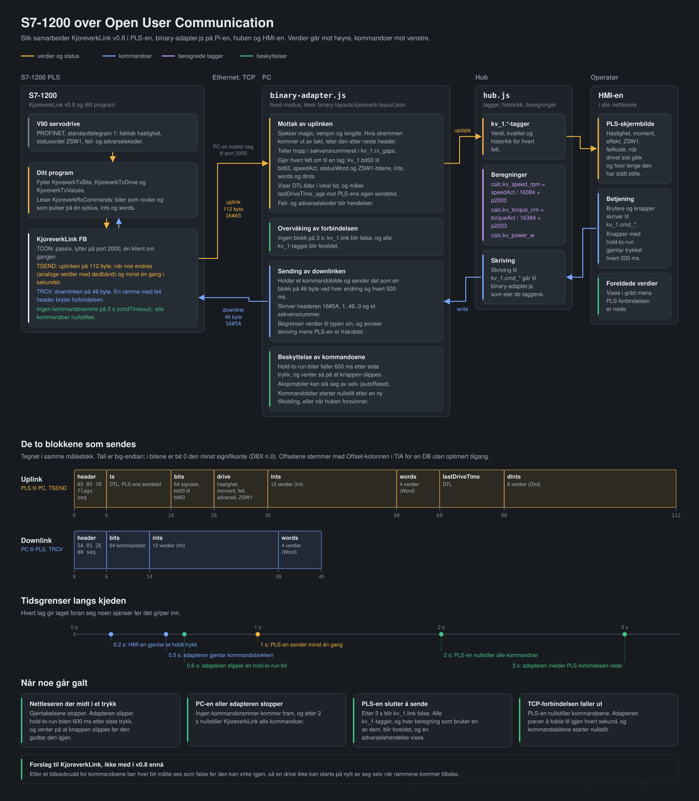

# HMI core

Et HMI i nettleseren for kjøreverket: en S7-1200-PLS som snakker med en Raspberry Pi over
Open User Communication (TCP). Du lager skjermbildene i nettleseren og knytter widgeter til
PLS-ens tagger. Recorderen lagrer det du velger i en database på Pi-en, og databaseleseren
viser hva som er lagret.

```
 HMI-er i        <--WebSocket-->  hub.js  <--WebSocket-->  binary-adapter.js  <--TCP-->  S7-1200
 nettleseren                      tagger, historikk,       + kjoreverk-       port 2000  KjoreverkLink
 (mappen hmi/)                    beregninger, alarmer,      layout.json
                                  prosjektlagring
                                     |
                                  recorder.js --> SQLite (data/recorder.db) <-- db-browser.js
```

Huben har en liste over **tagger** (navngitte verdier som `kv_1.speedAct`). `binary-adapter.js`
leser blokkene fra PLS-en, gjør dem om til tagger ut fra layoutfilen `kjoreverk-layout.json`, og
sender kommandoer fra HMI-en tilbake til PLS-en. Alle nettlesere som åpner HMI-en, ser de
samme taggene, live.


---

## Innhold

1. [Kom i gang](#1-kom-i-gang)
2. [Kjernefiler og prosjektfiler](#2-kjernefiler-og-prosjektfiler) — hva du skal la være, og hva som er ditt
3. [Å jobbe med flere prosjekter](#3-å-jobbe-med-flere-prosjekter)
4. [Begreper](#4-begreper): tagger, adaptere, variabler og [dine egne navn på tagger](#tagnavn-dine-egne-navn-på-tagger)
5. [Lage skjermbilder](#5-lage-skjermbilder)
6. [Widgeter](#6-widgeter)
7. [Beregnede verdier](#7-beregnede-verdier)
8. [Lagring til database](#8-lagring-til-database): hva Pi-en lagrer, hvor ofte, og hvordan du pauser lagringen. Databaseleseren og alle tabellene: [docs/DATABASE-BROWSER.md](docs/DATABASE-BROWSER.md)
9. [Tegninger (SVG)](#9-tegninger-svg) — hva en tegning trenger
10. [Animasjoner (Three.js)](#10-animasjoner-threejs) — hva en kodesnutt trenger
11. [Forbindelsen til PLS-en](#11-forbindelsen-til-pls-en) — [tcplink-adapter.js med navnene fra PLS-en](#tcplink-navnene-kommer-fra-pls-en), binary-adapter.js og layouten, og [eksempeladaptere](#andre-enheter-og-programmer) for andre enheter
12. [Referanse](#12-referanse) — protokoll, HTTP-API, prosjektfil, kommandolinje
13. [Sikkerhet](#13-sikkerhet)
14. [Feilsøking](#14-feilsøking)
15. [Endre kjernen](#15-endre-kjernen)

---

## 1. Kom i gang

Du trenger [Node.js](https://nodejs.org) 22.13 eller nyere for recorderen og
databaseleseren (de bruker den innebygde SQLite-en). Huben og adapterne for PLS-en kjører på
Node 10 og nyere. For en Raspberry Pi uten internett, se
[Installere uten internett](#installere-uten-internett-raspberry-pi).

Start hver del i sin egen terminal, fra mappen `hmi-core`:

```bash
npm install                      # én gang: ws (WebSocket) og three (for Animation-widgeter)
node hub.js                      # huben og HMI-en: http://localhost:8080
node adapters/binary-adapter.js adapters/binary-layouts/kjoreverk-layout.json   # forbindelsen til PLS-en
node recorder.js                 # lagrer til data/recorder.db (Node 22.13+)
node db-browser.js               # databaseleseren: http://localhost:8088
```

- **PLS-ens adresse** står i `"connect"` i `kjoreverk-layout.json` (`10.0.123.51:2000`). Er den en
  annen, endre den der, eller start adapteren med `--plc=<ip>:2000`. Startes adapteren uten
  argumenter, bruker den `adapters/binary-layouts/kjoreverk-layout.json`.
- **Kjører PLS-en TcpLink-blokken**, start `node adapters/tcplink-adapter.js` i stedet for
  `binary-adapter.js`. Navnene og størrelsene kommer da fra PLS-en, og det trengs ingen
  layoutfil; se [TcpLink: navnene kommer fra PLS-en](#tcplink-navnene-kommer-fra-pls-en).
- **At forbindelsen er oppe**, ser du på taggen `kv_1.link` (true) og i adapterens logg. Blir
  den ikke det, se [Igangkjøring med en ekte PLS](#faste-blokker-s7-pls-er-open-user-communication)
  og [Feilsøking](#14-feilsøking).
- **Recorderen og databaseleseren** trengs bare når du vil lagre data; se
  [8](#8-lagring-til-database).
- **Automatisk start på Pi-en** (ved oppstart og etter strømbrudd, med omstart hvis noe
  krasjer): se `README_systemd-service.md` i mappen over `hmi-core`.

Åpne <http://localhost:8080>, eller `http://<pi-ip>:8080` fra en annen maskin på nettverket.
Bytt mellom **Edit** og **Run** øverst til høyre.

**Prosjektet huben starter med** er `config/hmi.json`: skjermbildene dine, variablene, og
beregningene for PLS-en (hastighet i rpm, moment, effekt og kontrollene i
[7](#betingelser-og-kontroller-over-tid)). Før du legger en knapp på en kommandobit
(`kv_1.cmd_bit03`), sjekk hva biten gjør i PLS-programmet, og gi en jog-bit `"hold"` i
layouten (se [13](#hold-for-å-kjøre-over-et-nettverk)).

### Installere uten internett (Raspberry Pi)

`npm install` trenger internett, men den trenger ikke kjøres på Pi-en. Begge avhengighetene
(`ws` og three.js) er ren JavaScript, så en mappe som er installert på Windows, virker uendret
på en Pi:

1. **På en datamaskin med internett** pakker du ut `hmi-core` og kjører `npm install` i
   mappen. Kopier hele mappen, også `node_modules`, til en minnepenn.
2. **På Pi-en** kopierer du den fra minnepennen, for eksempel
   `cp -r /media/$USER/<stick>/hmi-core ~/`, og kjører så `node hub.js` i den.

**"SyntaxError: Unexpected token" ved oppstart betyr at Node.js på Pi-en er eldre enn koden
forventer.** Sjekk den med `node -v`. Gamle utgaver av Raspberry Pi OS har gamle
Node-versjoner: 10 i Buster, 12 i Bullseye. HMI core kjører på Node 10 og nyere, men de to
versjonene sluttet å få rettelser for flere år siden, så en Pi som skal gå i årevis, fortjener
en ny versjon.

**Slik installerer du en ny Node.js uten internett** (Node 22.13 eller nyere trengs for den
innebygde SQLite-en som recorderen bruker):

1. **Finn ut hvilket bygg Pi-en trenger.** Kjør `dpkg --print-architecture` på Pi-en:

   | Den sier | Og `uname -m` sier | Last ned |
   |---|---|---|
   | `arm64` | (hva som helst) | `node-v22.x.y-linux-arm64.tar.xz` |
   | `armhf` | `armv7l` eller `aarch64` | `node-v22.x.y-linux-armv7l.tar.xz` |
   | `armhf` | `armv6l` (Pi Zero, Pi 1) | Ikke blant de offisielle byggene; se <https://unofficial-builds.nodejs.org> |

   Ikke gå bare etter `uname -m`: et 32-biters Raspberry Pi OS kan kjøre en 64-biters
   Linux-kjerne, og da nekter 64-biters Node å starte. Node 22 er den siste versjonen med
   32-biters (`armv7l`) bygg.
2. **På Windows-PC-en** laster du ned den nyeste 22.x-filen fra
   <https://nodejs.org/dist/latest-v22.x/> og kopierer den til en minnepenn.
3. **På Pi-en** pakker du den ut i en egen mappe og lenker den inn i stien (PATH).
   Minnepennen dukker vanligvis opp under `/media/<user>/<name>`:

   ```bash
   sudo mkdir -p /opt/node22
   sudo tar -xJf /media/$USER/<stick>/node-v22.*-linux-arm64.tar.xz -C /opt/node22 --strip-components=1
   sudo ln -sf /opt/node22/bin/node /usr/local/bin/node
   sudo ln -sf /opt/node22/bin/npm  /usr/local/bin/npm
   hash -r
   node -v                                              # v22.x.y
   which node                                           # /usr/local/bin/node
   node -e "require('node:sqlite'); console.log('SQLite OK')"
   ```

   Når Node ligger i `/opt/node22`, er en oppgradering bare å pakke ut en nyere versjon og
   peke de to lenkene til den, og å fjerne den er å slette mappen og lenkene.
4. **Sjekk alt som starter huben automatisk.** En tjeneste som kjører `/usr/bin/node`,
   bruker fortsatt den gamle versjonen; endre den til `/usr/local/bin/node`.
5. **Når alt virker,** fjerner du den gamle versjonen med `sudo apt remove nodejs` (dette
   virker uten nett). Før det viser `apt-cache rdepends --installed nodejs` om noe annet
   fortsatt bruker den.

**Hvis noe går galt:**
- *"cannot execute binary file"* eller *"No such file or directory"* når du kjører `node`:
  feil bygg for prosessoren. Sjekk trinn 1 igjen.
- `node -v` viser fortsatt den gamle versjonen: kjør `hash -r`, eller logg ut og inn igjen.

Huben skriver ut hvilken Node-versjon den kjører på, når den starter.

---

## 2. Kjernefiler og prosjektfiler

Det finnes tre slags filer. Det er det å vite hvilke som er hvilke, som gjør HMI-en
gjenbrukbar.

```
hmi-core/
  hub.js           program: huben og HMI-en            node hub.js
  recorder.js      program: lagrer til databasen       node recorder.js
  db-browser.js    program: databaseleseren            node db-browser.js
  adapters/        programmer: tcplink-adapter.js og binary-adapter.js (PLS-en), tcp-bridge.js, og eksempeladapterne
  lib/             kode programmene bruker; kjøres ikke alene (calc.js, record-rules.js)
  hmi/             nettsiden til HMI-en, som huben sender til nettleseren
  db-browser/      nettsiden til databaseleseren, som db-browser.js sender til nettleseren
  config/          prosjektet: hmi.json, codes.json, tagnames.json, assets/
  data/            databasen og lagringsreglene (recorder.db, recorder.rules.json); lages av recorderen
  docs/            dokumentasjonen og diagrammene
```

Alt du starter med `node`, ligger altså øverst eller i `adapters/`.

### Kjerne — den samme i alle prosjekter, ikke endre den for et prosjekt

| Fil | Hva den er |
|---|---|
| `hub.js` | Huben: tagger, WebSocket, historikk, beregninger, lagring av prosjekt og ressurser (assets) |
| `lib/calc.js` | Formelspråket for beregnede tagger. Brukes av `hub.js` |
| `recorder.js` | Recorderen: lagrer valgte tagger og hendelser i SQLite (trenger Node 22.13+) |
| `lib/record-rules.js` | Lagringsreglene og regelfilen. Brukes av `recorder.js` og `db-browser.js` |
| `db-browser.js`, `db-browser/` | Databaseleseren: recorderens database, eller en hvilken som helst SQLite-fil, på en nettside (trenger Node 22.13+, ingen npm-pakker). Se [Se gjennom databasen](#se-gjennom-databasen) |
| `hmi/` (hele mappen) | HMI-en i nettleseren: editor, kjøremiljø, alle widgeter, stiler |
| `package.json` | Avhengigheter (`ws`, `three`) — `npm install` lager `node_modules/` ut fra den |
| `adapters/tcplink-adapter.js` | Forbindelsen til en PLS med TcpLink-blokken: størrelsene og navnene på plassene kommer fra PLS-en, så den trenger ingen layoutfil. Se [TcpLink: navnene kommer fra PLS-en](#tcplink-navnene-kommer-fra-pls-en) |
| `adapters/binary-adapter.js` | Forbindelsen til en PLS med KjoreverkLink-blokken: gjør de faste blokkene fra S7-1200 (OUC over TCP) om til navngitte tagger, og sender kommandoene tilbake. Konfigureres med en layoutfil, redigeres aldri. Se [Pakket binærdata](#pakket-binærdata) |
| `adapters/tcp-bridge.js` | En generell bro for enheter som sender JSON-linjer over rå TCP. PLS-en bruker den ikke; bruken står øverst i filen |
| `README.md` | Denne filen |
| `docs/` | `CALCULATIONS.md` (referansen for beregninger og betingelser), `DATABASE-BROWSER.md` (databaseleseren, og recorderens database tabell for tabell), arkitekturdiagrammene, og skriptene som tegner dem (`docs/src/`) |

Når det kommer en nyere versjon av kjernen, bytter du ut disse filene og kjører
`npm install`. Prosjektfilene dine blir ikke rørt, så lenge de ligger utenfor kjernemappen
(se [3](#3-å-jobbe-med-flere-prosjekter)). Alt som ligger i `hmi-core/config/`, ville blitt
erstattet sammen med kjernen.

### Prosjektfiler — dine, forskjellige i hvert prosjekt

| Fil | Hva den er | Hvordan du endrer den |
|---|---|---|
| `hmi.json` | Prosjektet: skjermbilder, widgeter, koblinger til tagger, variabler, beregninger | I HMI-editoren (Save). Det går an å redigere for hånd, se [12.3](#123-prosjektfilen) |
| `codes.json` | Tekster og beskrivelser for feil- og alarmkoder | *Code texts* i HMI-en, lagres med en gang, også fra Run-modus (se [Kodetekster](#kodetekster-feilkoder-og-alarmkoder)) |
| `tagnames.json` | Dine egne navn og beskrivelser for tagger (`kv_1.bit05` = *Dør lukket*) | **Tag names** i databaseleseren, eller **✎ Name tags** i tagoversikten i HMI-en, lagres med en gang (se [Tagnavn](#tagnavn-dine-egne-navn-på-tagger)) |
| `assets/*.svg` | Tegninger for Drawing-widgeter | Tegneprogrammet ditt; last opp i HMI-en |
| `assets/*.js` | Three.js-kode for Animation-widgeter | Kodeeditoren i HMI-en, eller en hvilken som helst teksteditor |
| `assets/*.glb`, `.gltf`, `.bin`, bilder | 3D-modeller og teksturer som animasjonene bruker | Kopier dem inn i mappen |
| `binary-layouts/*-layout.json` | Layouten for PLS-blokkene til `binary-adapter.js`: hvilket felt som ligger hvor, og hva det heter | Teksteditor |
| `tcplink-options/*-options.json` | Det `tcplink-adapter.js` ikke får fra PLS-en: tagprefikset, adressen, alarmer, bits i et statusord og hold-for-å-kjøre | Teksteditor |

`hmi.json`, `codes.json`, `tagnames.json` og `assets/` ligger alltid sammen. Huben holder dem
ved siden av den prosjektfilen den ble startet med.

### Det som følger med: prosjektet, layouten og eksempeladapterne

| Fil | Hva den er |
|---|---|
| `adapters/binary-layouts/kjoreverk-layout.json` | Layouten for S7-1200-protokollen Kjoreverk (KjoreverkLink v0.8): blokken PLS-en sender, og kommandoblokken tilbake |
| `adapters/tcplink-options/kjoreverk-options.json` | Innstillingene for TcpLink-blokken på kjøreverket: alarmer på feil- og varselkoden, bitene i ZSW1, og hold-for-å-kjøre på joggebitene |
| `config/hmi.json`, `config/assets/` | Prosjektet huben starter med (se [1](#1-kom-i-gang)) |
| `adapters/example-adapters/` | Maler for å koble til mer enn PLS-en: en ESP32, en Pico W med MicroPython, og programmer i Python og Node.js på andre maskiner. Se [Andre enheter og programmer](#andre-enheter-og-programmer) |

Prosjektet ligger i `hmi-core/config/` bare for at `node hub.js` skal virke med en gang.
Vil du kunne bytte ut kjernen uten å røre prosjektet, flytter du det ut av kjernemappen, som
vist nedenfor.

---

## 3. Å jobbe med flere prosjekter

Ha kjernen i én mappe og hvert prosjekt i sin egen mappe:

```
hmi-core/                  kjernen (pluss prosjektet i config/)
projects/
  kjoreverk_1/
    hmi.json               lages første gang du trykker Save
    assets/                lages første gang du laster opp
    binary-layouts/
      kjoreverk-layout.json   en kopi av layouten, hvis dette kjøretøyet trenger en egen
```

Start huben med prosjektfilen den skal bruke (porten først, så prosjektet), og adapteren med
layouten:

```bash
node hmi-core/hub.js 8080 projects/kjoreverk_1/hmi.json
node hmi-core/adapters/binary-adapter.js projects/kjoreverk_1/binary-layouts/kjoreverk-layout.json
```

På Windows virker det samme med omvendt skråstrek:
`node hmi-core\hub.js 8080 projects\kjoreverk_1\hmi.json`.

- **Et nytt prosjekt:** pek huben på en sti som ikke finnes ennå. HMI-en åpner et tomt
  prosjekt, og Save lager filen og mappen.
- **Kopiere et prosjekt:** kopier mappen. `hmi.json`, `codes.json`, `tagnames.json` og
  `assets/` følger hverandre. (**Export** i verktøylinjen laster bare ned `hmi.json`, uten
  tegningene, animasjonskoden, kodetekstene og tagnavnene.)
- **Flere kjøretøy med samme PLS-program:** samme skjermbilder kan brukes for alle. Sett
  `"device"` i layouten (`kv_1`, `kv_2`) og prosjektvariabelen `kv` til det samme, så følger
  skjermbildene og tagnavnene med (se [Variabler](#4-begreper)).
- **To prosjekter samtidig:** kjør to huber på forskjellige porter.

---

## 4. Begreper

**Tag.** En navngitt verdi på huben: `device.name`, f.eks. `kv_1.speedAct`, `kv_1.cmd_bit03`.
Delen før det første punktumet er navnet på adapteren (`"device"` i layouten eller innstillingsfilen). En tag har en
verdi (tall, boolsk eller tekst), et tidsstempel og en kvalitet:

| Kvalitet | Betydning |
|---|---|
| `good` | Normalt |
| `uncertain` | Ingen verdi mottatt ennå |
| `bad` | Adapteren som eier taggen, er frakoblet. Widgetene blir grå og viser *stale*, og fortsetter å vise siste verdi |

**Adapter.** Et program som kobler seg til huben, publiserer tagger og utfører skrivinger.
Her er det `tcplink-adapter.js` eller `binary-adapter.js`, som står mellom huben og PLS-en. Når den utfører en skriving,
sender den den nye verdien tilbake (*ekkoet*): verdien som nå står i kommandoblokken til
PLS-en. Det er ekkoet alle HMI-er viser, så et betjeningselement vises først som omslått når
adapteren har tatt imot det.

**Hub.** Har listen over tagger og den siste verdien for hver tag, pluss omtrent 10 minutter
historikk per numerisk tag (600 punkter). Den sender skrivinger videre til adapteren som eier
taggen, tar vare på de siste 200 hendelsene og alarmene, regner ut beregnede tagger, og
lagrer prosjektet og ressursene (assets) til det. Historikk og hendelser ligger bare i
minnet, så de starter tomme etter en omstart.

**Beregnet tag.** En tag med navnet `calc.<name>` som huben regner ut fra andre tagger med
en formel. Se [7](#7-beregnede-verdier).

**Variabler.** Teksterstatninger for hele prosjektet: `kv=kv_1` lar widgeter bruke
`${kv}.speedAct`. Endre variabelen, så følger alle widgeter, koblinger, innganger og formler
med. Slik kan ett skjermbildeoppsett betjene flere kjøretøy med samme PLS-program.

**Hendelser.** Tekstmeldinger med en alvorlighetsgrad (`info`, `warning`, `alarm`) som
adaptere sender, eller som huben sender når adaptere kobler til og fra. Vises av
Event log-widgeten.

**Alarmer.** Betingelser som er på eller av, for eksempel en drivfeil eller en tapt
PLS-forbindelse. Huben viser hver av dem mens den er aktiv og til noen har kvittert for den;
topplinjen viser den mest presserende. Se [Alarmer](#alarmer-og-kvittering).

### Tagnavn: dine egne navn på tagger

En PLS sender dataene sine som posisjoner: `bit00` … `bit63`, `ints_1`, `cmd_bit05`. I
stedet for å endre PLS-programmet for å gi dem mening, gir du her hver tag ditt eget **navn**
og din egen **beskrivelse**, f.eks. `kv_1.bit05` = *Dør lukket*, *endebryter B12, venstre dør*.

Taggen beholder navnet sitt. Skjermbilder, lagringsregler og lagret historikk forblir som de
er, og et navn kan endres når som helst uten nedlasting til PLS-en.

- **Sette dem:**
  - **Tag names** i databaseleseren viser alle tagger med live-verdien. En verdi som endrer
    seg, blinker, så du finner en bit ved å få den til å endre seg.
  - I HMI-en (Edit-modus): **✎ Name tags** i tagoversikten.

  Begge lagrer med en gang, uten Save av prosjektet.
- **Hvor de vises:**
  - tagoversikten og trendforklaringene i HMI-en;
  - etiketten til en widget, når du velger en navngitt tag for en widget som fortsatt har
    standardetiketten sin;
  - databaseleseren;
  - recorderens database (`tag.label`, `tag.info`).
- **Hvor de lagres:** huben har dem i `tagnames.json`, ved siden av prosjektfilen.
- **Prosjektvariabler:** med `kv = kv_1` lagres et navn for `kv_1.bit05` som
  `${kv}.bit05`, så et annet kjøretøy (`kv = kv_2`) får de samme navnene for sine egne tagger.

**Navn fra PLS-en.** Med TcpLink-blokken ligger navnene i PLS-en (`LinkNames`), og
`tcplink-adapter.js` gir hver tag navnet den har der, med enheten fra en `[...]` til slutt
i navnet. Da trenger du ikke navngi noe her. Navnet fra PLS-en kommer på nytt ved hver
tilkobling og lagres ikke i `tagnames.json`. Gir du en tag ditt eget navn, går det foran;
tøm feltet, så vises navnet fra PLS-en igjen. Tagoversikten og databaseleseren viser navnet
fra PLS-en som forslag i navnefeltet. Se [TcpLink: navnene kommer fra PLS-en](#tcplink-navnene-kommer-fra-pls-en).

Layoutfilens `description` for et felt (f.eks. *ZSW1*) vises ved siden av, som det
enheten selv sier. [docs/DATABASE-BROWSER.md](docs/DATABASE-BROWSER.md#5-tagnavn-dine-egne-navn-på-tagger)
har detaljene og filformatet.

---

## 5. Lage skjermbilder

| Modus | Hva du kan gjøre |
|---|---|
| **Edit** | Legg til widgeter fra paletten til venstre, dra for å flytte, dra i hjørnet for å endre størrelse (rutenett på 10 px), sett egenskaper til høyre |
| **Run** | Betjen HMI-en. Lerretet skaleres så det passer i vinduet |

- **Skjermbilder:** faner øverst. **+ Screen** legger til ett; gi det nytt navn eller slett
  det i panelet til høyre når ingen widget er valgt.
- **Prosjektpanelet** (klikk på tomt lerret): prosjektnavn, størrelse på lerretet, hub-URL (la
  den stå tom), variabler, og listene over tagger fra enheter og beregnede tagger.
- **Save** (Ctrl+S) skriver prosjektfilen på huben. Nettleseren advarer før du forlater siden
  med endringer som ikke er lagret.
- **Export / Import** laster ned eller laster inn `hmi.json` for sikkerhetskopier. Import
  laster den inn i editoren; trykk Save for å lagre den.
- **Kort** (Card) grupperer widgeter og kan ha faner. Legg til et Card fra paletten, og så:
  - **Legge widgeter på det:** dra en widget inn på kortet, så havner den på fanen som vises;
    dra den av, så går den tilbake til lerretet. Når kortet, eller en widget på det, er
    valgt, havner nye widgeter fra paletten på kortet.
  - **Faner:** legg dem til, gi dem nytt navn, endre rekkefølgen og slett dem i egenskapene
    til kortet. Klikk på en fane på kortet for å vise den, både i Edit- og i Run-modus.
  - **Flytte ting:** når du flytter et kort, flyttes alt på det. Egenskapene til en widget
    viser hvilket kort og hvilken fane den ligger på, og kan flytte den til en annen fane,
    eller tilbake til lerretet.
  - **Slette:** når du sletter et kort eller en fane, slettes widgetene på det, etter at du
    har bekreftet.
  - **Ressursbruk:** bare widgetene på fanen som vises, kjører, som med skjermbilder. En
    animasjon på en skjult fane bruker ingen grafikk, og en trend fylles opp fra historikken i
    huben når fanen åpnes.
  - **Enkle rammer:** et kort med én fane og uten tittel er en enkel ramme for gruppering.
  - **Bare ett nivå:** kort kan ikke legges inni kort.
- **Tagoversikten:** listeknappen i enden av hvert tagfelt åpner et vindu med alle taggene på
  huben. Hver tag viser live-verdi, måleenhet og siste oppdatering, og tagger som er foreldet
  eller uten verdi, er merket, så du ser med en gang om en enhet virkelig sender. Søk, filtrer
  (enheter, beregnede, live, foreldede) og klikk på en tag for å bruke den. Når en
  prosjektvariabel navngir enheten, settes taggen inn som `${kv}.speedAct`, så widgeten fortsetter
  å følge variabelen. For trender legges den valgte taggen til i listen. *Browse tags with live
  values* i prosjektpanelet åpner det samme vinduet bare for å se.
- **Tagfelt** foreslår taggene huben kjenner. Taggene trenger ikke finnes ennå: en widget
  som er koblet til en tag som mangler, viser bare `—` til taggen dukker opp.
- **Velge flere widgeter:**
  - **Shift-dra** tegner en markeringsboks. Den tar med alle widgeter den berører, bortsett
    fra at et kort bare blir valgt når boksen rommer hele kortet, så en boks tegnet inni et
    kort velger widgetene på det.
  - **Shift-klikk** legger til eller fjerner én widget, og **Ctrl+A** velger alt på
    skjermbildet.
  - **Flytte og slette dem:** dra en hvilken som helst valgt widget for å flytte alle, bruk
    piltastene, eller trykk Delete (én bekreftelse for alle). Widgeter på et valgt kort
    flyttes med kortet.
  - **Tekststørrelser for alle:** panelet til høyre setter *Label size* og *Value and text
    size* på alle valgte widgeter samtidig. *Mixed* betyr at de er forskjellige nå.
- **Høyreklikkmeny** (Edit-modus):
  - **På en widget eller et utvalg:** Cut, Copy, Paste here, Duplicate, Bring to front, Send
    to back, Move to canvas (for widgeter på et kort), Delete, og "Edit mappings…" eller "Edit
    code…" for tegninger og animasjoner.
  - **På tomt lerret, eller den tomme delen av et kort:** Paste here, Add widget here (plassert
    der du klikket, og inni kortet hvis du klikket på et), og Select all.
  - **Bruke den:** piltastene, Enter og Escape virker i menyen. Run-modus beholder
    nettleserens egen meny.
- **Tastatur:**
  - **Delete** fjerner utvalget. **Piltastene** flytter det 10 px (Shift: 1 px), og
    **Escape** opphever markeringen.
  - **Ctrl+C**, **Ctrl+X**, **Ctrl+V** og **Ctrl+D** kopierer, klipper ut, limer inn og
    dupliserer. Innliming virker også på et annet skjermbilde; hver innliming havner 20 px
    lenger bort.
- **Passkode for Edit:** sett en i prosjektpanelet, så spør HMI-en etter den når du bytter
  til Edit, og et tilfeldig trykk på Edit kan ikke åpne editoren. Et prosjekt med passkode
  åpnes i Run-modus. Den lagres i prosjektfilen, så den er ikke et sikkerhetstiltak: alle som
  når huben, kan lese den, eller endre prosjektet uten den.
- **Dobbeltklikk** på en Drawing- eller Animation-widget for å åpne editoren dens.
- **Flere nettlesere** kan være åpne samtidig, og alle ser live-verdier. Etter at én av dem
  har lagret et endret oppsett, viser de andre det når de er lastet inn på nytt.

---

## 6. Widgeter

| Widget | Leser | Skriver | Viktige innstillinger |
|---|---|---|---|
| Card | — | — | Tittel, faner, fanefarge; rommer andre widgeter (se [5](#5-lage-skjermbilder)) |
| Text | — | — | Størrelse (small til xx-large), justering, farge |
| Value | 1 tag | — | Måleenhet, desimaler, alarm over/under; tallformat desimalt, heks (`16#FF37`) eller binært; viser også teksttagger; kodetekster, med en beskrivelse ved klikk (se [nedenfor](#kodetekster-feilkoder-og-alarmkoder)) |
| Gauge | 1 tag | — | Stil: arc, semicircle, needle, ring; tykkelse; min/maks; fargeterskler; skalatall rundt needle-skiven; alarmgrenser tegnet som røde soner, blinker i alarm |
| Bar | 1 tag | — | Vannrett eller loddrett; fyll fra min, eller fra null for verdier med fortegn; fargeterskler; nummerert skala; alarmsoner og blinking |
| Indicator | 1 tag | — | Lyser når true/ulik null, eller når den er lik en valgt verdi; tekst for på/av |
| Switch | 1 tag | true/false | Viser taggen; et klikk skriver det motsatte. [Sikrere betjening](#sikrere-betjening) |
| Button | 1 tag | en hvilken som helst verdi | Verdi ved trykk; valgfri verdi ved slipp (momentan); *Repeat while held* for hold-for-å-kjøre, se [13](#13-sikkerhet). Blir grå når enheten er frakoblet. [Sikrere betjening](#sikrere-betjening) |
| Slider | 1 tag | tall | Skriver når du slipper. [Sikrere betjening](#sikrere-betjening) |
| Number input | 1 tag | tall | Skriv inn en verdi, trykk Set. [Sikrere betjening](#sikrere-betjening) |
| Trend | opptil 3 tagger | — | Et tidsrom fra minutter til uker, fra recorderen; tidsknapper og en markør i Run-modus; fast eller automatisk skala, én farge per linje. Se [Trender](#trender-over-timer-og-dager) |
| Event log | hendelser | — | Filtrer på kildeprefiks og laveste alvorlighetsgrad |
| Alarm list | alarmer | — | De aktive og ukvitterte alarmene, med Ack; filtrer på kilde og alvorlighetsgrad. Se [Alarmer](#alarmer-og-kvittering) |
| Drawing | mange tagger | mange tagger | En SVG med en koblingstabell — se [9](#9-tegninger-svg) |
| Animation | mange tagger | — | En Three.js-kodesnutt med deklarerte innganger — se [10](#10-animasjoner-threejs) |

**Farger.** De fleste widgeter har en fargeinnstilling; *Default* betyr temafargen. Alarmrødt
overstyrer den alltid, så en verdi utenfor området ser lik ut uansett hvilken farge du valgte.

**Tekststørrelser.** Alle widgeter med tekst har to størrelser, fra 75 % til 300 % av normal:
- **Label size** er etiketten øverst. På et kort er det tittelen og fanene.
- **Value size** er alt under etiketten: avlesningen og måleenheten, skalatall, påskrifter,
  trendens forklaring og akse, hendelsesradene. Der "value" ikke passer, har den et annet
  navn: *Button size*, *Lamp and text size*, *Row text size*. En lampe, bryter eller knapp
  vokser med teksten sin.
- **En verdi mister aldri sifre.** Når en avlesning er for bred for widgeten sin, for eksempel
  når et tall blir lengre under kjøring, krymper den til den passer, i stedet for å vise
  `16#EB3` for `16#EB31`. Gjør widgeten bredere for å få full størrelse tilbake.
- **Like størrelser:** velg flere widgeter (Shift-dra, eller Ctrl+A) for å sette størrelsene
  deres samlet. Text-widgeten beholder sin egen *Size*-innstilling.
- **Å endre størrelsen på en widget endrer ikke teksten,** bortsett fra at skiven på en gauge
  vokser med widgeten. Bruk *Value size* for å få avlesningen til å passe.

Fargen og tekststørrelsene til et kort gjelder bare kortet, ikke widgetene på det.

### Sikrere betjening

Button, Switch, Slider og Number input har tre innstillinger som holder kommandoene der de
hører hjemme:

- **Enabled when:** en tag og en betingelse (`true`, `false`, `=3`, `!=0`, `>50`, `10..20`).
  Så lenge betingelsen ikke er oppfylt, er betjeningselementet grått og kan ikke brukes. Holder
  du musen over det, står det hvorfor. For eksempel Jog bare uten feil: tag `${kv}.bit02`,
  betingelse `false`.
  - **Flere betingelser:** lag en boolsk [beregning](#7-beregnede-verdier), som
    `calc.jog_allowed = ${kv}.link && !${kv}.bit02`, og bruk den som tag.
  - **Ved tvil, ikke aktivert:** en tag som er foreldet eller ikke har noen verdi ennå,
    regnes som ikke aktivert.
  - **Hold-for-å-kjøre:** en Jog-knapp som holdes inne, slippes i det øyeblikket betingelsen
    ikke lenger er oppfylt.
  - **Å slå av virker alltid:** en bryter som er på, kan alltid slås av, også når den ikke er
    aktivert. En betingelse må aldri hindre deg i å stoppe noe.
- **Ask before sending:** et spørsmål som *Tilbakestille drivfeilen?*, som besvares med Cancel
  eller knappens egen handling. Fokuset starter på Cancel, så et tilfeldig Enter sender ingenting.
  - **Switch:** spør når den slås på. Å slå av sendes med en gang, med mindre *Ask when
    switching off too* er krysset av; la den være av for alt som stopper en maskin.
  - **Button med en verdi ved slipp:** OK sender et kort trykk, verdien og så slippverdien et
    halvt sekund senere.
  - **Hold-for-å-kjøre-knapper** kan ikke spørre: de må holdes inne.
  - **Slider og Number input:** spørsmålet viser den nye verdien. Ved Cancel går slideren
    tilbake.
- **En frakoblet enhet kan ikke styres:** et betjeningselement med foreldet tag blir grått, og
  ingenting sendes til en enhet som ikke er tilkoblet. Dette gjelder også klikkhandlinger i
  tegninger. Knapper følger nå taggen sin for dette, slik brytere alltid har gjort.

Disse gjør feil mindre sannsynlige; de er ikke sikkerhetsfunksjoner. Se
[Hold-for-å-kjøre over et nettverk](#hold-for-å-kjøre-over-et-nettverk).

### Alarmer og kvittering

Topplinjen viser den mest presserende alarmen, og hvor mange flere det er. Den er rød og
blinker mens en alarm ikke er kvittert, gul for advarsler, og bare med omriss når alt er
kvittert. Et klikk åpner listen. **Alarm list**-widgeten viser den samme listen på et
skjermbilde, filtrert på kilde (f.eks. `kv_1`) og alvorlighetsgrad.

En alarm blir stående i listen til den **både** har gått bort og er kvittert:

| Tilstand | Betyr |
|---|---|
| Active | På nå, og ingen har kvittert den: rød eller gul i listen |
| Active · acknowledged | Fortsatt på, men noen har sett den |
| Cleared · not acknowledged | Den gikk bort før noen så den |

**Ack** kvitterer én alarm, **Acknowledge all** alle i listen. At en alarm kommer, går bort
og blir kvittert, havner i hendelsesloggen (og dermed i recorderens database), sammen med
hvilken HMI som kvitterte. Alarmer fra et kodefelt (se [Kodetekster](#kodetekster-feilkoder-og-alarmkoder))
har en ⓘ som åpner beskrivelsen av koden.

**Hvor alarmene kommer fra:**

| Kilde | Aktiv så lenge | Eksempel |
|---|---|---|
| Et felt i layouten med `"event": "alarm"` eller `"warning"` | verdien er på | `faultCode`, `warnCode` i `kjoreverk-layout.json` |
| En beregning med en *Warning*- eller *Alarm*-hendelse | resultatet er sant | `calc.kv_crash` |
| En adapter som har koblet fra | til den kobler til igjen | *kv_1: Adapter disconnected* |
| En PLS-forbindelse | ingen data fra PLS-en på 2 s | *kv_1: No data from the PLC* |

Alarmene følger verdier, ikke meldinger. En alarm som allerede er på når huben, adapteren
eller PLS-en starter, vises med en gang, og etter en omstart bygger listen seg opp igjen fra
verdiene slik de er. Kvitteringer ligger bare i minnet til huben, så etter
en omstart av huben må aktive alarmer kvitteres på nytt.

### Kodetekster (feilkoder og alarmkoder)

Et tall som feilkode 7900 sier lite før noen slår det opp. Kodetekster tar vare på den
kunnskapen i HMI-en: en **kort tekst** for hver kode, vist på widgeten, og en
**beskrivelse** som klikkes opp: hva koden betyr, sannsynlige årsaker, hva som bør sjekkes.
Hvem som helst kan legge til i en beskrivelse etter hvert som de lærer mer.

**Sette det opp:**
1. Åpne **ⓘ Code texts** i topplinjen (Edit-modus) og lag en liste, for eksempel
   *V90-feil*. Gi den et **prefiks** hvis manualen skriver kodene med ett: med prefiks
   `F` vises kode 7900 som `F7900`.
2. Legg til koder én og én (**+ Add code**), eller kopier kolonnene *kode, kort tekst,
   beskrivelse* fra et regneark og bruk **Paste rows**. Rader kan også skrives med
   semikolon: `7900; Motor blocked; Check the brake and the load`. Innliming fyller bare inn
   tomme tekster, med mindre du krysser av for *Replace*, så den overskriver aldri notater ved
   et uhell.
3. På en Value-widget velger du listen under **Code texts**. *Show* velger mellom *number and
   text*, *text only* og *number only*.

**Bruke det:** i Run-modus klikker du på verdien (den lille ⓘ markerer widgeter som kan dette).
- **Lese:** popup-vinduet viser koden, teksten og beskrivelsen. Nettadresser i en
  beskrivelse blir lenker, for eksempel til en side i manualen.
- **Legge til:** **Edit** eller **Add text** endrer den på stedet, og **All codes** åpner
  hele listen. Hvis prosjektet har en passkode for Edit, spør HMI-en etter den når du endrer
  en tekst; for å lese trengs den aldri.
- **Lagre:** en endring lagres med en gang, for seg selv. Den lagrer ikke oppsettet, og alle
  åpne HMI-er viser den med en gang.

**Hvordan kodene matches:**
- **Heltall:** lagres som desimale sifre, så 7900, `16#1EDC` og `F7900` er den samme koden.
  En verdi i heks eller binært på widgeten finner fortsatt teksten sin.
- **Tekstverdier:** fra en teksttag, matches nøyaktig.
- **Ingen tekst ennå:** en kode uten tekst viser *No text yet*, og klikker du på den, kan du
  legge til en.

**Hvor de lagres:** `codes.json`, ved siden av `hmi.json`. Det er en egen fil, så en
beskrivelse som legges til i Run-modus, kan ikke lagre halvferdige endringer i oppsettet, og
to personer som redigerer forskjellige koder, overskriver ikke hverandre.
- **Skriving:** huben legger hver endring inn i det som ligger på disken, og skriver filen i
  én operasjon, så et strømbrudd ikke kan etterlate en halv fil.
- **For hånd:** den er ren JSON og kan redigeres i en hvilken som helst teksteditor.
- **En fil den ikke kan lese:** huben melder fra og nekter å skrive over den, så en skrivefeil
  ikke kan koste deg notatene i den.
- **Sikkerhetskopi:** ta sikkerhetskopi av den sammen med resten av prosjektmappen.

### Trender over timer og dager

En Trend viser et tidsrom, fra sekunder til uker. *Time range* i innstillingene er der den
starter.

- **Tidsknapper (Run-modus):** *10 min · 1 h · 8 h · 24 h · 7 d* viser den siste perioden av
  den lengden, live. **◀ ▶** går bakover og framover med halve tidsrommet, og datoene viser
  hva du ser på. **Live** går tilbake til nå. Fjern krysset for *Time controls in Run mode*
  for en trend som skal bli stående slik den er satt.
- **Markøren:** pek på trenden for å lese tiden og verdien til hver linje der.
- **Hvor punktene kommer fra:**
  - **Huben:** den har de siste minuttene av hver tag i minnet.
  - **Recorderen:** den svarer for alt som er eldre, fra databasen sin (se
    [8](#8-lagring-til-database)).
  - **Bare lagrede tagger har historikk:** en trend av en tag uten lagringsregel sier fra om
    det, og viser det huben har.
  - **Uten at recorderen kjører:** bare minuttene i huben, og trenden sier fra om det også.
- **Hvordan den tegnes:**
  - **Trinn:** verdier holdes til de endrer seg, slik recorderen lagrer dem, så en bit som
    endret seg to ganger på et døgn, blir to trinn, ikke en skråning.
  - **Hull:** der en enhet var frakoblet.
  - **Topper:** i lange tidsrom dekker hvert punkt en periode og tar vare på laveste og
    høyeste verdi, så en kort topp vises fortsatt over en uke.
- **Biter også:** true og false tegnes som 1 og 0.

**Fargeterskler** (Gauge, Bar) er en liste med `value → colour`:
- **Regelen er "på eller over".** Forbi en terskel får buen, viseren eller stolpen og
  avlesningen fargen til den terskelen. Under den første terskelen beholder de widgetens egen
  farge. Terskler på 80, 110 og 120 gir altså fire bånd.
- **Hver terskel er merket på skalaen.** Arc, semicircle, ring og Bar får en kort strek i
  terskelens farge; needle-skiven får fargede bånd mellom tersklene.

**Skalatall:** *Scale divisions* bestemmer hvor mange nummererte trinn det er fra min til
maks. Velg et antall som deler området jevnt: 0–100 i 5 trinn gir 0, 20, 40 og så videre.
- **På en gauge:** sett *Style* til **needle**, så dukker *Scale numbers* og *Scale divisions*
  opp. Tallene står inne i skiven, og inndelingene bestemmer også skalastrekene.
- **På en bar:** kryss av for *Scale numbers*, så dukker *Scale divisions* opp. De nummererte
  strekene går langs stolpen.

**Alarmgrenser** (Value, Gauge, Bar) gjør verdien rød utenfor grensene. På en gauge eller
bar blinker også buen, viseren eller stolpen i alarm (*Blink while in alarm*, på som
standard; langsommere hvis datamaskinen er satt til å redusere bevegelse). Alarmrødt vinner
over alle terskelfarger. Alarmgrenser påvirker bare det widgeten viser; de lager ikke
hendelser.

**Beregnede verdier** er merket med en fiolett **ƒ** på widgeten. Hold musen over den for å
se formelen.

---

## 7. Beregnede verdier

For verdier enhetene ikke regner ut selv: effekt fra dreiemoment og turtall, virkningsgrad,
summer, betingelser. Åpne **ƒ Calculations** i topplinjen (Edit-modus).

```
calc.motor_power  [kW]  =  ${mono}.torque * ${mono}.speed * 2 * pi / 60 / 1000
```

- **Huben regner dem ut**, så alle HMI-er viser det samme resultatet, trender har historikk,
  og beregningene fortsetter å kjøre uten at noen nettleser er åpen.
- **De lagres i prosjektfilen** og trer i kraft når du trykker Save & apply. Ingen omstart
  trengs.
- **Resultatet er en skrivebeskyttet tag** med navnet `calc.<name>`. Bruk den overalt der en
  tag kan stå, også i andre beregninger. Enheter kan ikke publisere under `calc.`.
- **Foreldede innganger gir et foreldet resultat.** Hvis en inngang er foreldet eller mangler,
  er resultatet det også. Divisjon med null gir et foreldet resultat, aldri et tall.
- **Editoren sjekker hver formel mens du skriver**, med hubens egen parser. Den viser det
  nåværende resultatet, taggene som brukes, og eventuelle feil med posisjon.

| | |
|---|---|
| Tagger | `kv_1.speedAct` `${kv}.speedAct` `calc.kv_power_w` `[odd-name.with-dashes]` |
| Operatorer | `+ - * / % ^`  `== != < <= > >=`  `&&` `\|\|` `!`  `cond ? a : b` |
| Funksjoner | `abs sqrt pow exp log log10 sin cos tan asin acos atan atan2 floor ceil round(x, digits) sign min max avg sum hypot clamp(x, lo, hi) if(cond, a, b)` |
| Konstanter | `pi e true false`. Boolske verdier teller som 1 og 0; vinkler er i radianer |
| Betingelser | `a && b && !c` (alle), `a \|\| b` (minst én), `count(a, b, c) >= 2` (minst to sanne), `between(x, lo, hi)` |
| Over tid | `changes(x, s)`, `rate(x, s)`, `delta(x, s)`, `held(cond, s)`, `stretch(cond, s)`, `avgOver(x, s)`, `minOver(x, s)`, `maxOver(x, s)` |

- **Typer:** velg *boolean* for betingelser (`calc.drive_ready`), *number* for alt annet.
- **Rekkefølge:** huben finner rekkefølgen når beregninger bruker hverandre, og melder fra om
  sirkulære referanser.
**Den fullstendige referansen** for å skrive beregninger er
[docs/CALCULATIONS.md](docs/CALCULATIONS.md). Den dekker alle operatorer og funksjoner,
kontrollene over tid, kvalitetsregler, hendelser, eksempler etter oppgave, fallgruver og
feilmeldinger.

### Betingelser og kontroller over tid

En *boolean*-beregning er en betingelse, for eksempel "kjører i fart med sensor 1 og 3 på og
sensor 2 av":

```
${kv}.speedAct > 5000 && ${kv}.bit01 && ${kv}.bit03 && !${kv}.bit02
```

Bruk `if(condition, value, otherValue)` når du heller vil ha et tall ut.

**Tidsfunksjoner** husker inngangen sin, så en kontroll kan se tilbake i tid. `s` er et
antall sekunder, 0.05 til 3600.

| Funksjon | Svarer på | Eksempel |
|---|---|---|
| `changes(x, s)` | Hvor mange ganger x endret seg de siste s sekundene | Flimring, løs kabel: `changes(${kv}.bit06, 2) >= 6` |
| `rate(x, s)` | Hvor fort x endrer seg, per sekund | Kollisjon: `abs(rate(calc.kv_speed_rpm, 0.3)) > 4000` |
| `delta(x, s)` | Hvor mye x endret seg de siste s sekundene | `delta(${kv}.dints_0, 60)` = strekning det siste minuttet |
| `held(cond, s)` | Sann når cond har vært sann i s sekunder uten avbrudd | `held(speed > 1000 && ok, 3)` |
| `stretch(cond, s)` | Sann mens cond er sann og i s sekunder etterpå | Holder en kort kollisjon synlig: `stretch(calc.kv_crash, 10)` |
| `avgOver`, `minOver`, `maxOver(x, s)` | Gjennomsnitt (tidsvektet), laveste, høyeste | `avgOver(${kv}.ints_1, 60)` |

Slik oppfører de seg:
- **Hver endring teller.** Når inngangen er en tag, mater huben hver endring inn i funksjonen
  etter hvert som den kommer, så flimring ikke blir oversett mellom utregningene. Et uttrykk
  som inngang (`held(a && b, 3)`) sjekkes hver gang beregningen regnes ut.
- **Klokken driver dem også.** Beregninger med tidsfunksjoner sjekkes på nytt ti ganger i
  sekundet, så `held` blir sann i tide, og en flimretelling faller igjen når flimringen
  stopper.
- **Foreldede innganger får dem til å begynne på nytt.** Når en inngang blir foreldet,
  glemmer funksjonene historikken sin og begynner å måle på nytt når data kommer tilbake, så
  hoppet i verdi ikke blir tatt for en kollisjon.
- **Når du lagrer, starter de på nytt.** De begynner å måle når beregningen lagres eller
  huben starter. Live-sjekken i editoren viser hva formelen gir uten historikk ennå.

**Hendelser:** hver beregning kan utløse en hendelse når resultatet blir sant (eller ulik
null): velg *Info*, *Warning* eller *Alarm* og skriv teksten. Når resultatet går tilbake,
følger en "Cleared: ..."-hendelse.
- **Hva som teller:** foreldede resultater utløser aldri hendelser.
- **Grense for hyppighet:** høyst én hendelse per beregning per sekund. Endringer i
  mellomtiden holdes tilbake og slås sammen i neste hendelse ("2 more changes in the second
  before"), og den endelige tilstanden logges alltid.

Uønskede tilstander som en løs kabel, en kollisjon eller kjøring med en feil havner dermed i
hendelsesloggen, og i enhver database som lagrer hendelsene.

*Insert example…* i editoren gir mønstre å starte fra; bytt ut `device.*` med taggene
dine. Prosjektet har tre slike beregninger på PLS-ens tagger: en løs kabel
(`calc.kv_cable_fault`: `bit06` flimrer), en kollisjon (`calc.kv_crash`: hastigheten endrer
seg fortere enn drivet kan rampe) og en betingelse som holder seg (`calc.kv_cruising`).

### Lagring av beregnede verdier

Beregninger kjører i huben, ikke i nettleseren, så de fortsetter å gi verdier selv om alle
nettlesere er lukket. Recorderen ([8](#8-lagring-til-database)) lagrer `calc.*`-tagger som
alle andre tagger.

---

## 8. Lagring til database

`recorder.js` lagrer taggene og hendelsene du velger, i en SQLite-database på Pi-en. Den
trenger **Node.js 22.13 eller nyere**, for den innebygde SQLite-en i Node. Huben og adapterne
kjører fortsatt på Node 10 og nyere.

```bash
node recorder.js                               # ved siden av hub.js og adapterne
node recorder.js --db /data/recorder.db        # eller med databasen et annet sted
```

Uten `--db` er databasen `data/recorder.db` inne i `hmi-core`, og recorderen lager den
første gang. På en Pi med skrivebeskyttet system (overlay-filsystemet) gir du den et sted på
den skrivbare datadisken.

**Hva som lagres**, stilles inn i databaseleseren (`node db-browser.js`, se
[Se gjennom databasen](#se-gjennom-databasen)) under **Recording**, ved siden av hvor mye
hver tag lagrer. **⏺ Recording** i HMI-en åpner den.

- **Hvor reglene ligger:** i en egen fil ved siden av databasen: `data/recorder.db` har
  `data/recorder.rules.json`. Reglene hører til databasen, ikke til prosjektet, så de står
  ikke i `hmi.json`.
- **Når de trer i kraft:** recorderen leser filen på nytt innen 2 sekunder etter en endring.
  Ingen omstart trengs, og siden sier fra når recorderen har tatt i bruk de nye reglene.
- **Redigere for hånd:** filen er ren JSON, så du kan også redigere den i en teksteditor.
- **Eldre prosjekter** hadde reglene under `"record"` i `hmi.json`: recorderen kopierer dem
  til regelfilen første gang den starter, når regelfilen ikke finnes ennå. Etterpå brukes
  `"record"` ikke lenger, og kan slettes fra `hmi.json`.

### Recording-siden

- **Hva som lagres, per tag:**
  - hvor mange verdier hver tag lagret den siste timen og de siste 24 timene;
  - hva det betyr i MB per dag, og taggens andel av databasen;
  - regelen som lagrer den.

  De tyngste taggene kommer først, så de som lagres for ofte, skiller seg ut. **Rule…** ved
  siden av en tag bestemmer hvordan den taggen lagres: den lager en regel bare for den,
  plassert først så den bestemmer.
- **Regler:** i rekkefølge, med hvilke tagger hver regel fanger, og hvilke den ville ha fanget,
  men som en tidligere regel tar først.
  - **Redigere:** **↑ ↓** flytter en regel, og **+ Add rule** legger til en på slutten.
    Endringene er et utkast til du trykker **Save rules**.
  - **Estimate with the last hour:** spiller den siste timen med lagrede verdier for en tag
    gjennom regelen du redigerer, og sier hvor mange den ville ha lagret. Tallet er nøyaktig
    når regelen som er i bruk, lagrer hver endring, og for lavt når den regelen allerede
    utelater verdier.
- **Innstillinger:** hvor ofte det skal skrives, hvor lenge data skal beholdes,
  størrelsesgrensen, hendelser.

### Innstillinger

| Innstilling | Standard | Virkning |
|---|---|---|
| Write to the SD card every | 30 s | Verdiene venter i RAM og skrives i én transaksjon. Færre skrivinger skåner SD-kortet; et strømbrudd mister høyst så mye. En vanlig stopp skriver alt først. |
| Keep for | 7 dager | Eldre data slettes |
| Size limit | 1000 MB | Over dette slettes de eldste dataene, og en advarselshendelse sier fra når til når |
| Record events | på | Alarmer, advarsler og meldinger, også hendelsene fra beregningene |

### Regler

Bare tagger som en regel fanger, blir lagret. Den **første regelen som fanger en tag**,
bestemmer for den, så sett spesifikke regler over generelle. En verdi som ikke har endret
seg, lagres aldri to ganger, uansett regel.

**Hvilke tagger:** navn adskilt med komma. `*` matcher hva som helst: `${kv}.bit0*` er bit00
til bit09, og `calc.*` er alle beregninger. Prosjektvariabler virker som ellers.

**Hva som skal lagres**, ett av tre:

| | Lagrer | Bruk det til |
|---|---|---|
| **Each change** | en ny verdi når den har endret seg, finjustert med innstillingene nedenfor | de fleste tagger |
| **At a fixed interval** | siste verdi med *N* sekunders mellomrom, endret eller ikke | en langsom verdi der et jevnlig punkt er nok: en temperatur hvert minutt |
| **Nothing** | ingenting: taggene ignoreres | ledige signaler, plassert over en bredere regel som `${kv}.*` |

**Each change** kan finjusteres; et tomt felt er av:

| Innstilling | Virkning |
|---|---|
| **Smallest change** | Et tall lagres bare når det har flyttet seg minst så mye siden forrige lagrede verdi: `30` for 30 (i taggens måleenhet), eller `2%` for to prosent av den verdien. Små svingninger utelates |
| **Bits** | For status- og styreord: bare de valgte bitene teller (`0-7, 11`), eller alle unntatt de valgte (`8, 10`). Et ord med én bit som flimrer, lagres da bare når en bit som betyr noe, endrer seg |
| **At most one value per** | Høyst én lagret verdi per så mange sekunder. Den siste verdien lagres likevel når tiden er ute, så den endelige verdien går aldri tapt |
| **Store again after** | Verdien lagres på nytt etter så mange sekunder selv om ingenting har endret seg, så også en lang stabil periode har punkter |
| **Flicker** | Mer enn *N* endringer innen *T* sekunder: slutt å lagre hver endring. Én hendelse sier at taggen flimrer; når den har roet seg, lagres den endelige verdien, med en hendelse som sier hvor mange endringer over hvor lang tid |

Uansett regel (unntatt *Nothing*) lagres en tags **første verdi** og hver **endring av
kvalitet** (for eksempel når PLS-forbindelsen blir foreldet).

Eksempler på regler:

| Tagger | Innstillinger | Hvorfor |
|---|---|---|
| `${kv}.cmd_*` | ingenting | Kommandoene HMI-en sender; svaret fra PLS-en lagres i stedet |
| `${kv}.speedAct, ${kv}.torqueAct` | minste endring 2%, høyst én per 1 s, på nytt etter 60 s | Svingninger utelates, ekte endringer beholdes, og ett punkt i minuttet når verdien er stabil |
| `${kv}.statusWord` | hver endring, alle biter unntatt 8 og 10 | De to flimrer mens drivet går |
| `${kv}.dints_0` | minste endring 1000, høyst én per 5 s | Strekning i mm: hver meter |
| `${kv}.ints_1` | hvert 60. sekund | Temperatur: ett punkt i minuttet er rikelig |
| `${kv}.faultCode, ${kv}.warnCode, ${kv}.link` | hver endring | Hver feil, advarsel og hvert brudd i forbindelsen |
| `${kv}.bit00, ${kv}.bit01, ${kv}.bit02, ${kv}.bit06` | flimring: mer enn 6 på 2 s | Signalene som er i bruk; de ledige bitene får ingen regel |

### Pause lagringen

Under vedlikehold eller tester stopper **⏸ Pause recording…** på Recording-siden recorderen
fra å lagre, så testverdier ikke blandes med ekte verdier.

- **What:** alle tagger, eller bare noen, f.eks. ett kjøretøy (`kv_1.*`).
- **For:** 15 minutter til 24 timer, eller til du gjenopptar lagringen.
- **Why:** valgfritt; det havner i hendelsesloggen.

Mens pausen er på:
- **Hva som stopper:** de pausede taggene lagres ikke, og det gjør heller ikke hendelsene og
  alarmene fra de pausede enhetene.
- **I databasen:** hver tag får ett merke (kvalitet 3, *paused*) der pausen begynner, så
  trendene viser et hull. Når pausen slutter, lagres verdien hver tag har i det øyeblikket.
- **Hvor det vises:** **⏸ Recording paused** i topplinjen i HMI-en (også i Run-modus) og på
  alle sidene i databaseleseren.
- **Omstarter:** pausen lagres i `recorder.rules.json`, så den overlever en omstart.

**+30 min**, **+1 h**, **No end** og **▶ Resume now** endrer den. Se
[docs/DATABASE-BROWSER.md](docs/DATABASE-BROWSER.md#4-pause-lagringen).

### Status og hvordan du sjekker hva som lagres

Recorderen publiserer tilstanden sin som tagger, som vises på Recording-siden, i
tagoversikten og i en hvilken som helst widget:

| Tag | Betydning |
|---|---|
| `rec.buffered` | Verdier som venter i RAM på neste skriving |
| `rec.last_write` | Når siste skriving skjedde |
| `rec.stored`, `rec.db_mb` | Verdier i databasen, og størrelsen på den |
| `rec.recorded_tags` | Tagger som en regel fanger |
| `rec.flickering` | Tagger som holdes tilbake nå fordi de flimrer |
| `rec.mb_per_day` | Forventet vekst med takten fra de siste 10 minuttene |
| `rec.rules_at` | Når recorderen lastet inn reglene den bruker |
| `rec.paused` | Pauser som er på nå; 0 når det lagres slik reglene sier |
| `rec.pause_text` | Hva som er pauset, til når, og hvorfor |

Hvis recorderen stopper, blir disse foreldet, og det merkes med en gang.

Fra en terminal på Pi-en:

```bash
node recorder.js --db /data/recorder.db --info                               # størrelse, rader, tidsrom
node recorder.js --db /data/recorder.db --query "kv_1.speedAct, calc.*" --minutes 30   # CSV
node recorder.js --db /data/recorder.db --events --minutes 120              # CSV
```

### Inne i databasen

En lagret verdi tar omtrent 47 byte, medregnet indeksen som gjør trendene raske, så 40
verdier i sekundet, kontinuerlig, blir omtrent 160 MB per dag. Med dødbånd og intervaller er
det vanligvis langt mindre.

| Tabell | Inneholder |
|---|---|
| `sample` | Én rad per lagret verdi: tid, tag, verdi (eller tekst), kvalitet. Indeksert på tag, for trender |
| `rollup` | Laveste og høyeste verdi for hver tag per minutt, oppdatert ved hver skriving, så en trend over flere dager leser én rad per minutt i stedet for hver verdi |
| `event` | Alarmer, advarsler og meldinger |
| `tag` | Tagnavn (radene viser til dem med nummer), med ditt eget navn og din egen beskrivelse for hver (`label`, `info`) |
| `batch` | Én rad per skriving: hvilke rader den inneholder. Sletting av gamle data sletter hele skrivinger, de eldste først. |
| `boot`, `meta` | Hver oppstart av Pi-en, og en tilfeldig id for denne databasefilen |

Alle tabeller og kolonner er forklart i
[docs/DATABASE-BROWSER.md](docs/DATABASE-BROWSER.md#9-recorderens-database), med eksempler på
spørringer.

**Trender fra recorderen:** recorderen svarer på spørsmålene fra trendene gjennom huben.
Målt på en uke med én verdi i sekundet for to tagger, blant 2.4 millioner rader totalt, tok
en trend over en uke 37 ms på en PC; regn med flere ganger det på en Pi. En database fra en
eldre recorder får indeksen og minuttsammendraget første gang den nye recorderen åpner den:
det tar litt tid på en stor database, én gang, og recorderen sier fra om det i loggen sin.

Hver rad lagrer også oppstarten (boot) og tiden siden oppstart, ved siden av klokketiden på
Pi-en, så tidsstempler kan rettes når riktig tid er kjent (for eksempel fra en sentral
server). Huben, adapterne og recorderen måler tidsrom med en klokke som aldri hopper, så det
forstyrrer dem ikke at klokken på Pi-en stilles mens de kjører.

### Se gjennom databasen

`db-browser.js` viser databasen i en nettleser: alle tabeller, én side om gangen, med lesbare
tagnavn og tider, og en SQL-boks. Den følger med `hmi-core` og bruker den innebygde SQLite-en
i Node og ingen npm-pakker, så på en Pi uten internett er det ingenting å installere: kopier
`hmi-core` som vanlig. Den trenger Node.js 22.13 eller nyere, som recorderen.

```bash
node db-browser.js                           # recorderens database, på det vanlige stedet
node db-browser.js --db /data/recorder.db    # eller der du ba recorderen legge den
```

Åpne så `http://<pi-address>:8088`; `hostname -I` på Pi-en viser adressen. Recorderen lager
databasen første gang den starter, så start recorderen én gang før databaseleseren.

| Valg | Virkning |
|---|---|
| `--db <file>` | Databasen. Standard er `data/recorder.db`, recorderens egen standard. En hvilken som helst SQLite-fil virker |
| `--port <n>` | Webporten. Standard 8088 |
| `--write` | Tillat endringer: rader, tabeller og indekser. Uten dette valget åpnes databasen skrivebeskyttet, og ingenting du skriver noe sted, kan endre den |
| `--local` | Bare Pi-en selv kan åpne siden |
| `--hub <url>` | Hvor huben er, for taglisten og recorderens status på Recording-siden. Standard: denne datamaskinen, port 8080 |

**Hva den viser:**
- **Recording:** hva recorderen lagrer, hvor mye av hver tag, reglene som bestemmer det, og
  pause av lagringen (se [8](#8-lagring-til-database)). Å sette regler og pause virker uten
  `--write`: de ligger i en egen fil, ikke i databasen.
- **Tag names:** ditt eget navn og din egen beskrivelse for hver tag (se
  [Tagnavn](#tagnavn-dine-egne-navn-på-tagger)). Trenger huben, som tar vare på dem.
- **Tables:** rader én side om gangen, nyeste først; klikk på en kolonne for å sortere.
  - **Filtrere:** med en SQL-betingelse som `value > 1000 AND q = 0`, eller, for
    recorderens tabeller, ved å velge en tag og et tidsrom.
  - **Readable values** (lesbare verdier): tider, tagnavn og kvalitet vises med ord; pek på en
    av dem for å se den lagrede verdien.
- **En rad:** klikk på den for å se hele raden; med `--write` også for å endre eller slette den.
- **Structure:** kolonner, indekser og `CREATE`-setningen.
- **SQL:** alt SQLite forstår, med eksempler for recorderens data (verdiene til en tag,
  høyeste og laveste per time, alarmer, når en tag var foreldet, plass per tabell). Høyst 1000
  rader kommer tilbake, og den sier fra når det var flere.
- **Export CSV:** alle rader som passer med filteret, med lesbare kolonner lagt til. Filen
  skrives etter hvert som radene leses, så millioner av rader går også.
- **Back up:** en konsistent kopi av hele databasen, ved siden av den, også mens recorderen
  skriver. Den trenger like mye ledig plass til.
- **Manage og New table** (med `--write`): gi en tabell nytt navn, legg til, gi nytt navn og
  fjern kolonner, legg til og fjern indekser, tøm eller slett en tabell, og lag nye egne
  tabeller.
  - **SQL-en vises først:** hver endring viser SQL-en den skal kjøre.
  - **Å tømme eller slette en tabell** krever at du skriver navnet på tabellen.

**Ved siden av recorderen:**
- **Det er trygt å bla skrivebeskyttet mens den lagrer:** SQLite lar recorderen skrive og
  databaseleseren lese samtidig.
- **Recorderens egne tabeller** (`sample`, `rollup`, `batch`, `tag`, `event`, `boot`, `meta`)
  må beholde formen sin. Å endre dem kan stoppe lagringen. Slik endrer du dem:
  1. Stopp recorderen.
  2. Trykk **Back up**.
  3. Start databaseleseren med `--write`.
- **Dine egne tabeller** i den samme databasen kan trygt endres mens den lagrer.
- **Sikkerhet:** som huben har den ingen innlogging. Alle som når porten, kan lese databasen,
  og med `--write` også endre den. Bruk `--write` bare mens du trenger det, eller legg til
  `--local`.

---

## 9. Tegninger (SVG)

En Drawing-widget viser en SVG og lar deler av den vise tagtilstander og fungere som betjening.

### Hva en tegning trenger

Svært lite. Alle SVG-er fungerer. For hver del du vil animere:

1. **Gi den en unik, lesbar ID.** Det er det eneste absolutte kravet.
   - **draw.io:** marker formen → *Edit Data* (Ctrl+M) → endre ID-en øverst.
     Den eksporteres som `data-cell-id`.
   - **Inkscape:** *Object Properties* (Ctrl+Shift+O) → ID.
   - **Håndskrevet SVG:** `id="pump"`.

   ID-er som ser maskinlagde ut (bare tall, draw.io sine tilfeldige ID-er, Inkscapes `rect123`)
   skjules i koblingseditoren hvis du ikke krysser av for *include unnamed*.
2. **Delen er elementet med ID-en pluss alt inni det.** I draw.io er det én form. I Inkscape
   eller håndskrevet SVG grupperer du (`<g id="...">`) nøyaktig de bitene som hører
   sammen.
3. **For å farge om en form må den være tegnet med fyll.** *Colour by state* farger formene i
   delen (`rect path ellipse circle polygon polyline line`) som allerede har fyll, eller
   strek når *Paint* er satt til stroke. En form tegnet uten fyll forblir ufylt. Linjesymboler
   (brytere, piler) bruker *Paint: stroke*. Tekst farges ikke om.
4. **Spin og Rotate dreier delen rundt midten av det omsluttende rektangelet (bounding box).**
   For en vifte: gi bladene sin egen ID, i stedet for bladene og huset sammen.
5. **Avstander for Move er i tegningsenheter** (SVG-ens `viewBox`), ikke skjermpiksler.
6. **Teksthandlinger erstatter delens egen etikett.** Det er draw.io-etiketten eller den første
   `<text>` i delen; har den ingen, legges det til en etikett i midten av den.

### Greit å vite

- **Skript og hendelseshåndterere fjernes** når en tegning lastes.
- **Størrelse:** tegningen skaleres til widgeten og beholder proporsjonene. Har den ingen
  `viewBox`, lages en ut fra bredden og høyden.
- **draw.io sine adaptive farger** (lys/mørk) følger widgetens *Colours*-innstilling: mørk
  (standard), lys eller auto.
- **Behold `.drawio`-filen som original, og eksporter SVG-en fra den** (*File → Export
  as → SVG*). Kopien av diagrammet som draw.io bygger inn i en eksportert SVG, har omnummererte
  ID-er, så åpner du selve SVG-en i draw.io igjen og eksporterer på nytt, kan navnene gå tapt.
- **Bytte ut en tegning:** last opp en fil med samme navn, så oppdateres alle widgeter som
  bruker den. Koblingene følger ID-ene, så de overlever så lenge ID-ene er de samme. En kobling
  der delen mangler, vises i rødt i editoren og nevnes på widgeten.
- **Lenkede bilder og fonter:** bygg bildene inn i SVG-en i stedet for å lenke til dem. Tekst
  bruker fontene som er installert på datamaskinen som viser tegningen.

### Koble deler til tagger

Velg eller last opp SVG-en i egenskapspanelet, og trykk så **Edit mappings** (eller
dobbeltklikk widgeten). Klikk på en del av tegningen for å velge den og legge til rader. Hver
rad er én del, én tag og én handling. Handlingen bestemmer retningen:

| Handling | Retning | Innstillinger |
|---|---|---|
| Colour by state | tag → tegning | Regler (`condition → colour`); farg fyll, strek eller begge |
| Show value as text | tag → tegning | Mal som `{value} rpm`, desimaler |
| Visible when | tag → tegning | Betingelse |
| Blink when | tag → tegning | Betingelse |
| Spin when | tag → tegning | Betingelse, sekunder per omdreining (negativ = mot klokka) |
| Rotate by value | tag → tegning | Verdiområde → vinkelområde |
| Move by value | tag → tegning | Verdiområde → avstand x, y |
| Toggle on click | tegning → tag | Skriver det motsatte av gjeldende verdi |
| Momentary (hold) | tegning → tag | Verdi mens den er trykket, verdi ved slipp, gjenta mens den holdes (hold-for-å-kjøre) |
| Set value on click | tegning → tag | Verdi |

**Betingelser:** `true`, `false`, `=3`, `!=0`, `>50`, `<=10`, `10..20`, `running`, `*`
(hva som helst). For farger vinner den første regelen i en rad som passer, og en senere rad
overstyrer en tidligere. Passer ingenting, beholder delen tegningens egen farge.

**Toveis deler får to rader.** For eksempel får en av/på-knapp *Toggle on click* på
`${mono}.power` pluss *Colour by state* på samme tag. Fargen viser da hva enheten meldte
tilbake, ikke hva som ble klikket. Betjeningshandlinger virker bare i Run-modus.

---

## 10. Animasjoner (Three.js)

En Animation-widget kjører en Three.js-kodesnutt og sender tagverdier inn i innganger som
kodesnutten deklarerer.

### Hva en kodesnutt trenger

Det er en vanlig Three.js ES-modul, med fire regler:

1. **Importer bare `'three'` og `'three/addons/...'`.** Disse serveres av huben fra dens egen
   kopi av three.js (låst versjon i `package.json`, virker uten nett). CDN-URL-er og andre
   pakker kan ikke lastes.
2. **Deklarer inngangene som tagger kan styre, med `hmi.inputs()`.** Uten den kjører
   kodesnutten likevel, men det er ingenting å koble til.
3. **Les inngangene der du bruker dem**, inne i render-løkken eller `onFrame`. Input-objektet
   holder alltid siste verdi; `const r = input.roll` øverst ville aldri endret seg.
4. **Tegn inn i widgeten:** bruk `hmi.stage()`, eller legg canvas-elementet til din egen
   renderer inn i `hmi.container`.

Det er alt. Resten er vanlig Three.js: bygg mesher, last inn modeller, bruk addons.

### Den korteste komplette kodesnutten

```js
import * as THREE from 'three';

const input = hmi.inputs({
  angle: { value: 0, min: 0, max: 360, unit: '°', smooth: 0.2, wrap: 360 },
});

const { scene, onFrame } = hmi.stage({ camera: [3, 2.5, 4], grid: true, controls: true });

const cube = new THREE.Mesh(new THREE.BoxGeometry(1.5, 1.5, 1.5),
                            new THREE.MeshStandardMaterial({ color: hmi.colors.accent }));
scene.add(cube);

onFrame(() => { cube.rotation.y = THREE.MathUtils.degToRad(input.angle); });
```

### Bruke din egen renderer i stedet for `hmi.stage()`

```js
const renderer = new THREE.WebGLRenderer({ antialias: true });
hmi.container.append(renderer.domElement);
function fit() { renderer.setSize(innerWidth, innerHeight); camera.aspect = innerWidth / innerHeight; camera.updateProjectionMatrix(); }
addEventListener('resize', fit);    // utløses når widgeten endrer størrelse
fit();
renderer.setAnimationLoop(() => { /* les innganger, oppdater, render */ });
```

### `hmi`-objektet

| | |
|---|---|
| `hmi.inputs({ name: value, … })` | Deklarerer innganger og returnerer et objekt som alltid holder de siste verdiene deres. Per inngang: `value` (startverdi), `min`/`max` (området til test-glidebryteren), `unit`, `smooth` (sekunder for å gli over til en ny verdi), `wrap: 360` (vinkler tar korteste vei rundt) |
| `hmi.stage(options)` | Valgfri ferdig scene. Valg: `camera: [x,y,z]`, `target: [x,y,z]`, `fov`, `grid` (true eller en størrelse), `gridY`, `controls` (orbit med musen i Run-modus), `lights: false`, `transparent`. Returnerer `{ THREE, scene, camera, renderer, controls, onFrame(fn(dt, t)) }` |
| `hmi.onInput((name, value) => …)` | Kalles hver gang en koblet tag endres |
| `hmi.asset('robot.glb')` | URL-en til en fil i prosjektets `assets/`-mappe, for lastere (loaders) |
| `hmi.colors` | Temafarger: `background`, `accent` (widgetens fargeinnstilling), `ink`, `grid`, `gridSoft` |
| `hmi.container` | Elementet du rendrer inn i når du lager din egen renderer |

### Konvertere en eksisterende kodesnutt

1. Endre importene fra CDN-URL-er til `'three'` og `'three/addons/...'`.
2. Bytt ut dine egne variabler for levende verdier med `const input = hmi.inputs({...})`, og
   les `input.x` der du brukte dem.
3. Render inn i `hmi.container`, eller slett ditt eget oppsett av scene, kamera, lys og løkke,
   og bruk `hmi.stage()`.

`config/assets/plane.js` viser dette: den opprinnelige flykoden står uendret mellom to
markørkommentarer.

**Enheter og fortegn:** inngangene kommer i taggens enheter. Konverter i kodesnutten
(`THREE.MathUtils.degToRad`) eller lag en beregnet tag. Luftfartskonvensjonen (positiv roll =
høyre vinge ned, positiv yaw = nesen mot høyre) er motsatt av Three.js sin rotasjonsretning
rundt Z og Y, og derfor snur `plane.js` fortegnet på de to.

### Kobling og redigering

I egenskapspanelet velger, laster opp eller lager du (**New…**) `.js`-filen. Inngangene koden
deklarerer, vises da med et tagfelt hver. Dobbeltklikk widgeten for å åpne
**kodeeditoren**:

- **Direkte forhåndsvisning** av koden i editoren.
- **En test-glidebryter for hver inngang**, så du kan prøve uten enheten. *Use live tag
  values* følger de virkelige taggene i stedet.
- **En konsoll:** feil viser dine egne linjenumre, og klikker du på en, hopper du til den
  linjen.
- **Ctrl+Enter** kjører koden, **Ctrl+S** lagrer den. Lagring starter alle widgeter som bruker
  filen, på nytt.

Én kodesnutt kan brukes av flere widgeter med ulike koblinger, for eksempel samme modell for to
kjøretøy.

### Sandkassen

Hver animasjon kjører i sin egen ramme i en sandkasse (sandbox):

- **Den kan ikke lese eller skrive tagger, HMI-siden eller prosjektet,** og når ikke ut på
  nettverket, bortsett fra three.js og prosjektets assets. Tagverdier går bare inn, så en
  prosjektfil med animasjonskode kan bare tegne.
- **En feil blir værende i sin widget** og vises der.
- **Bytte av skjermbilde fjerner rammen helt,** så render-løkker og WebGL-kontekster hoper
  seg ikke opp i en HMI som kjører i dagevis.
- **Animasjoner er bare til visning.** Kamerastyringen virker i Run-modus, men et klikk på en
  3D-del kan ikke styre noe.

---

## 11. Forbindelsen til PLS-en

En adapter står mellom huben og PLS-en. Hvilken, avhenger av blokken PLS-en kjører:

| Blokken i PLS-en | Adapteren | Navnene på taggene kommer fra |
|---|---|---|
| **TcpLink** (format 7) | `tcplink-adapter.js` | PLS-en (`LinkNames`), ved hver tilkobling. Ingen layoutfil. Se [TcpLink: navnene kommer fra PLS-en](#tcplink-navnene-kommer-fra-pls-en) |
| **KjoreverkLink** v0.8 (fast blokk på 112 byte) | `binary-adapter.js` | Layoutfilen. Se [Pakket binærdata](#pakket-binærdata) |

Bare én av dem om gangen: PLS-en tar imot én klient per port.

Mot huben er adapteren en adapter som alle andre (WebSocket og JSON, se
[12.1](#121-websocket-protokoll)); mot PLS-en snakker den TCP:

1. Den kobler til huben som `kv_1` og registrerer taggene, med type, måleenhet,
   beskrivelse og alarmer.
2. Den kobler til PLS-en og tar imot meldingene den sender. Endrede verdier går videre til
   huben som tagger.
3. Når HMI-en skriver til en kommandotag (`kv_1.cmd_bit03`, `kv_1.cmd_ints_0`), setter den
   verdien i kommandobildet, sender det til PLS-en og svarer huben med verdien som nå står
   der (ekkoet).

Den kobler til igjen av seg selv når forbindelsen til huben eller PLS-en faller ut. Mens den
er borte, viser huben taggene som foreldet (stale).

### TcpLink: navnene kommer fra PLS-en


TcpLink-blokken (se `TCP_LINK.md` i PLS-prosjektet) sender dataene som plasser i arrayer, og
forteller i headeren på hver melding hvor store arrayene er. Ved hver tilkobling sender den
også navnene på plassene, fra `LinkNames`. `tcplink-adapter.js` bruker begge deler, så den
trenger ingen layoutfil:

```bash
node adapters/tcplink-adapter.js                          # innstillingene i adapters/tcplink-options/kjoreverk-options.json
node adapters/tcplink-adapter.js --plc=10.0.123.51:2000   # en annen adresse enn i innstillingene
node adapters/tcplink-adapter.js --no-commands            # bare se: HMI-en kan ikke styre noe
node adapters/tcplink-adapter.js --dump                   # logg hver melding i hex
```

**Én tag per plass.** Taggen er plassen, og navnet fra PLS-en er det som vises:

| I PLS-en | Taggen | Navnet i HMI-en kommer fra |
|---|---|---|
| `txDigital.bits[i]` | `kv_1.bit00` … | `LinkNames.txBits[i]` |
| `txDigital.words[i]` | `kv_1.words_0` … | `txWords[i]` |
| `txDigital.times[i]` | `kv_1.times_0` (tiden som tekst) og `kv_1.times_0_age` (sekunder fra tiden til PLS-klokka) | `txTimes[i]` |
| `txAnalog.ints`, `dints`, `reals[i]` | `kv_1.ints_0`, `kv_1.dints_0`, `kv_1.reals_0` … | `txInts`, `txDints`, `txReals[i]` |
| `rx.bits[i]` | `kv_1.cmd_bit00` … (skrivbare) | `rxBits[i]` |
| `rx.words`, `ints`, `dints`, `reals[i]` | `kv_1.cmd_words_0`, `cmd_ints_0`, `cmd_dints_0`, `cmd_reals_0` … (skrivbare) | `rxWords`, `rxInts`, `rxDints`, `rxReals[i]` |

I tillegg kommer `kv_1.link` (true mens meldinger kommer, med alarmen *No data from the
PLC*), `kv_1.rx_gaps` (hopp i sekvensnummeret), `kv_1.ts` (PLS-klokka) og
`kv_1.ts_is_local`.

- **Enheter:** en `[...]` helt til slutt i navnet på en tallplass (ints, dints og reals, begge
  veier) blir enheten: `'Hastighet [rpm]'` blir navnet *Hastighet* med enheten *rpm*. Bits,
  words og times beholder hele teksten, som i klientene i PLS-prosjektet.
- **Plasser uten navn** registreres også, med bare plassnavnet (`kv_1.bit05`). **With a name**
  i tagoversikten viser bare de navngitte.
- **Hvorfor taggen ikke heter det samme som navnet:** skjermbilder, beregninger,
  lagringsregler og lagret historikk peker på taggen. Gir du en plass et nytt navn i PLS-en,
  byttes bare navnet som vises, og ingenting mister koblingen sin. Flytter du et signal til en
  annen plass, må du flytte det i HMI-en også.
- **Ditt eget navn går foran.** Et navn du gir en tag i HMI-en eller databaseleseren
  ([Tagnavn](#tagnavn-dine-egne-navn-på-tagger)), vises i stedet for navnet fra PLS-en. Tøm
  det, så kommer navnet fra PLS-en tilbake.

**Når du endrer noe i PLS-en:**

| Endring | Hva adapteren gjør |
|---|---|
| Nye eller endrede navn i `LinkNames` | Navnene kommer ved neste tilkobling, eller med en gang når du gir `resendNames` en stigende flanke. Hendelsesloggen sier hva som er endret, f.eks. `Names from the PLC changed: reals_0 "Hastighet [rpm]" -> "Fart [m/s]"` |
| En UDT med andre størrelser | Størrelsene står i headeren. Nye plasser blir nye tagger, og plasser som er borte, blir foreldet (stale). Hendelsesloggen sier `The PLC changed its sizes: ...` |
| Navnene sendes ikke (`namesStatus` 2 eller 3) | Taggene kommer likevel, med bare plassnavnene, og loggen sier `no names from the PLC yet` |

**Innstillingsfilen.** Det PLS-en ikke kan si noe om, står i
`adapters/tcplink-options/kjoreverk-options.json`:

```json
{
  "device": "kv_1",
  "connect": "10.0.123.51:2000",
  "tags": {
    "words_0": { "event": "alarm", "text": "Drive fault F{value}" },
    "words_2": { "bits": { "2": "zsw1_enabled", "3": "zsw1_fault" } },
    "cmd_bit05": { "hold": 600 }
  }
}
```

| Felt | Betydning |
|---|---|
| `device` | Tagprefikset. `--device=kv_2` overstyrer det |
| `connect` | Adressen til PLS-en. `--plc=<ip>:<port>` overstyrer den |
| `commands` | `false`: send bare nuller, så HMI-en ikke kan styre noe (som `--no-commands`). Linken holdes likevel i live |
| `sendEveryMs`, `timeoutMs`, `reconnectMs` | Kommandorammen hvert 500 ms; taggene foreldet etter 3000 ms uten melding; nytt forsøk på å koble til etter 2000 ms |
| `onReconnect`, `onHubLoss` | `clearBits` (standard): kommandobitene nullstilles når PLS-forbindelsen er ny, og når huben forsvinner |
| `tags` | Per plass. For en plass fra PLS-en: `event` (`info`, `warning`, `alarm`), `text` (`{value}` blir verdien), `codes` (en kodeliste, se [Kodetekster](#kodetekster-feilkoder-og-alarmkoder)), `delay` (ms), `bits` (navn på enkeltbits i et word, en int eller en dint) og `description`. For en kommando: `hold` (ms, [hold-for-å-kjøre](#hold-for-å-kjøre-over-et-nettverk)) eller `autoReset` (ms) |

Filen for kjøreverket følger tilordningen i `LinkNames.db`: alarmer på `words_0`
(Feilkode) og `words_1` (Varselkode), ZSW1-bitene fra `words_2` (Statusord), og
hold-for-å-kjøre på `cmd_bit05` og `cmd_bit06` (Jogg forover og Jogg bakover). Gi
joggeknappene i HMI-en **Repeat while held** = 200 ms; uten det slipper biten 600 ms etter
trykket. Flytter du disse signalene i PLS-en, flytt dem i filen også.

**Kommandoene** følger reglene i `TCP_LINK.md`: ingenting går ut før den første
datameldingen har fortalt hvordan kommandorammen skal se ut, hele rammen går ut hvert 500 ms
og ved hver endring, og verdier begrenses til typen sin. Stopper adapteren, nullstiller
PLS-en alt i `rx` etter 2 s (`rxTimeout`). Kommer det ingenting fra PLS-en på 3 s, blir
`kv_1.link` false og taggene foreldet; etter 10 s kobler adapteren til på nytt.

**Fra KjoreverkLink til TcpLink.** Tilordningen i avsnitt 9 i `TCP_LINK.md` beholder bits,
ints og dints på de samme indeksene, så `kv_1.bit06`, `kv_1.ints_1` og `kv_1.dints_0`
betyr det samme som før. Dette flytter seg:

| Før (`binary-adapter.js`) | Nå (`tcplink-adapter.js`) |
|---|---|
| `kv_1.speedAct` (16#4000 = p2000), skalert i `calc.kv_speed_rpm` | `kv_1.reals_0`, allerede i rpm |
| `kv_1.torqueAct` (16#4000 = p2003), skalert i `calc.kv_torque_nm` | `kv_1.reals_1`, allerede i Nm |
| `kv_1.faultCode`, `warnCode`, `statusWord` | `kv_1.words_0`, `words_1`, `words_2` |
| `kv_1.words_0` … `words_3` | `kv_1.words_4` … `words_7` |
| `kv_1.lastDriveTime`, `lastDriveTime_age` | `kv_1.times_0`, `times_0_age` |

Beregninger og lagringsregler som bruker taggene i venstre kolonne, må endres. ZSW1-bitene
(`kv_1.zsw1_enabled` …) heter det samme, fra innstillingsfilen. Stopp `binary-adapter.js`
før du starter `tcplink-adapter.js`: PLS-en tar imot én klient.

### Pakket binærdata

`binary-adapter.js` gjør posisjonsbaserte binærdata om til navngitte tagger: posisjonen til en
verdi i blokken sier hva den er, og en **layoutfil** gir hver posisjon et navn. Med PLS-en
brukes modusen `fixed`: blokker med fast lengde fra TSEND_C / TRCV_C, tall i big-endian (som
i S7) og Bools pakket åtte per byte.

Adapteren er kjerne; layoutfilen hører til prosjektet. En endring i DB-ene i PLS-en trenger en
endring i layouten, aldri en endring i adapteren.

```bash
node adapters/binary-adapter.js <layout.json> [ws://hub:8080]
node adapters/binary-adapter.js            # uten argumenter: adapters/binary-layouts/kjoreverk-layout.json og ws://localhost:8080
node adapters/binary-adapter.js <layout.json> --map        # skriv ut offset og tagnavn for hvert felt, og avslutt
node adapters/binary-adapter.js <layout.json> --dump       # logg hver blokk i hex mens den kjører
node adapters/binary-adapter.js <layout.json> --plc=192.168.0.1:2000   # koble til PLS-en der (overstyrer layouten)
node adapters/binary-adapter.js <layout.json> --plc=2000   # vent i stedet på PLS-en på denne porten
node adapters/binary-adapter.js <layout.json> --commands   # send kommandoer selv om layouten har toPlc.enabled = false
```

#### Faste blokker: S7-PLS-er (Open User Communication)

PLS-en sender én blokk med fast lengde (`fromPlc`); adapteren sender én blokk tilbake
(`toPlc`). Hvert felt blir en tag med navnet `<device>.<name>`.

```json
{
  "mode": "fixed",
  "device": "kv_1",
  "byteOrder": "big",
  "bitOrder": "lsb0",
  "listen": 2000,
  "timeoutMs": 3000,
  "fromPlc": {
    "length": 112,
    "fields": [
      { "name": "bit{i:2}",   "type": "Bool", "offset": "6.0",  "count": 64 },
      { "name": "speedAct",   "type": "Int",  "offset": "14.0" },
      { "name": "faultCode",  "type": "Word", "offset": "18.0", "event": "alarm", "text": "Drive fault F{value}" },
      { "name": "statusWord", "type": "Word", "offset": "22.0", "bits": { "0": "zsw1_ready_on", "3": "zsw1_fault" } },
      { "name": "lastDriveTime", "type": "DTL", "offset": "68.0", "age": true }
    ]
  },
  "toPlc": {
    "length": 46,
    "enabled": true,
    "sendEveryMs": 1000,
    "fixed": [ { "type": "Word", "offset": "0.0", "value": "16#4B56" } ],
    "fields": [
      { "name": "cmd_bit00", "type": "Bool", "offset": "6.0" },
      { "name": "cmd_bit01", "type": "Bool", "offset": "6.1", "autoReset": 500 },
      { "name": "cmd_bit{i:2}", "type": "Bool", "offset": "6.2", "count": 62, "start": 2 },
      { "name": "cmd_ints_{i}", "type": "Int", "offset": "14.0", "count": 12 }
    ]
  }
}
```

**Toppnivå**

| Nøkkel | Betydning |
|---|---|
| `device` | Tagprefiks |
| `byteOrder` | `big` for S7 (standard) eller `little` |
| `bitOrder` | `lsb0`: `x.0` er den minst signifikante biten, som i S7 (standard); eller `msb0` |
| `listen` | TCP-port der adapteren venter på PLS-en (PLS-en er aktiv; standard 2000) |
| `connect` | `"<plc-ip>:<port>"` i stedet for `listen` når PLS-en er passiv |
| `reconnectMs` | Med `connect`: tid mellom tilkoblingsforsøk (standard 1000) |
| `timeoutMs` | Kommer det ingen blokk fra PLS-en på så lang tid, blir verdiene foreldet (stale), og det kommer en advarsel. Sett den til omtrent tre av PLS-ens hjerteslag (heartbeats) |
| `onReconnect` | Når PLS-en kobler til igjen: `clearBits` (standard) slår først av alle kommando-Bools; `keep` sender siste blokk på nytt |
| `onHubLoss` | Når forbindelsen til huben faller ut: `clearBits` (standard) slår av kommando-Bools; `keep` lar dem stå |

**Felter**

| Nøkkel | Betydning |
|---|---|
| `name` | Tagnavn. Med `count` er `{i}` indeksen, og `{i:2}` fyller den ut til to sifre (`bit07`); `start` setter første indeks; `names: [...]` gir individuelle navn |
| `type` | `Bool` `Byte` `Char` `SInt` `USInt` `Int` `UInt` `Word` `DInt` `UDInt` `DWord` `Real` `LReal` `DTL` |
| `offset` | `"byte.bit"`, nøyaktig som i **Offset**-kolonnen for en DB med *Optimized block access* slått av. Andre typer enn Bool starter på `.0` |
| `count` | Gjenta for en array: Bools går én bit videre, andre typer ett element |
| `unit`, `description` | Vises i HMI-en |
| `bits` | For heltallstyper: publiser enkeltbiter som Bool-tagger, `{ "3": "fault" }`. Bit 0 er den minst signifikante biten i verdien, uansett byte-rekkefølge |
| `event`, `text` | `warning` eller `alarm`: feltet er en [alarm](#alarmer-og-kvittering), på mens verdien er true eller ulik null. `info`: en hendelse når verdien blir true eller ulik null, og "cleared" når den går tilbake. `{value}` i teksten erstattes. Virker også inne i `bits`: `{ "3": { "name": "fault", "event": "alarm" } }`. Alle andre verdier avvises når layouten lastes |
| `codes` | Med en alarm på et kodefelt: en [kodetekst](#kodetekster-feilkoder-og-alarmkoder)-liste der teksten legges til alarmen, f.eks. `"codes": "v90-faults"` for *Drive fault F7900: Motor blocked* |
| `age` | For DTL: publiser også `<name>_age`, sekunder siden det tidspunktet. Etter klokka på denne datamaskinen, eller med `ageFrom` etter en annen DTL i samme blokk (f.eks. PLS-ens sendetid), så de to klokkene aldri trenger å stemme overens |
| `clock` | For DTL: `utc` hvis PLS-en skriver UTC (RD_SYS_T). Vises i lokal tid på denne datamaskinen |
| `autoReset` | For `toPlc`-felter: slå av igjen så mange ms etter at feltet ble satt. For handlingsbiter (start, reset) med en PLS som reagerer på stigende flanke |
| `hold` | For `toPlc`-Bools: hold-for-å-kjøre (hold-to-run). Biten faller så mange ms etter at siste trykk kom fram, og må deretter slippes før den kan trykkes igjen. Kombiner med *Repeat while held* på HMI-knappen (f.eks. `hold` 600, repeat 200) |
| `default` | For `toPlc`-felter: verdien før HMI-en har satt en |

`fromPlc.check` og `toPlc.fixed` inneholder header-konstanter som ikke er tagger:

- **`check`** er det PLS-en må sende. En blokk som ikke stemmer, avvises, og adapteren leter
  byte for byte etter neste gyldige header. En `"auto": "counter"`-oppføring er et
  sekvensnummer: hopp telles i taggen `<device>.rx_gaps`.
- **`fixed`** er det PLS-en forventer fra adapteren.

Begge kan bruke `"value"` (et tall, eller `"16#A5"`), `"auto": "length"` eller
`"auto": "counter"`.

**Innstillinger for enkeltfelter** legges i `overrides`, med feltnavnet som nøkkel, uten at du
må dele opp arrayen de hører til. En override kan sette `name`, `unit`, `description`,
`default`, `autoReset`, `hold`, `event`, `text` og `codes`:

```json
"toPlc": {
  "overrides": {
    "cmd_bit03": { "name": "jog_fwd", "hold": 600 },
    "cmd_bit05": { "name": "reset", "autoReset": 400 }
  }
}
```

**Én layout kan bygge på en annen** med `"extends": "other.json"`. Filen sier da bare det som
er forskjellig; `fromPlc`, `toPlc` og deres `overrides` slås sammen. Et kjøretøy nummer to
med samme PLS-program trenger for eksempel bare dette:

```json
{ "extends": "kjoreverk-layout.json", "device": "kv_2", "connect": "10.0.123.52:2000" }
```

**Oppførsel**

- **Uendrede verdier sendes ikke på nytt.** Bare endrede verdier går til huben, pluss alt én
  gang i sekundet, så trender alltid har ett punkt per sekund.
- **`<device>.link`** er true mens blokkene kommer. Når PLS-en er stille i `timeoutMs` eller
  kobler fra, blir alle verdiene dens foreldet (stale), og alarmen *No data from the PLC*
  følger 2 s senere. Loggen sier hvorfor.
- **Skrivinger kontrolleres:** de begrenses til typens område (med en advarsel), og avvises
  når sending er slått av, PLS-en ikke er tilkoblet, eller taggen er en som PLS-en sender.
  Ekkoet er verdien som nå står i kommandoblokken, så ved en avvist skriving hopper
  betjeningselementet tilbake.
- **Når kommandoblokken sendes:** etter en endring, og hvert `sendEveryMs`.
- **Trygge standardvalg:** reglene for ny tilkobling og tapt hub-forbindelse ovenfor slår av
  kommando-Bools. Settpunkter beholdes.

**Igangkjøring med en ekte PLS**

1. Slå av *Optimized block access* for DB-ene du sender og mottar, så TIA viser
   **Offset**-kolonnen. Kopier disse offsetene inn i layouten.
2. Kjør med `--map` og sammenlign offsetene med TIA linje for linje.
3. Kjør med `--dump`. Adapteren logger størrelsen på den første TCP-biten og hver blokk i
   hex. Sjekk lengden og noen kjente verdier: en Bool du slår om i PLS-en, en Int du
   setter til 1000 (`03 e8`).
4. Først da setter du `toPlc.enabled` til true. Inntil header og offsets er bekreftet, sender
   adapteren ikke noe den ikke kan gå god for.

Trygge standardvalg, hold-for-å-kjøre og PLS-ens egen rolle er beskrevet i [13](#13-sikkerhet).



**Kjoreverk-layouten** (`adapters/binary-layouts/kjoreverk-layout.json`) passer til `KjoreverkLink` v0.8:
uplink-format 5 (112 byte, magic 16#A5) og downlink-format 1 (46 byte, magic 16#5A).

- **PLS-en er passiv** og lytter på port 2000, så sett `connect` til IP-adressen dens (eller
  bruk `--plc=<ip>:2000`).
- **Kommandoblokken gjentas hvert 500 ms,** godt innenfor FB-ens `cmdTimeout` på 2 s.
- **Ingen bit har hold-for-å-kjøre ennå.** En bit som kjører noe bare mens den holdes (jogg,
  krypkjøring), trenger `"hold": 600` i `toPlc.overrides`, og HMI-knappen
  *Repeat while held* = 200 ms. Uten det kan biten bli stående på hvis nettleseren fryser midt
  i et trykk, fordi adapteren fortsetter å sende kommandoblokken (se
  [13](#hold-for-å-kjøre-over-et-nettverk)).
- **"Standing still for"** (`lastDriveTime_age`, tid i ro) måles mot PLS-ens egen sendetid
  `ts`, så PC-klokka spiller ingen rolle. Logikken din må skrive `lastDriveTime` med samme
  klokke som FB-en (RD_SYS_T, UTC, med mindre `useLocalTime` er satt).

Hastighet, moment og effekt regnes ut som beregninger i prosjektet (`calc.kv_speed_rpm`,
`calc.kv_torque_nm`, `calc.kv_power_w`): 16#4000 = p2000 for hastighet, 16#4000 = p2003 for
moment. Sjekk begge parameterne på drivet.

### Andre enheter og programmer

Skal noe annet enn PLS-en vise verdier i HMI-en eller ta imot kommandoer fra den, kobler det
seg til huben som en egen adapter, med sitt eget tagprefiks. Det snakker da hubens
JSON-protokoll over WebSocket ([12.1](#121-websocket-protokoll)), akkurat som
`binary-adapter.js`. Fire maler ligger klare i `adapters/example-adapters/`:

| Mappe | For |
|---|---|
| `esp32-json/` | En ESP32 med Wi-Fi: adapteren ligger i sketchen (Arduino, WebSockets og ArduinoJson) |
| `pico-micropython/` | En Raspberry Pi Pico W eller Pico 2 W med MicroPython, uten biblioteker |
| `python/` | Et Python-program på en annen maskin: `hub_adapter.py` flettes inn i programmet, uten pakker |
| `node/` | Et Node.js-program på en annen maskin: `hub-adapter.js`, uten pakker på Node 22+ |

[adapters/example-adapters/README.md](adapters/example-adapters/README.md) forklarer hver av
dem, hvordan du fletter en adapter inn i ditt eget program, og meldingene, med to kart.

---

## 12. Referanse

### 12.1 WebSocket-protokoll

JSON-tekstrammer over én WebSocket (`ws://<hub>:8080`). Adaptere og HMI-er bruker samme type
forbindelse; `hello` sier hvilken av dem det er. Eksempeladapterne i
`adapters/example-adapters/` viser protokollen i bruk.

**Klient → hub**

| Melding | Fra | Formål |
|---|---|---|
| `{"type":"hello","role":"adapter"\|"hmi","name":"kv_1"}` | begge | Identifiser seg. For adaptere er `name` tagprefikset |
| `{"type":"register","tags":[{"name":"kv_1.speedAct","dataType":"number","unit":"","writable":false,"description":"..."}]}` | adapter | Deklarer tagger. Valgfritt: ukjente tagger opprettes ved første oppdatering. En tag kan ha med `"alarm": {"severity","text","when","delay","codes"}`; `binary-adapter.js` lager det ut fra `event`-feltene i layouten. `"label"` er enhetens eget navn på taggen (`tcplink-adapter.js`: navnet fra PLS-en); huben viser det når du ikke har gitt taggen ditt eget |
| `{"type":"update","tag":"kv_1.speedAct","value":4096}` | adapter | Én verdi |
| `{"type":"update","values":{"kv_1.speedAct":4096,"kv_1.bit05":true}}` | adapter | Flere verdier samtidig |
| `{"type":"event","severity":"info"\|"warning"\|"alarm","message":"text"}` | adapter | En melding eller alarm til HMI-ene |
| `{"type":"subscribe","tags":["kv_1.*","*"]}` | hmi | Motta oppdateringer. Gjeldende verdier sendes med en gang |
| `{"type":"unsubscribe","tags":[...]}` | hmi | Slutt å motta dem |
| `{"type":"write","tag":"kv_1.cmd_bit00","value":true}` | hmi | Be adapteren som eier taggen, om å endre noe |
| `{"type":"ack","keys":["tag:kv_1.faultCode"]}` eller `{"type":"ack","all":true}` | hmi | Kvitter alarmer (ikke fra skrivebeskyttede HMI-er) |
| `{"type":"historyRange","id":1,"tags":[...],"from":ms,"to":ms,"points":800}` | hmi | Punkter for et tidsrom, til en trend: fra hubens minne, eller sendt videre til recorderen |
| `{"type":"queryResult","id","series","unrecorded"}` | recorder | Svaret på en `query` |
| `{"type":"history","tag":"kv_1.speedAct"}` | hmi | De siste 600 punktene |
| `{"type":"checkCalc","id":1,"formula":"...","vars":{}}` | hmi | Sjekk en formel. Svaret er `calcCheck` |
| `{"type":"list"}` / `{"type":"ping"}` | begge | Tagliste / keep-alive |

**Hub → klient**

| Melding | Til | Formål |
|---|---|---|
| `{"type":"welcome","name":...}` | begge | Svar på hello |
| `{"type":"tags","tags":[...]}` | hmi | Taglisten; sendes ved hello og hver gang den endres. `label` er navnet som vises: ditt eget (`ownLabel`), ellers adapterens (`deviceLabel`) |
| `{"type":"update","tag","value","ts","quality"}` | hmi | En verdi er endret |
| `{"type":"event",...}` / `{"type":"events","events":[...]}` | hmi | En ny hendelse / etterslepet ved tilkobling |
| `{"type":"history","tag","points":[[ts,value],...]}` | hmi | Svar på history |
| `{"type":"write","tag","value","from"}` | adapter | En videresendt skriving: utfør den, og send så en `update` |
| `{"type":"alarms","alarms":[{"key","source","severity","text","active","acked","since",...}]}` | hmi | Alarmlisten; sendes ved hello og etter hver endring |
| `{"type":"historyRange","id","series":{"tag":[[ts,value],...]},"source","note"}` | hmi | Svar på historyRange. `null` som verdi er et hull (stale) |
| `{"type":"query","id","tags","from","to","points"}` | recorder | Spørsmålet fra en trend, til en adapter som sa `"serves":["history"]` i sin hello |
| `{"type":"calcCheck","id","ok","error","pos","deps","unknown","value"}` | hmi | Svar på checkCalc |
| `{"type":"codes","codes":{"lists":{...}},"error"}` | hmi | Kodetekstene; sendes ved hello og etter hver endring |
| `{"type":"error","message"}` / `{"type":"pong"}` | begge | Noe var galt med forrige melding / keep-alive |

Huben pinger hver forbindelse hvert 15. sekund og kobler fra en som ikke svarer, for
eksempel et nettbrett som har mistet nettet.

### 12.2 HTTP-API

Alt går på hubens port:

| Endepunkt | Formål |
|---|---|
| `GET /` | HMI-en |
| `GET` / `PUT /api/config` | Les eller lagre prosjektfilen. Lagring laster beregningene på nytt |
| `GET /api/codes` | Kodetekstene (`codes.json`) |
| `POST /api/codes` | Endre kodetekster: `{"changes":[...]}`, alle eller ingen. En endring er `{"list":"v90-faults","set":{"name","prefix"}}` (en liste), `{"list","code":"7900","set":{"text","info"}}` (en kode; begge tomme fjerner den), eller en av dem med `"remove":true` |
| `GET /api/names` | Dine tagnavn (`tagnames.json`), og `byTag`: navnet på hver tag med variablene fylt inn |
| `POST /api/names` | Endre tagnavn: `{"changes":[{"tag":"kv_1.bit05","name":"Dør lukket","info":"..."}]}`, alle eller ingen. Tomt navn og tom info fjerner navnet. Lagres med prosjektvariabelen når en variabel navngir enheten (`${kv}.bit05`) |
| `GET /api/tags` | Taglisten med gjeldende verdier, navnet som vises (`label`: ditt eget, `ownLabel`, ellers adapterens, `deviceLabel`) og din beskrivelse (`info`) for hver tag |
| `GET /api/events` | Nylige hendelser |
| `GET /api/alarms` | Alarmlisten: aktive, og ikke kvittert ennå |
| `GET /api/history?tag=...` | Historikken til én tag |
| `GET /api/assets` | Filer i prosjektets `assets/`-mappe |
| `GET` / `PUT` / `DELETE /api/assets/<name>` | Én asset (kan også leses som `/assets/<name>`) |
| `GET /vendor/three/...` | three.js og dets addons, for Animation-widgeter |

Navn på assets kan bruke bokstaver, sifre, `_`, `.` og `-`, med filtypene `.svg .png .jpg
.jpeg .webp .js .glb .gltf .bin`, opptil 20 MB hver.

### 12.3 Prosjektfilen

`hmi.json` redigeres normalt gjennom HMI-en, men det er vanlig JSON:

```json
{
  "project": "Kjoreverk",
  "canvas": { "width": 1280, "height": 720 },
  "hub": { "url": "" },
  "vars": { "kv": "kv_1" },
  "screens": [
    { "id": "main", "name": "Main", "widgets": [
      { "id": "gauge-speed", "type": "gauge", "x": 20, "y": 20, "w": 220, "h": 190,
        "props": { "label": "Hastighet", "tag": "calc.kv_speed_rpm", "unit": "rpm", "min": 0, "max": 3000,
                   "style": "arc", "warnAbove": 2800 } }
    ] }
  ],
  "calcs": [
    { "name": "kv_speed_rpm", "formula": "${kv}.speedAct / 16384 * 3000", "unit": "rpm", "decimals": 0, "type": "number" }
  ]
}
```

`"editCode"` på toppnivå inneholder passkoden for redigering (tom for ingen).

**Widgettyper:** `card`, `text`, `value`, `gauge`, `bar`, `led` (Indicator), `switch`,
`button`, `slider`, `input` (Number input), `trend`, `events` (Event log), `svg` (Drawing),
`anim` (Animation).

**Kort** har fanene sine i `props.tabs` som `[{ "id": "ov", "name": "Overview" }, ...]`. En
widget på et kort har `"parent"` (kortets id) og `"tab"` (en fane-id), og `x`/`y` måles
fra øvre venstre hjørne av kortets innholdsflate:

```json
{ "id": "card-drive", "type": "card", "x": 20, "y": 80, "w": 620, "h": 450,
  "props": { "title": "Drive power", "tabs": [{ "id": "ov", "name": "Overview" }, { "id": "log", "name": "Log" }] } },
{ "id": "cd-power", "type": "gauge", "parent": "card-drive", "tab": "ov", "x": 20, "y": 20, "w": 290, "h": 370,
  "props": { "label": "Shaft power", "tag": "calc.motor_power" } }
```

En `parent` eller `tab` som ikke finnes, legger widgeten på lerretet eller på kortets første
fane når prosjektet lastes.

- **Innstillinger du utelater, får standardverdiene sine** når prosjektet lastes.
- **Gauge- og Bar-widgeter** har fargegrensene sine i `props.thresholds` som
  `[{ "value": 80, "color": "#f2b441" }, ...]`.
- **Drawing-widgeter** har koblingstabellen sin i `props.bindings` som
  `{ target, tag, action, ... }`-rader.
- **Animation-widgeter** har `props.inputs` som `{ inputName: tag }`.

### 12.4 Kommandolinje

```bash
node hub.js [port] [project file]
```

| Innstilling | Standard | Også som miljøvariabel |
|---|---|---|
| Port | 8080 | `HMI_PORT` |
| Prosjektfil | `config/hmi.json` inne i `hmi-core` | `HMI_CONFIG` |
| Historikkpunkter per tag | 600 | `HMI_HISTORY` |

```bash
node adapters/tcplink-adapter.js [options.json] [ws://hub:8080] [--plc=ip:port] [--device=kv_1] [--no-commands] [--dump]
node adapters/binary-adapter.js [layout.json] [ws://hub:8080] [--plc=ip:port] [--map] [--dump] [--commands]
```

Uten `ws://...` kobler adapterne til `HUB_URL`, eller `ws://localhost:8080`. Bruken står
også øverst i hver fil.

---

## 13. Sikkerhet

- **Huben har ingen innlogging.** Alle som når porten dens, kan se HMI-en, betjene
  kontrollene, og redigere og lagre prosjektet. Hold den på et nettverk du stoler på. Ikke
  eksponer den mot internett; trengs fjerntilgang, legg den bak en VPN eller en reverse proxy
  med autentisering.
- **Prosjektfiler behandles som data, ikke som programmer:**
  - tegninger får skript og hendelseshåndterere fjernet;
  - formler tolkes av huben og kjøres aldri som JavaScript;
  - animasjonskode kjører i en sandkasse, uten tilgang til tagger, siden eller nettverket.

  Å åpne andres prosjekt er derfor mye tryggere enn å kjøre programmene deres.
- **Adaptere er programmer.** Les gjennom en adapter før du kjører den, som med ethvert annet
  skript.

### Hold-for-å-kjøre over et nettverk

En jog-knapp i en nettleser har et problem som en fysisk knapp ikke har: krasjer nettleseren,
går nettbrettet i dvale eller faller Wi-Fi ut midt i et trykk, kommer slippet aldri fram. PLS-en
kan ikke merke det, fordi adapteren holder forbindelsen sin i live. Tre ledd tetter det hullet:

1. **HMI-en gjentar trykket.** Sett *Repeat while held* på Button (eller `repeatMs` på en
   tegnings Momentary-handling) til omtrent 200 ms. Mens knappen holdes, sendes trykket på nytt
   hvert 200 ms. Mister vinduet fokus, skjules fanen eller forlater du siden, slippes alle
   holdte knapper med en gang.
2. **Adapteren slipper biten når gjentakelsene stopper.** Sett `"hold": 600` for den biten i
   layouten. Når biten har falt, forblir den av til HMI-en sender et slipp, så trykk som ligger
   bufret i en død forbindelse, ikke kan starte noe på nytt når de til slutt kommer fram. En
   advarselshendelse sier hva som skjedde.
3. **PLS-en stopper av seg selv når adapteren blir stille.** For eksempel nullstiller
   `KjoreverkLink` alle kommandoer etter sin `cmdTimeout`.

Testet fra ende til ende mot en PLS-simulator under utviklingen: en side som frøs midt i et
trykk, stoppet joggingen omtrent 600 ms etter siste trykk. Da den frosne siden våknet igjen, startet den ikke joggingen
på nytt før knappen var sluppet og trykket inn igjen.

**Dette begrenser skaden ved en tapt forbindelse; det er ikke en sertifisert
sikkerhetsfunksjon.** Nødstopp, vern og alt som en risikovurdering kaller sikkerhetsrelatert,
hører hjemme i maskinvare og i PLS-ens sikkerhetslogikk, aldri i en nettleser.

På PLS-siden bør du også la en kommando som ble nullstilt av en timeout, kreve en ny stigende
flanke før den virker igjen. Ellers kan drivet starte av seg selv når rammene kommer igjen.

---

## 14. Feilsøking

| Symptom | Sannsynlig årsak |
|---|---|
| En widget viser `—` | Ingen verdi ennå, eller tagnavnet er feilstavet. Sammenlign med *Tags from devices* i prosjektpanelet; navnet må stemme nøyaktig |
| En widget er grå og sier *stale* | Adapteren som eier taggen, er koblet fra, eller en inngang til en beregning er foreldet |
| Et betjeningselement gjør ingenting | Adapteren sendte ikke ekko på skrivingen, taggen er ikke skrivbar, eller adapteren er frakoblet. Hubens logg viser `[write]`-linjer |
| `kv_1.link` er false, og alarmen *No data from the PLC* står | Adapteren når ikke PLS-en: sjekk IP-adressen i `"connect"` (eller `--plc`), kabelen, at PLS-en er i RUN, og at FB-en lytter på port 2000. Adapterens logg sier om tilkoblingen feiler eller om blokkene avvises (feil header eller lengde: kjør med `--dump`) |
| En kommando fra HMI-en kommer ikke fram til PLS-en | Adapterens logg sier hvorfor skrivingen ble avvist: `toPlc.enabled` er false (TcpLink: `"commands": false` eller `--no-commands`), PLS-en er ikke tilkoblet, eller taggen er en PLS-en sender (bare `cmd_*` kan skrives) |
| Taggene fra TcpLink har bare plassnavn (`kv_1.reals_0`), uten navn | Navnemeldingen har ikke kommet: loggen sier `no names from the PLC yet`. Les `namesStatus` i instans-DB-en til TcpLink (2: for mange navn for én melding, 3: en strenglengde er et oddetall), og sjekk at `names` er koblet til `LinkNames` |
| Et nytt navn i PLS-en vises ikke i HMI-en | Navnene sendes ved tilkobling: gi `resendNames` en stigende flanke, eller start adapteren på nytt. Har du gitt taggen ditt eget navn, går det foran: tøm det i tagoversikten |
| Andre maskiner når ikke HMI-en | Brannmuren på Pi-en (eller PC-en) blokkerer port 8080. Windows spør første gang `node` lytter på en port, så tillat private nettverk |
| En del av en tegning skifter ikke farge | Formen har ikke fyll, så bruk *Paint: stroke* eller gi den fyll i tegningen. Eller ID-en er endret; koblingseditoren viser manglende deler i rødt |
| En animasjon forblir tom | Åpne kodeeditoren og les konsollen. Vanlige årsaker: en import fra en URL, eller rendering et annet sted enn i `hmi.stage()` / `hmi.container` |
| "three.js is not installed" | Kjør `npm install` i `hmi-core` |
| En trend viser bare de siste minuttene | Trenden sier hvorfor: recorderen kjører ikke, eller taggen har ingen lagringsregel. Legg til en på databaseleserens Recording-side (⏺ Recording i HMI-en åpner den) |
| Databasen vokser fort | Databaseleserens Recording-side viser taggene som lagrer mest. Gi dem en minste endring, et intervall, eller *Nothing* |
| ⏺ Recording i HMI-en åpner seg ikke | Den åpner databaseleseren på port 8088 på maskinen der huben kjører: start den der med `node db-browser.js` |
| Ingenting lagres, selv om reglene er riktige | En pause er aktiv: **⏸ Recording paused** i topplinjen. Gjenoppta lagringen på Recording-siden, eller vent til pausen er slutt |
| Tagnavn kan ikke lagres i databaseleseren | Det er huben som tar vare på dem: start den, eller gi databaseleseren adressen dens med `--hub` |
| Et betjeningselement er grået ut | *Enabled when*-betingelsen er ikke oppfylt (hold musepekeren over for å se hvilken), eller enheten er frakoblet (etiketten sier *stale*) |
| En alarm kommer tilbake hvert sekund | Verdien ligger og vipper ved grensen. Gi den hysterese i PLS-en, eller en `delay` i alarmen |
| En alarm blir stående i listen | Den venter på kvittering, eller den er fortsatt aktiv. Bare alarmer som er både borte *og* kvittert, forsvinner fra listen |
| En annen nettleser viser den gamle layouten | Last siden inn på nytt etter lagring |
| `EADDRINUSE` når huben startes | Porten er opptatt av en annen hub. Velg en annen: `node hub.js 8081 ...` |
| "The project couldn't be opened" | `hmi.json` er redigert for hånd og er ikke lenger gyldig JSON; meldingen sier hvor feilen er. Rett den og last inn på nytt. Lagring fra HMI-en spør først, og huben tar da vare på den gamle filen som `hmi.json.unreadable-<time>` |
| `Cannot find module 'ws'` | `npm install` er ikke kjørt i `hmi-core`, eller `node_modules` ble ikke kopiert med (se [Installere uten internett](#installere-uten-internett-raspberry-pi)) |

---

## 15. Endre kjernen

Prosjektene dine skal ikke trenge endringer i kjernen. Når du vil ha noe som alle prosjekter
får nytte av — en ny widgettype, en ny koblingshandling — endrer du kjernen bevisst, på ett
sted, og holder oversikt over endringen (git fungerer godt til det). Endringen gjelder da for
alle prosjekter.

**Hold serverfilene kompatible med Node 10.** `hub.js`, `lib/calc.js` og adapterne kjører på
Pi-en, der Node kan være gammel. Unngå `??`, `?.` og annen syntaks som er nyere enn 2019, der.
Nettleserfilene (`hmi/`) kjører i nettleseren og kan bruke alt som er moderne.

**Å legge til en widgettype** er én blokk i `hmi/widgets.js`:

```js
HMI.register('mywidget', {
  name: 'My widget', hint: 'Shown in the palette', size: [200, 100],
  props: [
    { key: 'label', label: 'Label', type: 'text', default: 'My widget' },
    { key: 'tag',   label: 'Tag',   type: 'tag',  default: '' },
    { key: 'color', label: 'Colour', type: 'color', default: '' },
  ],
  tags: w => [w.props.tag],                     // tagger det skal mottas oppdateringer for
  mount(root, w, ctx) {
    const body = HMI.helpers.plate(root, w.props.label);
    const out = document.createElement('div');
    body.append(out);
    return {
      update(tag, value, quality, ts) { out.textContent = value; },
      // event(ev) {}      hendelser og alarmer
      // destroy() {}      stopp timere
    };
  },
});
```

- **Egenskapstyper:** `text`, `number`, `select` (med `options`), `bool`, `tag`, `tags`,
  `color`, `size` (en tekststørrelse i prosent), `codelist` (en kodetekstliste).
- **`ctx`:** `ctx.write(tag, value)` skriver (bare i Run-modus); `ctx.history(tag)` returnerer
  tidligere punkter; `ctx.mode()` er `'edit'` eller `'run'`. `ctx.code(list, value)` gir
  `{ label, entry, short }` for en kode, og `ctx.openCode(list, value, { title })` åpner
  pop-up-vinduet for den. `ctx.confirm({ title, message, ok })` stiller et spørsmål (gir true
  for OK), `ctx.historyRange(tags, from, to, points)` henter punktene til en trend, og
  `ctx.ack(keys)` kvitterer alarmer.
- **Sikrere betjening:** for *Enabled when* og *Ask before sending*: legg til
  `...HMI.commonProps.safety('the question hint')` i `props`, returner begge taggene fra `tags`,
  og bruk `const g = HMI.helpers.guard(root, w, ctx); g.start();` i `mount`. Sjekk så
  `g.enabled()` og `await g.ask(question, okText)` før skriving, og send oppdateringer videre
  til `g.update(tag, value, quality)`, slik Button i `hmi/widgets.js` gjør.
- **Farge:** en egenskap med navnet `color` blir CSS-variabelen `--accent` på widgeten, så
  `var(--accent, var(--live))` i CSS gir den vanlige fargeoppførselen.
- **Tekststørrelser:** legg til `HMI.commonProps.labelSize()` og
  `HMI.commonProps.textSize('Value size')` i `props`. De blir faktorene `--fs-label` og
  `--fs-text` på widgeten (1 er normal størrelse), så skriv størrelser som
  `calc(16px * var(--fs-text))`. Etikettplaten følger allerede `--fs-label`.
