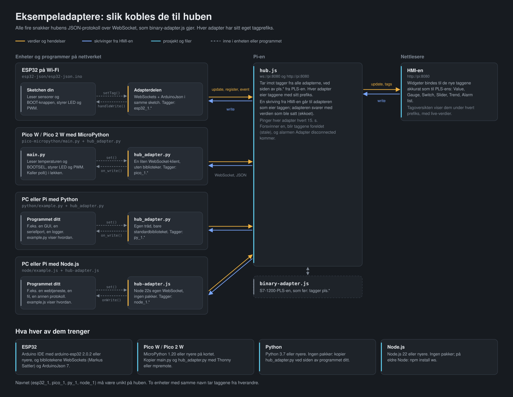
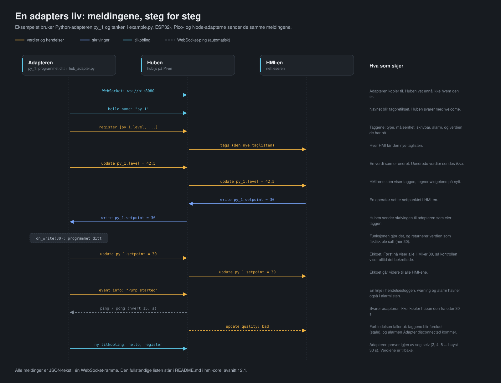

# Eksempeladaptere

`binary-adapter.js` er adapteren som kobler PLS-en til huben. Eksemplene her er maler for
alt annet du vil koble til senere: en mikrokontroller med sensorer, eller et program på en
annen maskin på nettverket som skal vise verdier i HMI-en eller ta imot kommandoer fra den.

Alle fire snakker hubens egen protokoll: JSON-meldinger over WebSocket, til `ws://<pi>:8080`.
Adapteren ligger i selve enheten eller programmet, så det trengs ingen bro eller ekstra
tjeneste på Pi-en.

| Mappe | Kjører på | Språk | Trenger |
|---|---|---|---|
| [`esp32-json/`](#2-esp32-esp32-json) | ESP32 med Wi-Fi | Arduino (C++) | Bibliotekene WebSockets og ArduinoJson 7 |
| [`pico-micropython/`](#3-raspberry-pi-pico-w-og-pico-2-w-pico-micropython) | Raspberry Pi Pico W eller Pico 2 W | MicroPython | Bare MicroPython |
| [`python/`](#4-python-på-en-annen-maskin-python) | PC, Pi eller annen maskin på nettverket | Python 3.7+ | Ingenting: bare standardbiblioteket |
| [`node/`](#5-nodejs-på-en-annen-maskin-node) | PC, Pi eller annen maskin på nettverket | JavaScript (Node.js 22+) | Ingenting: Node har WebSocket innebygd |



## Innhold

1. [Det alle fire har felles](#1-det-alle-fire-har-felles)
2. [ESP32 (`esp32-json`)](#2-esp32-esp32-json)
3. [Raspberry Pi Pico W og Pico 2 W (`pico-micropython`)](#3-raspberry-pi-pico-w-og-pico-2-w-pico-micropython)
4. [Python på en annen maskin (`python`)](#4-python-på-en-annen-maskin-python)
5. [Node.js på en annen maskin (`node`)](#5-nodejs-på-en-annen-maskin-node)
6. [Flette adapteren inn i ditt eget program](#6-flette-adapteren-inn-i-ditt-eget-program)
7. [Funksjonene i adaptermodulene](#7-funksjonene-i-adaptermodulene)
8. [Meldingene](#8-meldingene)
9. [Vise, lagre og navngi taggene](#9-vise-lagre-og-navngi-taggene)
10. [Feilsøking](#10-feilsøking)

---

## 1. Det alle fire har felles

- **Et navn som blir tagprefikset.** Adapteren kobler til som f.eks. `py_1`, og alle taggene
  dens heter `py_1.<noe>`. Navnet må være unikt på huben: to enheter med samme navn tar
  taggene fra hverandre. Bruk bokstaver, sifre og `_`. `kv_1` er PLS-en, og `calc` er tatt av
  huben.
- **Taggene registreres** med type (`number`, `boolean` eller `string`), måleenhet, om de er
  skrivbare, og verdien de har nå. Da finnes de i HMI-ens tagoversikt med en gang.
- **Bare endrede verdier sendes.** Programmet kan kalle `set()` så ofte det vil; adapteren
  sender bare når verdien er en annen enn sist.
- **Skrivinger fra HMI-en** kommer til en funksjon du skriver (`on_write`). Den gjør det som
  skal gjøres, og returnerer verdien som faktisk ble satt. Adapteren sender den tilbake til
  huben (*ekkoet*), og først da viser alle HMI-er den nye verdien. En kontroll viser derfor
  alltid det enheten har bekreftet, ikke bare det noen trykket.
- **Avvise en skriving:** kast en exception i funksjonen. Ekkoet er da den gamle verdien, så
  kontrollen hopper tilbake, og hendelsesloggen sier hvorfor.
- **Hendelser:** `event('Pump started')` blir en linje i HMI-ens hendelseslogg. Med
  `'warning'` eller `'alarm'` havner den også i alarmlisten, der den står til noen kvitterer.
- **Alarmer på en tag** er bedre enn alarmhendelser: en tag registrert med `alarm` står i
  alarmlisten så lenge verdien er true (eller ulik 0), og går av seg selv når den går tilbake.
  En alarm som allerede er på når huben starter, kommer også med.
- **Forbindelsen holdes oppe.** Huben pinger hver adapter hvert 15. sekund og kobler fra en
  som ikke svarer. Adapterne svarer, oppdager selv en død forbindelse, og kobler til igjen
  (etter 2, 4, 8 ... høyst 30 sekunder). Ved ny tilkobling registreres taggene på nytt, med
  verdiene de har.
- **Når en adapter forsvinner,** viser HMI-en taggene dens som foreldet (*stale*), med siste
  verdi i grått, og alarmen *Adapter disconnected* kommer i alarmlisten.

**Alarm-innstillingene** (en ordbok / et objekt på taggen):

| Nøkkel | Betydning |
|---|---|
| `severity` | `warning` eller `alarm` |
| `text` | Alarmteksten. `{value}` erstattes med verdien: `"Fault {value}"` |
| `when` | `"false"` for en alarm som er på mens verdien er false (f.eks. en "OK"-bit) |
| `delay` | Millisekunder verdien må være på før alarmen kommer, så et kort blipp ikke blir en alarm |
| `codes` | En kodetekstliste fra HMI-en, så kodens tekst legges til alarmen |

**Hvilke widgeter passer:** `number` → Value, Gauge, Bar, Trend, og Slider eller Number input
når den er skrivbar. `boolean` → Indicator, og Switch eller Button når den er skrivbar.
`string` → Value.

---

## 2. ESP32 (`esp32-json`)

`esp32-json.ino` er et helt ESP32-program der adapteren er en del av sketchen. Kortet kobler
seg til Wi-Fi og til huben, sender målingene sine og utfører skrivinger.

**Du trenger:**
- Arduino IDE med Espressifs **arduino-esp32**-kjerne, 2.0.2 eller nyere.
- Bibliotekene **WebSockets** av Markus Sattler (links2004/arduinoWebSockets) og
  **ArduinoJson** av Benoit Blanchon, versjon 7. Det finnes flere biblioteker som heter
  "WebSockets": ta det av Markus Sattler.
- Uten internett: last ned bibliotekene som .zip på en maskin med nett, og legg dem inn med
  *Sketch → Include Library → Add .ZIP Library*.

**Slik setter du den opp:**
1. Åpne `esp32-json/esp32-json.ino` (mappen og filen må hete det samme).
2. Sett `WIFI_SSID`, `WIFI_PASS`, `HUB_HOST` (Pi-ens IP-adresse) og `NAME` øverst.
3. Sjekk pinnene. Standardverdiene passer et vanlig ESP32-DevKit: LED på 2, PWM på 4,
   potmeter på 34, BOOT-knappen på 0. På en ESP32-S3 er f.eks. LED 48, PWM 5 og analog 4.
4. Last opp, og følg med i Serial Monitor (115200): den skriver IP-adressen, `hub: connected`
   og hver skriving.

**Taggene** (med `NAME = "esp32_1"`):

| Tag | Type | Skrivbar | Hva |
|---|---|---|---|
| `esp32_1.temp` | number, °C | | Brikkens egen temperatur (grov; bytt til en ekte sensor) |
| `esp32_1.analog` | number, % | | ADC på `ANALOG_PIN` |
| `esp32_1.button` | boolean | | BOOT-knappen; sendes med en gang den endres |
| `esp32_1.uptime` | number, s | | Tid siden oppstart |
| `esp32_1.rssi` | number, dBm | | Wi-Fi-signalet |
| `esp32_1.led` | boolean | ja | LED-en |
| `esp32_1.pwm` | number, % | ja | PWM på `PWM_PIN`, 0–100 % |
| `esp32_1.alarm_limit` | number, °C | ja | Grensen for alarmen |
| `esp32_1.temp_high` | boolean | | Alarm: *ESP32 temperature above limit* |

**Egne tagger:** legg en linje til i `TAGS[]`, send verdien med `setTag("navn", verdi)` i
`publish()`, og håndter skrivinger til den i `handleWrite()`. `flush()` sender det som er
endret, samlet i én melding.

---

## 3. Raspberry Pi Pico W og Pico 2 W (`pico-micropython`)

`main.py` er programmet som kjører på kortet; `hub_adapter.py` er adapteren, en liten
WebSocket-klient skrevet for MicroPython. Den bruker ingen andre biblioteker.

**Du trenger:**
- En **Pico W** (RP2040) eller **Pico 2 W** (RP2350). Pico og Pico 2 uten W har ikke Wi-Fi.
- **MicroPython 1.20 eller nyere** på kortet; for Pico 2 W den nyeste versjonen. Fastvaren er en
  `.uf2`-fil fra micropython.org: hold BOOTSEL inne mens du kobler til USB, og kopier filen
  til disken som dukker opp. Den kan lastes ned på en annen maskin og tas med på minnepenn.
- **Thonny** eller **mpremote** for å kopiere filene til kortet.

**Slik setter du den opp:**
1. Sett `WIFI_SSID`, `WIFI_PASS`, `HUB_HOST` og `NAME` øverst i `main.py`.
2. Kopier `main.py` og `hub_adapter.py` til roten av kortet. Med mpremote:

   ```bash
   mpremote cp hub_adapter.py :hub_adapter.py
   mpremote cp main.py :main.py
   mpremote reset
   ```

   I Thonny: åpne filene og velg *File → Save as… → Raspberry Pi Pico*.
3. Kortet starter `main.py` av seg selv. LED-en blinker mens det kobler til Wi-Fi. I Thonnys
   skall ser du `connected to the hub as pico_1`.

**Taggene** (med `NAME = 'pico_1'`):

| Tag | Type | Skrivbar | Hva |
|---|---|---|---|
| `pico_1.temp` | number, °C | | Brikkens temperatursensor (grov) |
| `pico_1.button` | boolean | | BOOTSEL-knappen; sendes med en gang den endres |
| `pico_1.uptime` | number, s | | Tid siden oppstart |
| `pico_1.rssi` | number, dBm | | Wi-Fi-signalet |
| `pico_1.led` | boolean | ja | LED-en på kortet |
| `pico_1.pwm` | number, % | ja | PWM på GP15, 0–100 % |
| `pico_1.alarm_limit` | number, °C | ja | Grensen for alarmen |
| `pico_1.temp_high` | boolean | | Alarm: *Pico temperature above limit* |

**Slik virker den:** det er ingen tråder. Hovedløkken kaller `hub.poll()` ofte (hvert 20. ms
i eksempelet). `poll()` kobler til når det er tid, behandler skrivinger og ping, og returnerer
med en gang når det ikke er noe å gjøre. Hold derfor løkken rask: en `sleep` på flere
sekunder gjør at skrivinger venter like lenge, og huben kobler fra etter 30 s uten svar på
ping.

**Teste uten kortet:** `hub_adapter.py` kjører også med vanlig Python på en PC, så du kan prøve
din egen kode mot huben før den legges på kortet (bare `main.py` trenger kortet).

---

## 4. Python på en annen maskin (`python`)

`hub_adapter.py` er en modul du kopierer ved siden av ditt eget program. Den bruker bare
Pythons standardbibliotek, så den virker uten `pip` og uten internett, på Windows, Linux og
macOS, og på Pi-en selv. `example.py` viser hvordan den brukes.

**Prøv eksempelet:**

```bash
cd adapters/example-adapters/python
python example.py ws://192.168.1.10:8080 py_1
```

Uten argumenter kobler det til `ws://localhost:8080` som `py_1` (eller adressen i miljøvariabelen
`HUB_URL`). Ctrl+C stopper det.

**Eksempelprogrammet** er en liten simulert tank med pumpe:

| Tag | Type | Skrivbar | Hva |
|---|---|---|---|
| `py_1.level` | number, % | | Tanknivået |
| `py_1.setpoint` | number, % | ja | Ønsket nivå; begrenses til 0–100 |
| `py_1.running` | boolean | ja | Pumpen går (Switch); gir en hendelse ved start og stopp |
| `py_1.reset` | boolean | ja | En knapp (Button med verdi true): nullstiller telleren |
| `py_1.pump_starts` | number | | Antall pumpestarter |
| `py_1.status` | string | | `filling`, `at setpoint` eller `stopped` |
| `py_1.high_level` | boolean | | Alarm: *Tank level above 95 %* (sett settpunktet til 100 for å se den) |

**I ditt eget program:**

```python
from hub_adapter import HubAdapter

hub = HubAdapter('ws://192.168.1.10:8080', 'py_1')
hub.add_tag('temp', 'number', unit='°C')
hub.add_tag('fan', 'boolean', writable=True, on_write=set_fan)   # set_fan(value) -> det som ble satt
hub.start()                                                      # kobler til i en bakgrunnstråd

while True:
    hub.set('temp', read_sensor())
    time.sleep(1)
```

Nettverkstrafikken går i en egen tråd, så resten av programmet blokkeres aldri, og `set()`
kan kalles fra hvilken som helst tråd. Se [6](#6-flette-adapteren-inn-i-ditt-eget-program)
for GUI-programmer og seriellporter.

---

## 5. Node.js på en annen maskin (`node`)

`hub-adapter.js` er en modul du kopierer ved siden av ditt eget program. På Node.js 22 eller
nyere bruker den Nodes innebygde WebSocket-klient, så den trenger ingen pakker. På eldre Node
bruker den pakken `ws` i stedet (`npm install ws`). `example.js` viser hvordan den brukes.

**Prøv eksempelet:**

```bash
cd adapters/example-adapters/node
node example.js ws://192.168.1.10:8080 node_1
```

Uten argumenter kobler det til `ws://localhost:8080` som `node_1` (eller adressen i `HUB_URL`).

**Eksempelprogrammet** viser ekte verdier fra maskinen det kjører på, og en teller som HMI-en
styrer:

| Tag | Type | Skrivbar | Hva |
|---|---|---|---|
| `node_1.cpu_load` | number, % | | CPU-last |
| `node_1.mem_used` | number, % | | Minne i bruk |
| `node_1.uptime` | number, h | | Maskinens oppetid |
| `node_1.host` | string | | Maskinens navn |
| `node_1.count` | number | | Telleren |
| `node_1.rate` | number, /s | ja | Tellinger per sekund; begrenses til 0–100 |
| `node_1.running` | boolean | ja | Telleren går (Switch) |
| `node_1.reset` | boolean | ja | En knapp: nullstiller telleren |
| `node_1.cpu_high` | boolean | | Advarsel: *CPU load above 90 %* når det varer i 5 s |

**I ditt eget program:**

```js
const { HubAdapter } = require('./hub-adapter');

const hub = new HubAdapter({ url: 'ws://192.168.1.10:8080', name: 'node_1' });
hub.addTag('temp', { unit: '°C' });
hub.addTag('fan', { dataType: 'boolean', writable: true, onWrite: async v => { await setFan(v); return v; } });
hub.start();

setInterval(() => hub.set('temp', readSensor()), 1000);
```

`onWrite` kan være `async`: adapteren venter på den før ekkoet sendes, så HMI-en viser verdien
først når programmet ditt er ferdig med den.

---

## 6. Flette adapteren inn i ditt eget program

Mønsteret er det samme overalt:

1. **Legg til taggene** du vil vise eller styre, med `add_tag` / `addTag`.
2. **Send verdier** med `set()` der programmet ditt allerede har dem: i hovedløkken, når en
   linje kommer fra en seriellport, når en fil endres. Ikke tenk på hvor ofte; bare endringer
   sendes.
3. **Gjør det HMI-en ber om** i `on_write`-funksjonene, og returner det som faktisk ble satt.
   Gjør det kort; noe som tar lang tid, bør startes og ikke ventes på (unntatt `async` i Node).
4. **Start adapteren** (`start()`, eller `poll()` i løkken på Pico).

**Et GUI-program i Python (tkinter):** `on_write` kalles i adapterens tråd, og tkinter tåler
bare kall fra sin egen tråd. Send derfor arbeidet over med `after`:

```python
def set_fan(value):
    root.after(0, lambda: fan_button.config(text='Fan ON' if value else 'Fan OFF'))
    return bool(value)

def refresh():
    hub.set('temp', read_sensor())
    root.after(1000, refresh)            # tkinters egen timer, i GUI-tråden
```

**En seriellport i Python** (med pakken pyserial): les linjene i hovedløkken, og send dem
videre:

```python
port = serial.Serial('COM3', 115200, timeout=1)
while True:
    line = port.readline().decode().strip()      # f.eks. "temp=21.5"
    if line.startswith('temp='):
        hub.set('temp', float(line[5:]))
```

**Ventetid i Node:** det som tar tid (HTTP, filer, en annen protokoll), gjøres med `await` i
`onWrite`. Kast en feil for å avvise skrivingen; HMI-en hopper da tilbake til den gamle verdien.

**Flere adaptere i samme program** går fint, med hvert sitt navn: f.eks. én per maskin eller
per enhet programmet snakker med.

---

## 7. Funksjonene i adaptermodulene

Python-, Node- og Pico-modulen har de samme funksjonene, med navn som passer språket.

| Python (`hub_adapter.py`) | Node (`hub-adapter.js`) | Pico (`hub_adapter.py`) | Hva den gjør |
|---|---|---|---|
| `HubAdapter(url, name)` | `new HubAdapter({ url, name })` | `HubAdapter(host, port, name)` | Lager adapteren. Kobler ikke til ennå |
| `add_tag(key, data_type, unit, writable, description, on_write, alarm, value)` | `addTag(key, { dataType, unit, writable, description, onWrite, alarm, value })` | `add_tag(key, data_type, unit, writable, on_write, alarm, value)` | Legger til taggen `<name>.<key>` |
| `set(key, value, quality='good')` | `set(key, value, quality)` | `set(key, value)` | Ny verdi; sendes hvis den er endret |
| `set_many({key: value})` | `setMany({ key: value })` | `set_many({key: value})` | Flere verdier i én melding |
| `get(key)` | `get(key)` | `get(key)` | Verdien taggen har nå |
| `event(message, severity='info')` | `event(message, severity)` | `event(message, severity)` | En linje i hendelsesloggen |
| `start()` / `stop()` | `start()` / `stop()` | `poll()`, ofte | Kobler til og holder forbindelsen oppe |
| `connected` | `connected` | `connected` | Om den er koblet til huben nå |

- **`quality='bad'`** brukes når programmet vet at verdien ikke stemmer, f.eks. en sensor som
  har falt ut. HMI-en viser den da som foreldet, og beregninger som bruker den, blir det også.
- **Skrivbare tagger uten `on_write`** tar imot verdien som den er, og ekkoet sendes med en
  gang. Programmet kan lese den med `get()`.

---

## 8. Meldingene



Modulene tar seg av meldingene; denne listen er for deg som vil skrive en adapter i et annet
språk. Alt er JSON-tekst, én melding per WebSocket-ramme:

| Melding | Retning | Betydning |
|---|---|---|
| `{"type":"hello","role":"adapter","name":"py_1"}` | adapter → hub | Først etter tilkobling. Huben svarer `{"type":"welcome",...}` |
| `{"type":"register","tags":[{"name":"py_1.level","dataType":"number","unit":"%","writable":false,"value":42.5}]}` | adapter → hub | Taggene. Med `"alarm": {...}` for en alarmtag |
| `{"type":"update","values":{"py_1.level":42.5,"py_1.status":"filling"}}` | adapter → hub | Endrede verdier. Også `{"type":"update","tag":"py_1.level","value":42.5}` |
| `{"type":"update","values":{...},"quality":"bad"}` | adapter → hub | Verdier som ikke stemmer (foreldet) |
| `{"type":"event","severity":"info","message":"Pump started"}` | adapter → hub | En hendelse: `info`, `warning` eller `alarm` |
| `{"type":"write","tag":"py_1.setpoint","value":30,"from":"hmi-2"}` | hub → adapter | En skriving fra HMI-en. Svar med en `update` for taggen (ekkoet) |
| `{"type":"error","message":"..."}` | hub → adapter | Noe var galt med forrige melding |
| WebSocket-ping | hub → adapter | Hvert 15. s. Svar med pong (WebSocket-biblioteker gjør det selv) |
| `{"type":"ping"}` → `{"type":"pong"}` | adapter → hub | Valgfritt: sjekk selv at forbindelsen lever |

Hele protokollen, også det HMI-ene bruker, står i avsnitt 12.1 i `README.md` i `hmi-core`.

---

## 9. Vise, lagre og navngi taggene

- **Se dem:** i HMI-en (Edit-modus) viser tagoversikten de nye taggene under prefikset sitt,
  med live-verdier. Bind en widget til f.eks. `py_1.level` som til en PLS-tag.
- **Prosjektvariabler:** med `dev = esp32_1` i prosjektinnstillingene kan widgeter bruke
  `${dev}.temp`, og et skjermbilde kan byttes til en annen enhet ved å endre variabelen.
- **Egne navn:** gi taggene norske navn og beskrivelser med **✎ Name tags** i HMI-en
  (**☰ Data-list** i Edit-modus), som for PLS-taggene.
- **Beregninger** kan bruke dem som alle andre tagger: `calc.*` kan f.eks. kombinere en
  ESP32-måling med en PLS-verdi.

---

## 10. Feilsøking

| Symptom | Sannsynlig årsak |
|---|---|
| *not reached* / *refused* i adapterens logg | Huben kjører ikke, adressen eller porten er feil, eller en brannmur stopper port 8080 på maskinen der huben kjører |
| Taggene finnes, men er grå (*stale*) | Adapteren er frakoblet: se loggen dens. Den kobler til igjen av seg selv |
| Taggene hopper mellom to enheter | To adaptere har samme navn. Gi hver sitt (`esp32_1`, `esp32_2`) |
| En kontroll hopper tilbake | Skrivingen ble avvist: hendelsesloggen sier hvorfor (ikke skrivbar, feil type, utenfor området) |
| Ingenting skjer ved skriving | `on_write`-funksjonen gjorde ikke det den skulle, eller taggen ble ikke registrert som skrivbar |
| ESP32: kompileringsfeil i JSON-koden | ArduinoJson 6 er installert; sketchen trenger versjon 7 |
| ESP32: `WebSocketsClient.h: No such file` | Feil "WebSockets"-bibliotek; ta det av Markus Sattler |
| Pico: `ImportError: no module named 'hub_adapter'` | `hub_adapter.py` ligger ikke i roten på kortet |
| Pico: blinker hele tiden, kommer aldri på nett | Feil SSID eller passord, eller et 5 GHz-nett: Pico W og ESP32 kan bare 2,4 GHz |
| Node: `Cannot find module 'ws'` | Node er eldre enn 22. Oppgrader, eller kjør `npm install ws` i mappen |
| Adapteren kobles fra hvert 30. sekund | Den svarer ikke på hubens ping, f.eks. fordi programmet blokkerer `poll()` for lenge (Pico) |
